# RStudio {#sec-rstudio}

## What this chapter is about

R itself is only an interpreter: a programming language that takes commands and returns answers. To work with R comfortably, you need an **integrated development environment (IDE)**: an editor, a console, a file browser and a variable inspector in one window. RStudio is this environment. In SPSS you reach everything through point-and-click dialogs; in RStudio you write your steps as code in a Quarto document. You can reproduce this code, add comments to it and keep track of its versions.

If you have not yet installed R and RStudio, you do so in the first two sections. Then open RStudio and work through the following sections alongside the text. By the end, you can find your way around RStudio, install additional packages and create your first project.

::: {.callout-note}
**Research journal: Where are you in your mini study?** You are just starting. In Chapters 1–3 you set up your tools. From @sec-datenimport onwards you load the 2023 German General Social Survey (ALLBUS), from @sec-datentransformation you build a scale of Islamophobia from six survey items, from @sec-univbivar you test hypotheses, and from @sec-erklaerung you model *which* social and political characteristics best explain Islamophobia. This is the first stage: setting up the workshop.
:::

## What you will be able to do after this chapter {-}

- Install R and RStudio in the right order.
- Use the RStudio interface with confidence.
- Create a project and work cleanly in it.
- Explain the difference between the console and a Quarto document.
- Explain what the working directory is and check it with `getwd()`.
- Install, activate and update packages, in particular tidyverse and mariposa.
- Open the help pages and package vignettes you need.
- Use the most important keyboard shortcuts.

## Installing R

R itself is the engine in the background, the language that runs your commands. RStudio is only the *interface*. You need to install both: R first, then RStudio. If you do it the other way round, you get the error message “No R installation found” when you first start RStudio.

Go to [cran.r-project.org](https://cran.r-project.org/) and choose your operating system:

- macOS → download the `.pkg` file for your architecture (Apple Silicon = M1/M2/M3/M4, or Intel) and install it by double-clicking.
- Windows → click *base*, then the download link, and run the `.exe` file.
- Linux → follow the instructions for your distribution on the CRAN page.

R 4.5 or later is recommended. If you already have an older version, that is not a problem; you install the new one alongside it.

::: {.callout-note collapse="true"}
## Background: R on the Mac

On Macs with Apple Silicon (M1–M4) you download the *arm64* version, on older Intel Macs the *x86_64* version. If you do not know which one you have: Apple menu → *About This Mac* → *Chip*. To compile packages you also need the *Xcode Command Line Tools*. They are installed automatically when needed, or you can install them in advance in the Terminal with `xcode-select --install`.
:::

## Installing RStudio

Once R is installed, download RStudio from [posit.co/download/rstudio-desktop](https://posit.co/download/rstudio-desktop/). The page detects your operating system and suggests the right version. Install it like any other program.

If you prefer not to install anything locally, you can use [Posit Cloud](https://posit.cloud/) in your browser instead. The account is free, and RStudio runs entirely online.

::: {.callout-note collapse="true"}
## Background: RStudio and Posit

The IDE is still called RStudio; the company behind it was renamed Posit in 2022. If you find references to “RStudio Cloud” on the web, the service is now at [posit.cloud](https://posit.cloud/).
:::

## The user interface

The RStudio user interface (graphical user interface, GUI) is divided into four panes (@fig-oberflaeche). As long as no document is open, the console takes up the whole left half. The editor at the top left appears as soon as you open a document (@sec-quarto-dokument).

{#fig-oberflaeche .lightbox fig-alt="Diagram of an RStudio window with the project R-Workshop, divided into four numbered panes. 1 at the top left, Write and save code: the tab 01-first_steps.qmd with a Run button, containing a grey chunk with the lines var1 <- 2 + 3 and var1 and, below it in green, the result [1] 5. 2 at the bottom left, Try out code, view output: the tabs Console, Terminal and Background Jobs, containing > var1 <- 2 + 3, > var1 and in green [1] 5. 3 at the top right, Objects and command history: the tabs Environment, History, Connections and Tutorial; under Global Environment and Values is var1 with the value 5. 4 at the bottom right, Files, plots, packages, help: the tabs Files, Plots, Packages, Help and Viewer, showing the folder Home > Documents > R-Workshop with the files 01-first_steps.qmd, ALLBUS2023.sav and R-Workshop.Rproj."}

| Pane                 | Contents                                        | What you need it for                        |
| :------------------- | :---------------------------------------------- | :------------------------------------------ |
| 1 top left           | Editor for Quarto documents (`.qmd`)            | Writing, saving and running code            |
| 2 bottom left        | Console                                         | Trying out code directly, viewing output    |
| 3 top right          | Environment, History, Connections, Tutorial     | Seeing objects, command history, databases  |
| 4 bottom right       | Files, Plots, Packages, Help, Viewer            | File browser, plots, help, packages         |

The following sections go through the panes one by one. The green number at the top right of each screenshot shows which pane it comes from. The screenshots were taken for the German edition of this book, so the example document in them is called `01-erste_schritte.qmd` instead of `01-first_steps.qmd`.

### Options for reproducible work

Before you start working with RStudio in earnest, go to `Tools` → `Global Options` and turn off two convenience features that do more harm than good in everyday research:

1. *Restore .RData into workspace at startup*: untick it.
2. *Save workspace to .RData on exit*: set it to *Never*.

This means you have to load your data and variables again every time you restart. In return, you get a genuinely fresh workspace without invisible leftovers from earlier sessions. This is the basis of *reproducible work*: your analysis should depend only on what is written in the document.

```{r, echo=FALSE, fig.align='center', out.width="661px", fig.alt="The RStudio Options dialog, section General, tab Basic. In the Workspace section, outlined in orange, Restore .RData into workspace at startup is not ticked, and Save workspace to .RData on exit is set to Never."}
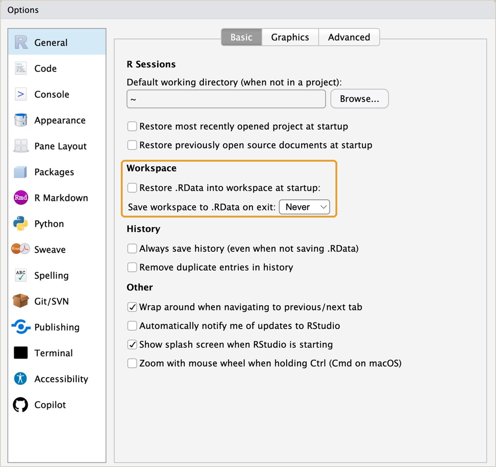
```

If you prefer a dark look, you can find colour schemes for the editor and the console under `Appearance`.

### Console

The console is the first place to practise: here you can try out input directly. The `>` sign is the prompt, and you can use R like a calculator:

```{r}
2 + 3
```

```{r, echo=FALSE, fig.align='center', out.width="687px", fig.alt="The RStudio console with R 4.6.2 in the folder ~/Documents/R-Workshop/. The input is 2 + 3, below it is [1] 5 and a new prompt. At the top right the green number 2."}
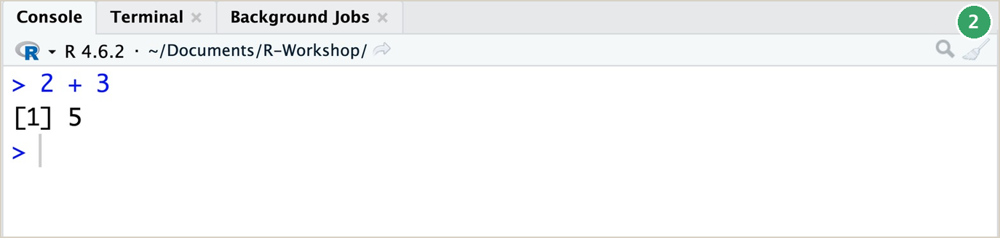
```

What you type in the console, however, is not saved anywhere permanently. As soon as you want to *keep* an analysis, it belongs in a Quarto document (see @sec-quarto-dokument).

### Environment and History

In the `Environment` tab you find the **Global Environment** (drop-down menu). R stores all the objects you have created here: variables, datasets and functions.

```{r, echo=FALSE, fig.align='center', out.width="575px", fig.alt="The Environment tab showing the Global Environment. Under Values is var1 with the value 5. At the top right the green number 3."}
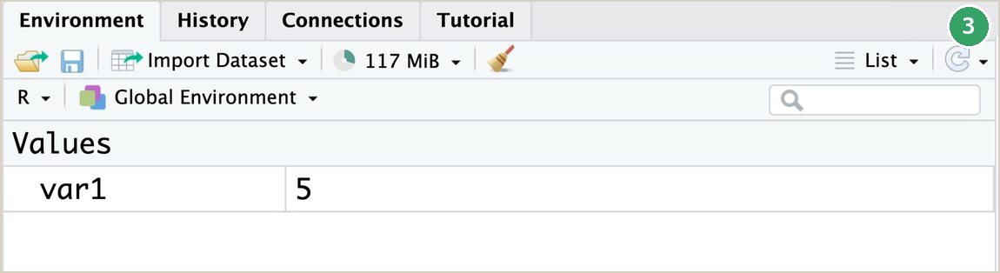
```

Under `History` you see all the commands you have run so far. Double-clicking a command copies it back into the console, where you can change it or run it again. In the console, you can also call up the history directly with `cmd` (macOS) or `ctrl` (Windows) + `↑`.

### Files and the working directory with `getwd()` and `setwd()`

Under `Files` you see the file browser for your **working directory**. This is the folder in which R looks by default when you read or save a file. If you write `read_spss("ALLBUS2023.sav")`, R looks for the file in exactly this folder. `getwd()` in the console tells you which folder this currently is:

```{r getwd-demo, eval=FALSE}
getwd()
# [1] "/Users/anna/Documents/R-Workshop"
```

You can set the working directory by hand with `setwd("…")`. In practice you *hardly ever* need this if you work with a project (see @sec-projects). Whenever you open a project, the working directory is automatically the project folder. This is the basis for portable documents: there are no absolute paths anywhere, and every file is addressed relative to the project.

```{r, echo=FALSE, fig.align='center', out.width="575px", fig.alt="The Files tab in the folder Home, Documents, R-Workshop with the files 01-erste_schritte.qmd, ALLBUS2023.sav and R-Workshop.Rproj. At the top right the green number 4."}
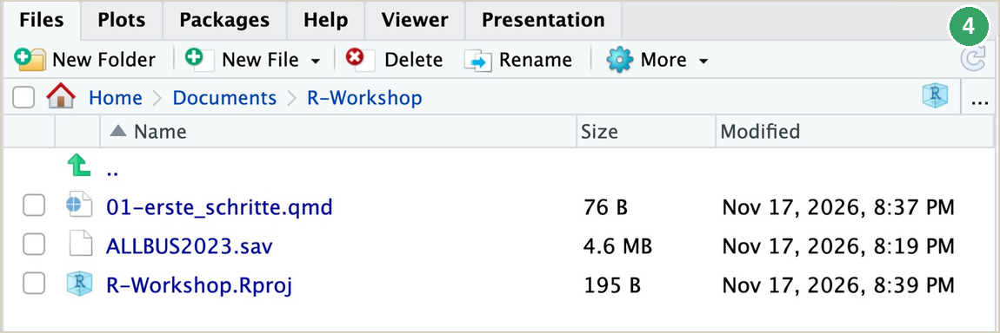
```

::: {.callout-warning}
**Caution: Absolute paths.** Never write `read_spss("/Users/anna/Documents/...")` in your document. As soon as you share it or move it to another computer, the path no longer works. With projects, the relative path is enough: the file name alone will do if the file is in the project folder.
:::

The file name alone is enough because R looks for it in the working directory, and with a project this is the project folder on every computer. The absolute path, on the other hand, points to a folder that exists only on Anna's computer (@fig-arbeitsverzeichnis).

{#fig-arbeitsverzeichnis .lightbox fig-alt="At the top, two numbered lines of code: 1 read_spss(“ALLBUS2023.sav”), 2 read_spss(“/Users/anna/Documents/R-Workshop/ALLBUS2023.sav”). Below them two boxes. On the left, ANNA’S COMPUTER: getwd() prints [1] “/Users/anna/Documents/R-Workshop”, below it a folder R-Workshop with the files R-Workshop.Rproj, 01-first_steps.qmd and ALLBUS2023.sav, next to it 1 found and 2 found in green. On the right, BORIS’S COMPUTER: getwd() prints [1] “C:/Users/boris/Documents/R-Workshop”, below it the same folder with the same files, next to it 1 found in green and 2 not found in orange."}

## Working with RStudio

Now for the practical part. Three ideas are central here: the project as a container, the Quarto document as the place where you work, and keyboard shortcuts to speed things up.

### Creating a project {#sec-projects}

Before you work with data, it is worth creating a **project**. Choose `File` → `New Project` → `New Directory` → `New Project` to open the dialog, then enter a name and a location.

```{r, echo=FALSE, fig.align='center', out.width="533px", fig.alt="The Create New Project step in the New Project Wizard. The directory name is R-Workshop, and the parent folder is the tilde for the home folder. At the bottom, the buttons Create Project and Cancel."}
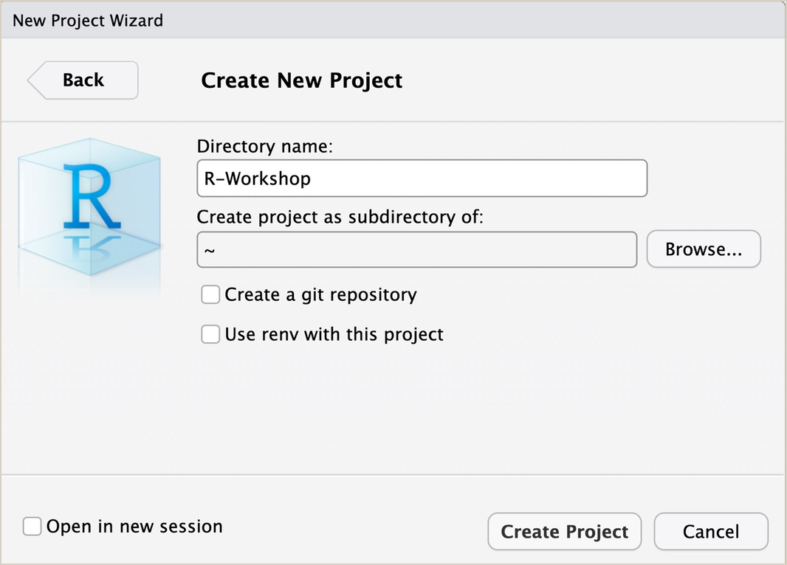
```

What a project gives you:

- When you open the project (by double-clicking the `.Rproj` file), all files that were open are opened again.
- You can open as many projects as you like at the same time and switch between them.
- The working directory is automatically the project folder, so you no longer have to type full paths.

Move your datasets (for example `ALLBUS2023.sav`, once you have it) into the project folder, and you can import them directly with `read_spss("ALLBUS2023.sav")`.

### Quarto documents: your main working file {#sec-quarto-dokument}

A **Quarto document** is a text file with the extension `.qmd`. It contains text, and in between there are **code chunks** with R code. When you run a chunk, the result appears directly below it. @sec-quarto shows how a Quarto document is structured and how it becomes a finished report.

To create a new document, choose `File` → `New File` → `Quarto Document…`. In the dialog, enter a title, leave HTML as the format and untick *Use visual markdown editor*. You then see the source text in the same form as in this book. Delete the example text below the header (everything after the second `---` line) and save the document in the project folder with `cmd`/`ctrl` + `S`, for example as `01-first_steps.qmd`.

::: {.callout-tip}
**SPSS → R: Syntax file and Quarto document.** The Quarto document plays the role of the SPSS syntax file. You still work *in syntax*, only in a different language, and the text and results sit right next to the code. Most SPSS workflows can be transferred step by step, often in fewer lines.
:::

A first example: insert a chunk with `cmd`/`ctrl` + `option`/`alt` + `I` and write two lines in it. In the document it looks like this:

````markdown
```{{r}}
var1 <- 2 + 3
var1
```
````

Put the cursor in the first line and run it with `Run` (or `cmd`/`ctrl` + `Enter`), then do the same with the second line. The result appears below the chunk and in the console:

```{r}
var1 <- 2 + 3
var1
```

In RStudio, the result appears in a box directly below the chunk:

```{r, echo=FALSE, fig.align='center', out.width="687px", fig.alt="The Quarto document 01-erste_schritte.qmd in the RStudio editor. At the top is the header with title: Erste Schritte (German for First steps) and format: html, below it a grey chunk with the lines var1 <- 2 + 3 and var1. Directly below the chunk, the result [1] 5 appears in a box. At the top right the green number 1."}
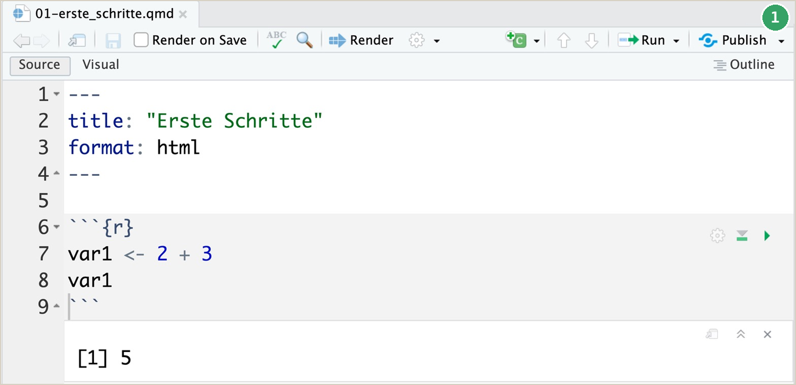
```

`var1` is now visible in the `Environment` with the value `5`. Chapter 3 explains what exactly a variable is, how you call functions and which data types R knows.

::: {.callout-warning}
**Caution: Assignment operator.** Use `<-` for assignments. `=` also works in many cases, but in more complex contexts (function arguments) it leads to subtle bugs. Make `<-` a habit.
:::

Console or document? Everything you want to keep goes into the Quarto document. You use the console for trying things out, for example for a quick calculation or to find out what an error message means. You also type `install.packages()` in the console, because you install a package only once per computer. `library()`, however, belongs in the first chunk of the document, because every new R session needs it again (@sec-library).

In other books and tutorials you will often come across **R scripts**. An R script is a text file with the extension `.R` that contains only code, without text or results in between. You run its lines in the same way with `cmd`/`ctrl` + `Enter`; the result then appears only in the console.

### Tab completion and the package prefix `::`

RStudio has a very useful feature: tab completion. While you type, a drop-down list with suggestions for completing your input appears. From the third character onwards it appears by itself; otherwise you call it up with the `Tab` key. If you type `w_m`, for example, RStudio suggests the mariposa functions `w_mean()`, `w_median()` and `w_modus()`, with the help for the highlighted function next to them.

```{r, echo=FALSE, fig.align='center', out.width="703px", fig.alt="In the chunk, line 9 contains w_m. Below it is a list with w_mean, w_median and w_modus, each followed by mariposa; w_mean is highlighted. To the right, a yellow box with the call w_mean(data, ..., weights = NULL, na.rm = TRUE), the title Calculate Population-Representative Averages and a short description. At the top right the green number 1."}
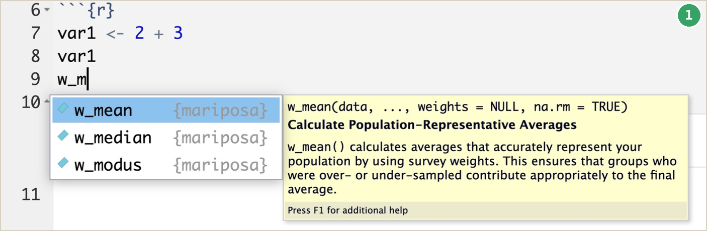
```

If the cursor is inside the brackets of a function and you press `Tab`, RStudio lists all its arguments. Function arguments tell a function *which* data to process and *how*. In mariposa functions the first argument is usually `data`, followed by the variables you are interested in and, optionally, `weights = wghtpew` for weighting.

```{r, echo=FALSE, fig.align='center', out.width="765px", fig.alt="In the chunk, line 9 contains w_mean(), with the cursor between the brackets. Below it is a list with data =, ... =, weights = and na.rm =, each followed by w_mean(), and the object var1; data = is highlighted. To the right, a yellow box: data, Your survey data (a data frame or tibble). At the top right the green number 1."}
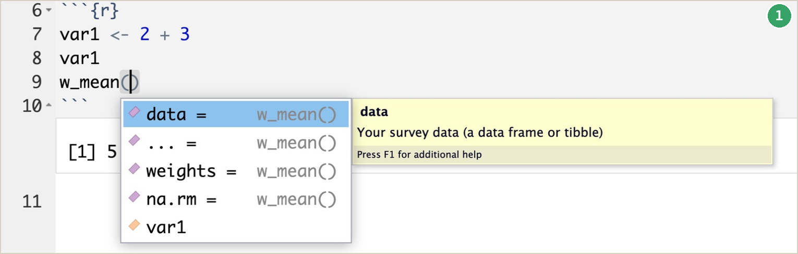
```

If two packages share a function name, you can resolve the ambiguity with the package prefix: `package::function`. After `mariposa::`, RStudio also shows you all the functions in the package:

```{r, echo=FALSE, fig.align='center', out.width="928px", fig.alt="In the chunk, line 9 contains mariposa::. Below it is a list of functions from mariposa: ancova, binomial_test, center, chi_square, chisq_gof, codebook and copy_labels; ancova is highlighted. To the right, a yellow box with the call and the description of ancova(). At the top right the green number 1."}
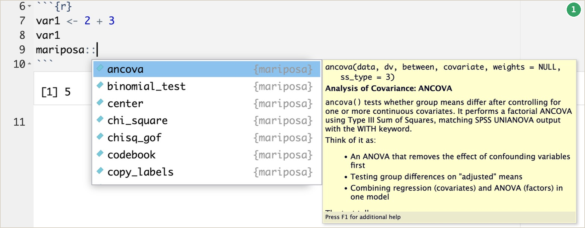
```

### Useful keyboard shortcuts {#sec-tastenkuerzel}

These keyboard shortcuts save you a lot of time in the long run:

| Shortcut                          | Effect                           | When it is useful                      |
| :-------------------------------- | :------------------------------- | :------------------------------------- |
| `cmd`/`ctrl` + `Enter`            | Run current line                 | In a chunk                             |
| `cmd`/`ctrl` + `S`                | Save document                    | After every change                     |
| `cmd`/`ctrl` + `option`/`alt` + `I` | Insert new chunk               | In a Quarto document                   |
| `cmd`/`ctrl` + `shift` + `Enter`  | Run whole chunk                  | After changes in the chunk             |
| `cmd`/`ctrl` + `↑`                | Show previous commands           | In the console                         |
| `control`/`ctrl` + `L`            | Clear console                    | When it gets cluttered                 |
| `cmd`/`ctrl` + `shift` + `C`      | Comment out line                 | To switch code off for a moment        |
| `cmd`/`ctrl` + `shift` + `A`      | Reformat code block              | To tidy up indented code               |
| `option`/`alt` + `-`              | Insert assignment arrow `<-`     | Instead of typing it by hand           |
| `cmd`/`ctrl` + `shift` + `M`      | Insert pipe `|>`                 | When writing pipes (see Chapter 3)     |

For a complete list of all available keyboard shortcuts in RStudio, press `option`/`alt` + `shift` + `K`.

::: {.callout-note collapse="true"}
## Background: `|>` or `%>%`?

Since version 2021.09, RStudio has offered the native pipe `|>` (available from R 4.1). Before that, the magrittr pipe `%>%` was standard. We use `|>` throughout this book. Under `Tools` → `Global Options` → `Code` you can choose which operator the shortcut inserts; we recommend the native pipe.
:::

## Packages

R already comes with a good number of useful functions, known as base R. For many analysis steps, however, they are too low-level, so we use additional **packages** that extend the set of functions available. In this book we deliberately work only with the tidyverse ecosystem for data manipulation and visualisation and the mariposa package for statistical analysis.

Functions such as `read_spss()` and `w_mean()` are contained in a package, in this case mariposa. The tidyverse brings together several packages, such as dplyr and ggplot2, that follow the same rules and that you install together with one command (@fig-oekosystem).

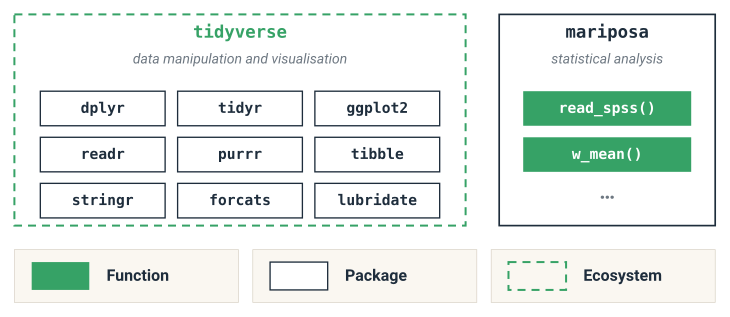{#fig-oekosystem .lightbox fig-alt="On the left a dashed green frame tidyverse, labelled data manipulation and visualisation, with nine dark-outlined package boxes: dplyr, tidyr, ggplot2, readr, purrr, tibble, stringr, forcats and lubridate. On the right a dark-outlined box mariposa, labelled statistical analysis, with the green functions read_spss() and w_mean() and an ellipsis. Below, a legend: green box Function, dark-outlined box Package, dashed green frame Ecosystem."}

You work with a package in two steps:

- Install it with `install.packages("name")`, *once per computer*. Imagine buying a tool at the hardware shop and putting it on your tool shelf.
- Activate it with `library(name)`, *once per R session*. You take the tool off the shelf and put it on the workbench.

Installing a package without calling `library()` is like leaving a tool unused on the shelf. The other way round, if you call `library(forcats)` without having installed the package, you get an error.

### Installing with `install.packages()`

The tidyverse is available on CRAN, the central archive of R packages, and you can install it directly:

```{r, eval=FALSE}
install.packages("tidyverse")
```

This installs the packages `dplyr`, `tidyr`, `ggplot2`, `readr`, `purrr`, `tibble`, `stringr`, `forcats` and `lubridate` in one step.

mariposa is also on CRAN, and you install it in the same way:

```{r, eval=FALSE}
install.packages("mariposa")
```

For combining plots in Chapter 9 you also need `patchwork`:

```{r, eval=FALSE}
install.packages("patchwork")
```

::: {.callout-note collapse="true"}
## Background: CRAN and GitHub

R packages are kept in two different places:

- CRAN (Comprehensive R Archive Network) is the official package archive, comparable to an app store. Every package is checked automatically before it is accepted (Does it build on all platforms? Is the documentation complete? Do the tests pass?). Updates are stable but arrive later.
- GitHub is the platform for developers. This is where you find the *current state of development*: the newest functions and the latest bug fixes, but also less checking. Many packages appear there earlier than on CRAN.

In this book you install both packages from CRAN, which is the stable option. If you need the development version of mariposa, you get it from GitHub with the helper package `remotes` (`remotes::install_github("YannickDiehl/mariposa")`); you do not need it for this book.
:::

### Activating with `library()` {#sec-library}

You need to activate installed packages with `library()` in every R session:

```{r, eval=FALSE}
library(tidyverse)
library(mariposa)
library(patchwork)
```

After these three lines, all three packages are on the workbench (@fig-regal-werkbank). When you close RStudio, they stay installed on the shelf; in the next session you call `library()` again.

{#fig-regal-werkbank .lightbox fig-alt="On the left, under SHELF: INSTALLED, a shelf with two boards; on the top board are the tiles tidyverse and mariposa, on the bottom board patchwork. Below it once per computer and the code install.packages(“tidyverse”), install.packages(“mariposa”) and install.packages(“patchwork”). An orange arrow points to the right, under WORKBENCH: ACTIVE, to a table on which tidyverse, mariposa and patchwork lie. Below it once per R session and the code library(tidyverse), library(mariposa) and library(patchwork)."}

You can also install and activate packages in the `Packages` tab (at the bottom right in RStudio). This is good for a quick overview, but for reproducible work, code is the better way. A tick in front of the name shows that the package has been activated with `library()`.

```{r, echo=FALSE, fig.align='center', out.width="714px", fig.alt="The Packages tab with part of the list of installed packages, each with description, source and version. lubridate and mariposa in version 0.7.4 are ticked; magrittr, MASS, Matrix, MatrixModels and memoise are not. At the top right the green number 4."}
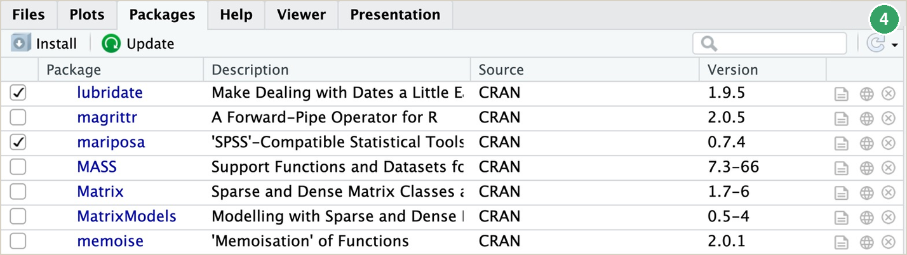
```

### Keeping packages up to date with `update.packages()` and `packageVersion()`

You can start updates in the `Packages` tab or with code:

```{r, eval=FALSE}
update.packages(ask = FALSE)     # update all CRAN packages, mariposa included
packageVersion("mariposa")       # which version is installed?
```

::: {.callout-warning}
**Caution: Updates in the middle of a project.** If you update a package in the middle of a project, the behaviour of your functions may change. Update packages *between* projects, or record the versions you used with `sessionInfo()`. This book was rendered with mariposa `r packageVersion("mariposa")`; with older versions some output differs.
:::

### Citing packages with `citation()` and `toBibtex()`

If you use mariposa for the calculations in your coursework, cite the package. `citation("mariposa")` gives you the complete reference including the DOI, and `toBibtex(citation("mariposa"))` gives it in BibTeX format for your bibliography (see @sec-literatur).

## Finding help with `?`, `vignette()` and `browseVignettes()`

Even people who work with R every day cannot remember every function. R therefore gives you a complete function reference in the `Help` tab. Some entries seem awkward at first, but once you are used to them they are the most reliable source.

```{r, echo=FALSE, fig.align='center', out.width="714px", fig.alt="The start page of the Help tab with the sections R Resources, RStudio, Manuals and Reference. Under Reference are the links Packages and Search Engine & Keywords. At the top right the green number 4."}
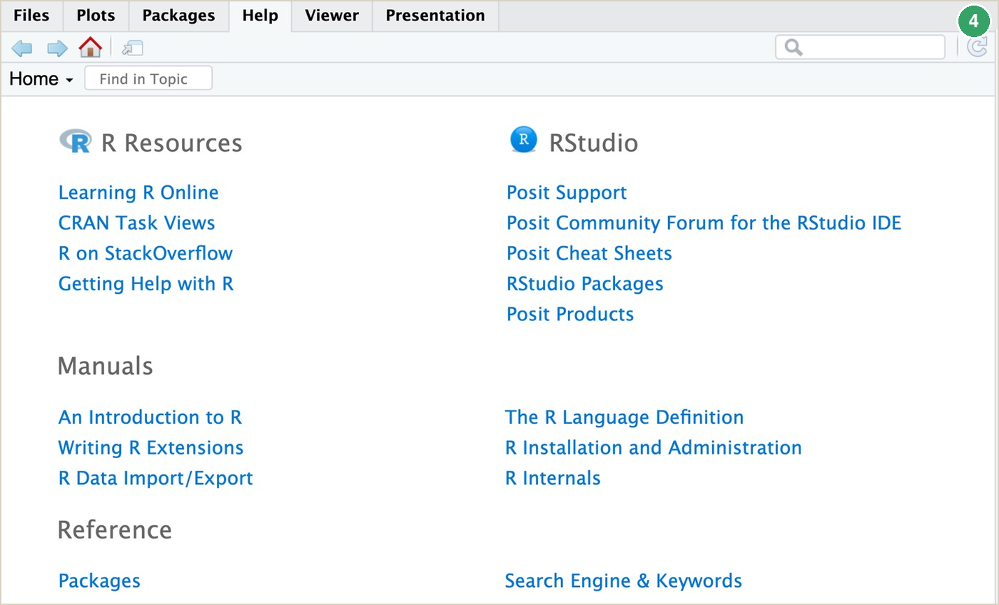
```

If you have a particular function in mind, the quickest way is through the console: a question mark in front of the function name is enough. Here, for example, for the mean function from base R:

```{r, eval=FALSE}
?mean
```

The help page opens in the `Help` tab at the bottom right. It shows a description of the function, its arguments and their default values, and it always ends with examples. You can copy the examples straight into your console.

The default values are listed under *Usage*: for `mean()`, the defaults are `trim = 0` and `na.rm = FALSE` (@fig-hilfeseite). The entry for an argument under *Arguments* explains what it does.

{#fig-hilfeseite .lightbox fig-alt="Diagram of a help page. At the top the header line with mean, the package base and R Documentation, below it the title Arithmetic Mean. Description with the sentence Generic function for the (trimmed) arithmetic mean., labelled function description on the right. Usage with the lines mean(x, ...), ## Default S3 method: and mean(x, trim = 0, na.rm = FALSE, ...), in which trim = 0 and na.rm = FALSE are highlighted in light orange, labelled default values on the right. Arguments with x, trim, na.rm (highlighted in light orange) and ..., each with a grey bar, labelled arguments on the right. In grey Value, References, See Also. Examples with the lines x <- c(0:10, 50), xm <- mean(x) and c(xm, mean(x, trim = 0.10)), labelled examples on the right."}

To list all the functions in a package, open the `Packages` tab, find the package and click on it. This takes you to the package reference.

Many developers also maintain their own websites for their packages, and these are often the best place to start:

- [tidyverse.org/packages](https://www.tidyverse.org/packages/): an overview of all tidyverse packages with vignettes and function reference.
- [yannickdiehl.github.io/mariposa](https://yannickdiehl.github.io/mariposa/): function reference and vignettes on labels, weighting, descriptive statistics, correlation, regression, scale analysis and SPSS compatibility.

A **vignette** is a longer article on how to use a package, usually with a worked example, and it comes with the package. On the package websites you find the vignettes under *Articles*. In RStudio you open one with `vignette("name")`, or list all vignettes of a package with `browseVignettes("packagename")`.

When you search the web for help, [Stack Overflow](https://stackoverflow.com/questions/tagged/r) is the main place to go. Add the keyword *Stack Overflow* to your search query: almost every typical R problem has been answered there before.

## First five steps after installation {-}

If you started this chapter on a fresh computer, here is the checklist to work through before you move on to Chapter 2:

1. R installed (from [cran.r-project.org](https://cran.r-project.org/)) and RStudio installed (from [posit.co](https://posit.co/download/rstudio-desktop/)). Order: R first, then RStudio.
2. Global Options set: *Restore .RData* off, *Save workspace on exit* set to *Never*.
3. Project created for this workshop (`R-Workshop` or similar).
4. Packages installed: `install.packages("tidyverse")`, `install.packages("mariposa")`, `install.packages("patchwork")`.
5. First Quarto document saved in the project folder, for example `01-first_steps.qmd`, with a first chunk that contains `library(tidyverse)` and `library(mariposa)`.

Once all five points are ticked off, you are ready to work through the rest of the book.

## Exercises {-}

::: {.callout-note title="Exercise 1 · Creating a project · Reproduction"}
Create a new project called `R-Workshop`. If you already have the ALLBUS, move `ALLBUS2023.sav` into the project folder. Close RStudio, double-click the `.Rproj` file and check whether everything is back.
:::

::: {.callout-note title="Exercise 2 · First Quarto document · Reproduction"}
Create a new Quarto document (`File` → `New File` → `Quarto Document…`), insert a chunk and write three lines in it: a calculation, an assignment and a line that calls the assigned variable. Run them one after the other with `cmd`/`ctrl` + `Enter`.
:::

::: {.callout-tip title="Solution" collapse="true"}
```{r ex2-loesung, eval=FALSE}
2 + 3
result <- 2 + 3
result
```
:::

::: {.callout-note title="Exercise 3 · Installing packages and testing tab completion · Transfer"}
Install `tidyverse` and `mariposa` (if you have not done so yet), activate them and type `mariposa::` in the console. The list appears by itself after a moment; otherwise press `Tab`. Which functions does RStudio suggest? Which five look particularly useful to you, and what do you think they do?
:::

::: {.callout-tip title="Solution" collapse="true"}
```{r ex3-loesung, eval=FALSE}
install.packages("tidyverse")
install.packages("mariposa")
library(tidyverse)
library(mariposa)
mariposa::   # after the :: the list of functions appears
```
:::

::: {.callout-note title="Exercise 4 · Setup for your own research · Mini research question"}
Imagine you want to start a small empirical study, for example on voting behaviour, attitudes to climate change or political trust in Germany. Which steps would you take in RStudio *now* to make a clean start?
Write down the ideal start-up sequence for yourself in 4–5 bullet points: creating a project, loading packages, naming the documents, storing the data, writing a README. Apply it to your own workshop folder.

*No model solution: the point is to work with your own research interests from the start.*
:::

## What you know now {-}

- You know the main panes of the RStudio interface and have set RStudio up for reproducible work.
- You create projects and use the automatic working directory.
- You write your code in Quarto documents and use the console for trying things out.
- You install, activate and update packages, in particular tidyverse and mariposa.
- You find help through `?function_name`, package websites and vignettes.
- You use the most important keyboard shortcuts as a matter of routine.

In the next chapter you get to know Quarto in more detail: how a Quarto document is structured and how your code and text become a report in HTML, PDF or Word format.

## Further reading {-}

- Posit, [RStudio User Guide](https://docs.posit.co/ide/user/), the complete reference for the IDE.
- Posit, [RStudio Cheatsheets](https://posit.co/resources/cheatsheets/), compact PDFs on shortcuts, the tidyverse, ggplot2 and many other topics.
- [Stack Overflow, tag `r`](https://stackoverflow.com/questions/tagged/r), the largest question-and-answer database for R.
