# RStudio {#sec-rstudio}

## Worum es geht

R selbst ist nur ein Interpreter — eine Programmiersprache, die Befehle entgegennimmt und Antworten zurückgibt. Damit du komfortabel mit R arbeiten kannst, brauchst du eine **integrierte Entwicklungsumgebung (IDE)**: einen Editor, eine Konsole, einen Datei-Browser und einen Variablen-Inspektor — alles in einem Fenster. **RStudio** ist diese Umgebung. Während du in SPSS alles über Klick-Dialoge erreichst, schreibst du in RStudio dein Vorgehen als Skript — reproduzierbar, kommentierbar, versionierbar.

Falls du R und RStudio noch nicht installiert hast, machst du das in den ersten zwei Abschnitten. Danach öffnest du RStudio und arbeitest die folgenden Abschnitte parallel mit. Am Ende kannst du dich darin orientieren, Pakete nachinstallieren und ein erstes Projekt anlegen.

::: {.callout-note}
**Forschungsjournal: Wo stehst du in deiner Mini-Studie?** Du startest gerade. In den nächsten drei Kapiteln (1–3) richtest du das Werkzeug ein. Ab @sec-datenimport lädst du den ALLBUS 2023, ab @sec-datentransformation baust du eine Skala zur Islamfeindlichkeit aus sechs Survey-Items, ab @sec-univbivar prüfst du Hypothesen — und ab @sec-erklaerung modellierst du, *welche* sozialen und politischen Merkmale Islamfeindlichkeit am besten erklären. Das hier ist die erste Etappe: die Werkstatt einrichten.
:::

## Was du nach diesem Kapitel kannst {-}

- R und RStudio in der richtigen Reihenfolge installieren.
- Die Benutzeroberfläche von RStudio sicher bedienen.
- Ein Projekt anlegen und in ihm sauber arbeiten.
- Den Unterschied zwischen Konsole und R-Skript erklären.
- Den Begriff *Working Directory* einordnen und mit `getwd()` prüfen.
- Pakete installieren, aktivieren und aktuell halten — insbesondere tidyverse und mariposa.
- Hilfe-Seiten und Paket-Vignetten gezielt aufrufen.
- Die wichtigsten Tastenkürzel anwenden.

## R installieren

R selbst ist das Rechenwerk im Hintergrund — die Sprache, die deine Befehle ausführt. RStudio ist nur die *Oberfläche*. Du musst beide installieren, **R zuerst**, dann RStudio. Wer es umdreht, bekommt beim ersten Start eine Fehlermeldung „No R installation found".

**R herunterladen.** Gehe zu [cran.r-project.org](https://cran.r-project.org/) und wähle dein Betriebssystem:

- **macOS** → lade die `.pkg`-Datei für deine Architektur (Apple Silicon = M1/M2/M3/M4, oder Intel) und installiere sie per Doppelklick.
- **Windows** → klicke auf *base*, dann auf den Download-Link, führe die `.exe`-Datei aus.
- **Linux** → folge den distro-spezifischen Anweisungen auf der CRAN-Seite.

Empfohlen ist **R 4.5 oder höher**. Wenn du schon eine ältere Version hast, ist das kein Problem — du installierst die neue parallel.

::: {.callout-tip}
**macOS-Hinweis.** Auf Macs mit Apple Silicon (M1–M4) lädst du die *arm64*-Version. Auf älteren Intel-Macs die *x86_64*-Version. Wenn du nicht weißt, was du hast: Apfel-Menü → *Über diesen Mac* → *Chip*. Für Paket-Compilations brauchst du außerdem die *Xcode Command Line Tools* — sie werden bei Bedarf automatisch installiert, oder vorab per Terminal mit `xcode-select --install`.
:::

## RStudio installieren

Erst nachdem R installiert ist, holst du dir RStudio von [posit.co/download/rstudio-desktop](https://posit.co/download/rstudio-desktop/). Die Seite erkennt dein Betriebssystem automatisch und schlägt die richtige Version vor. Installiere wie jedes andere Programm.

Wenn du lokal nichts installieren möchtest, kannst du alternativ [Posit Cloud](https://posit.cloud/) im Browser nutzen — kostenloser Account, RStudio läuft komplett online.

::: {.callout-note}
**Hintergrund: RStudio und Posit.** Die IDE heißt weiterhin **RStudio**, die Firma dahinter wurde 2022 in **Posit** umbenannt. Wenn du im Web Verweise auf „RStudio Cloud" findest, sind sie heute unter [posit.cloud](https://posit.cloud/) zu finden.
:::

## Benutzeroberfläche

Du solltest ungefähr diese Benutzeroberfläche (Graphical User Interface, kurz GUI) vor dir sehen (standardmäßig im hellen Theme):

```{r, echo=FALSE}
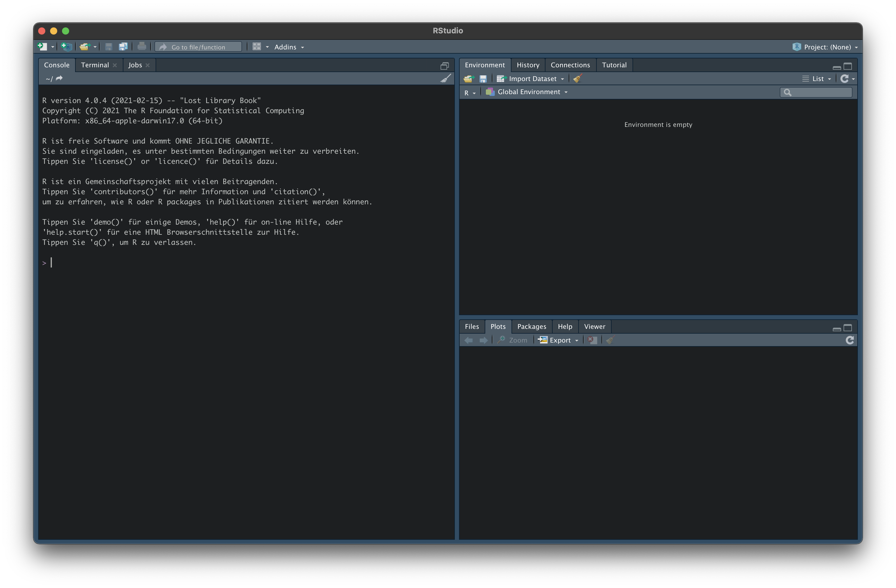
```

Vier Quadranten — bevor du in die Details gehst, lohnt sich die Landkarte:

| Quadrant         | Inhalt                                          | Wofür du es brauchst                        |
| :--------------- | :---------------------------------------------- | :------------------------------------------ |
| **Oben links**   | R-Skript / `.qmd`-Editor                        | Code schreiben, speichern, ausführen        |
| **Unten links**  | Konsole                                         | Code direkt ausprobieren, Output ansehen    |
| **Oben rechts**  | Environment, History, Connections, Tutorial     | Objekte sehen, Befehlsverlauf, Datenbanken  |
| **Unten rechts** | Files, Plots, Packages, Help, Viewer            | Datei-Browser, Grafiken, Hilfe, Pakete      |

Die folgenden Abschnitte gehen jeden Quadranten der Reihe nach durch.

### Optionen für reproduzierbares Arbeiten

Bevor du intensiv mit RStudio arbeitest, deaktiviere unter `Tools` → `Global Options` zwei Komfort-Features, die im Forschungsalltag mehr schaden als nützen:

1. *Restore .RData into workspace at startup* — deaktivieren.
2. *Save workspace to .RData on exit* — auf *Never* stellen.

Damit musst du bei jedem Neustart Daten und Variablen neu laden — der Vorteil ist ein wirklich frischer Workspace ohne unsichtbare Altlasten aus früheren Sitzungen. Das ist die Grundlage für *reproduzierbares Arbeiten*: deine Analyse darf nur von dem abhängen, was im Skript steht.

```{r, echo=FALSE, fig.align='center', out.width="75%"}
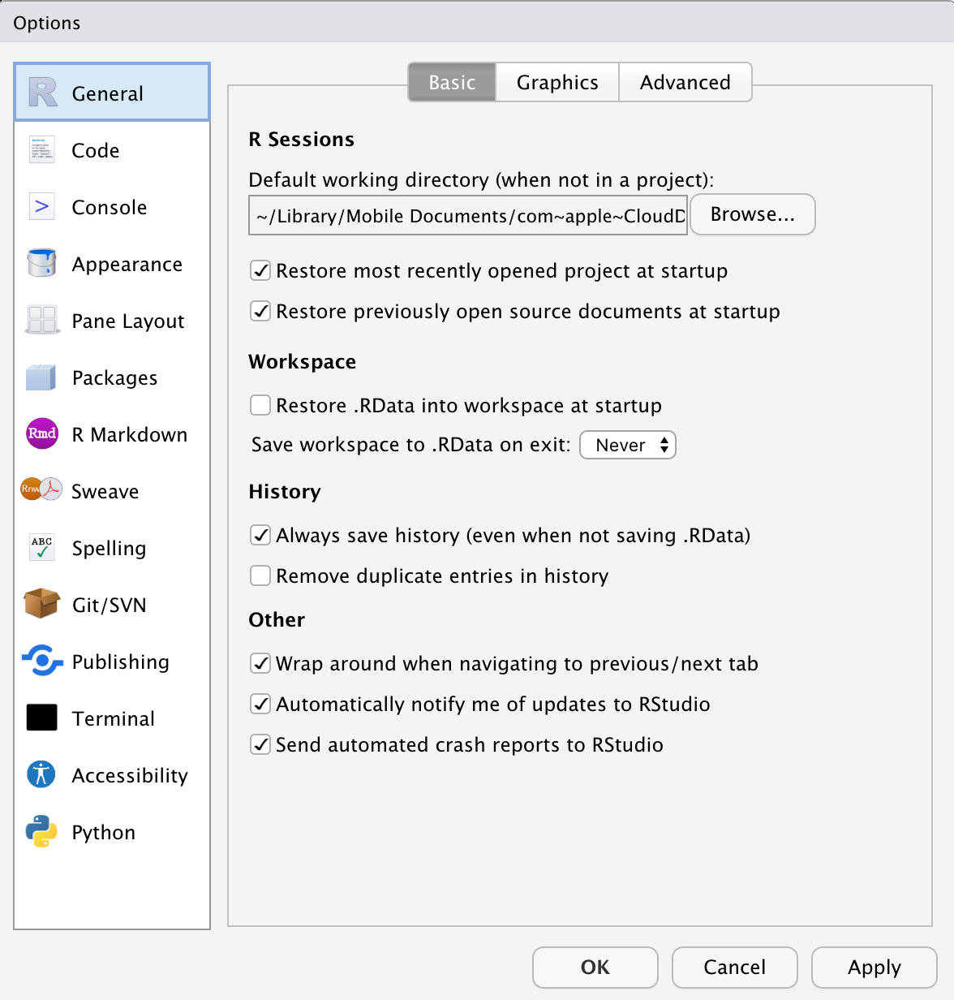
```

Wer es lieber dunkel mag: Unter `Appearance` findest du Farbschemata für Editor und Konsole.

### Konsole

Die Konsole ist dein **erstes Übungsfeld**: Hier kannst du Eingaben direkt ausprobieren. Das `>`-Zeichen ist die Eingabeaufforderung (*prompt*), und du kannst R wie einen Taschenrechner nutzen:

```{r}
2 + 3
```

```{r, echo=FALSE, fig.align='center', out.width="75%"}
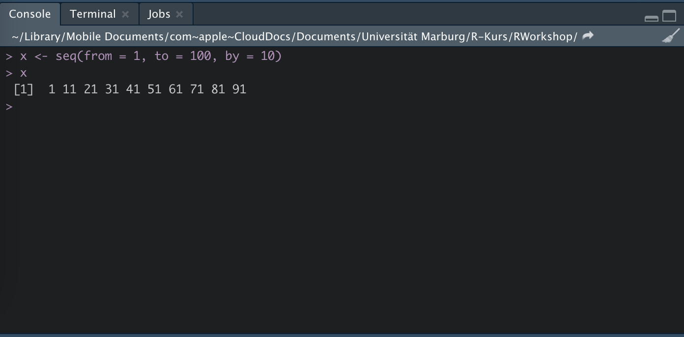
```

Was du in der Konsole tippst, ist allerdings nirgends dauerhaft gespeichert. Sobald du eine Analyse *behalten* willst, gehört sie in ein **R-Skript** (siehe @sec-r-skript).

### Environment und History

Im Reiter `Environment` findest du das **Global Environment** (Dropdown). Hier werden alle Objekte (Variablen, Datensätze, Funktionen), die du angelegt hast, gespeichert.

```{r, echo=FALSE, fig.align='center', out.width="75%"}
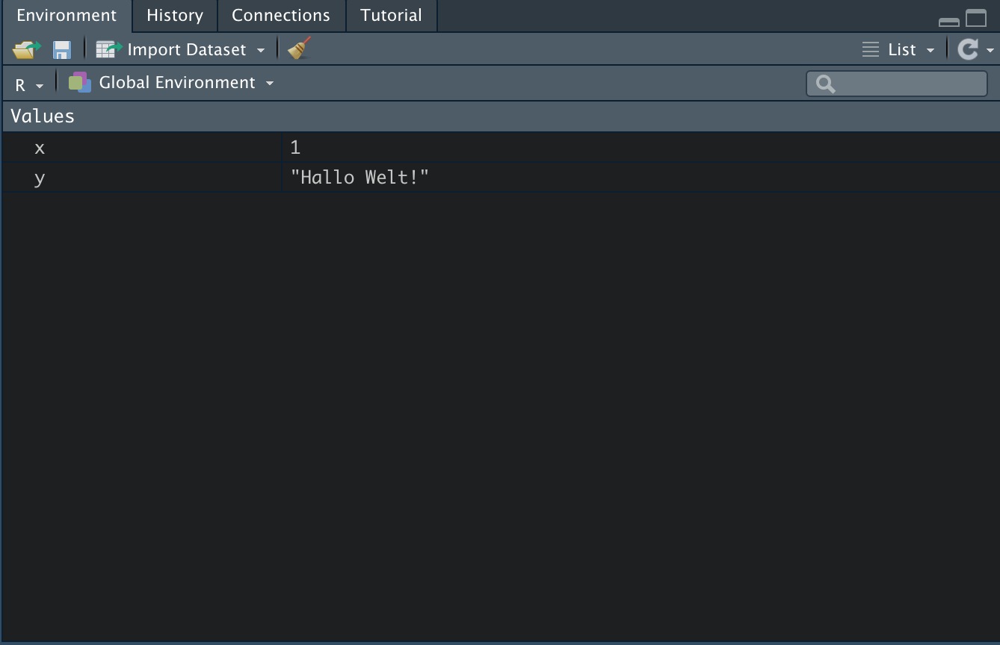
```

Unter `History` siehst du alle Befehle, die du bisher ausgeführt hast. Per Doppelklick werden sie zurück in die Konsole kopiert und können dort modifiziert oder erneut ausgeführt werden.

::: {.callout-tip}
**Tipp.** Die History rufst du auch direkt über die Tastenkombination `cmd` (macOS) bzw. `strg` (Windows) + `↑` in der Konsole ab.
:::

### Files

Unter `Files` siehst du den Datei-Browser deines **Arbeitsverzeichnisses** (*working directory*). Das ist der Ordner, in dem R standardmäßig sucht, wenn du eine Datei einliest oder speicherst — schreibst du `read_spss("ALLBUS2023.sav")`, dann sucht R die Datei genau dort. Welcher Ordner das gerade ist, sagt dir `getwd()` in der Konsole:

```{r getwd-demo, eval=FALSE}
getwd()
# [1] "/Users/anna/Documents/R-Workshop"
```

Manuell setzen kannst du das Arbeitsverzeichnis mit `setwd("…")` — in der Praxis brauchst du das *fast nie*, wenn du mit einem **Project** arbeitest (siehe @sec-projects). Bei jedem Project-Start ist das Arbeitsverzeichnis automatisch der Projektordner. Das ist die Grundlage für portable Skripte: nirgendwo absolute Pfade, jede Datei wird relativ zum Projekt angesprochen.

```{r, echo=FALSE, fig.align='center', out.width="75%"}
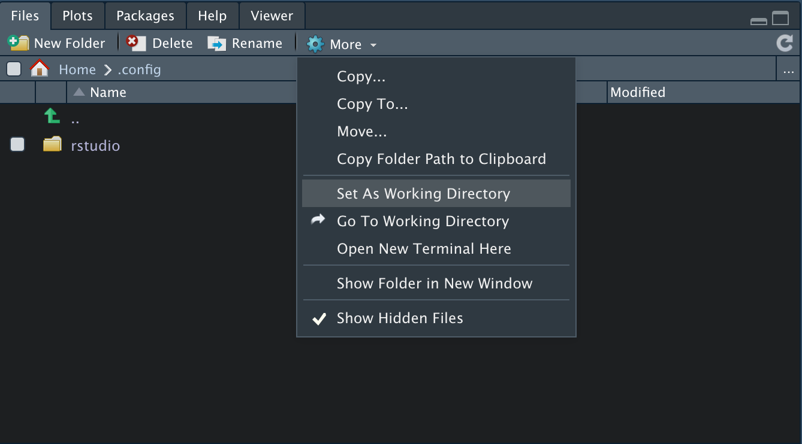
```

::: {.callout-warning}
**Vorsicht: Absolute Pfade.** Schreibe niemals `read_spss("/Users/anna/Documents/...")` in dein Skript. Sobald du es teilst oder auf einen anderen Rechner ziehst, ist der Pfad kaputt. Mit Projects reicht der relative Pfad — der Dateiname genügt, wenn die Datei im Projektordner liegt.
:::

## Mit RStudio arbeiten

Jetzt geht es an die praktische Arbeit. Drei Konzepte sind zentral: das **Projekt** als Container, das **R-Skript** als Arbeitsmedium und die **Tastenkürzel** als Beschleuniger.

### Projekt anlegen {#sec-projects}

Bevor du mit Daten arbeitest, lohnt es sich, ein **Project** anzulegen. Über `File` → `New Project` → `New Directory` → `New Project` öffnest du die entsprechende Maske, vergibst einen Namen und einen Speicherort.

```{r, echo=FALSE, fig.align='center', out.width="75%"}
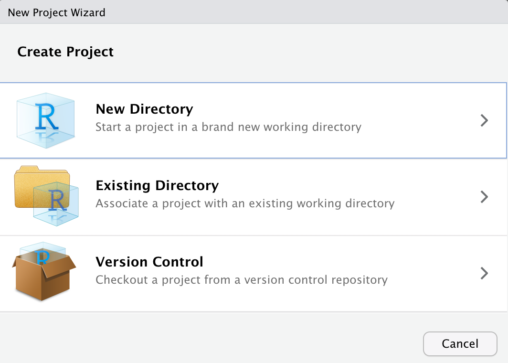
```

Was du davon hast:

- Alle geöffneten *Files* werden beim Start des Projekts (per Doppelklick auf die `.Rproj`-Datei) wieder geladen.
- Du kannst beliebig viele Projekte parallel öffnen und zwischen ihnen wechseln.
- Das Arbeitsverzeichnis ist automatisch der Projektordner — du musst dich nicht mehr darum kümmern, vollständige Pfade einzutippen.

Schiebe deine Datensätze (etwa `ALLBUS2023.sav`, sobald du ihn hast) in den Projektordner, und du kannst sie direkt mit `read_spss("ALLBUS2023.sav")` einlesen.

### R-Skript: dein zentrales Arbeitsobjekt {#sec-r-skript}

Ein **R-Skript** ist eine Textdatei mit der Endung `.R`, in der du deinen Code untereinander schreibst und kommentierst. Es ist das Pendant zur SPSS-Syntax-Datei — nur mächtiger, weil R selbst eine vollständige Programmiersprache ist.

Ein neues Skript öffnest du über das Symbol mit dem weißen Blatt und grünem Kreuz (oben links) — oder per Tastenkürzel `cmd`/`strg` + `shift` + `N`.

::: {.callout-tip}
**SPSS → R.** Das R-Skript ist das Pendant zur SPSS-Syntax-Datei. Du arbeitest weiterhin *in der Syntax* — nur in einer anderen Sprache. Die meisten SPSS-Workflows lassen sich Schritt für Schritt übertragen, oft sogar in weniger Zeilen.
:::

Ein erstes Beispiel — schreibe in dein Skript:

```{r, results='hide'}
var1 <- 2 + 3
var1
```

Mit `Run` (oder `cmd`/`strg` + `Enter`) führst du die aktuelle Zeile aus. Der Output erscheint in der Konsole:

```{r, echo=FALSE}
var1 <- 2 + 3
var1
```

`var1` ist jetzt im `Environment` sichtbar — mit dem Wert `5`. Was eine Variable genau ist, wie Funktionen aufgerufen werden und welche Datentypen R kennt, lernst du in Kap. 3.

::: {.callout-warning}
**Vorsicht: Zuweisungsoperator.** Für Zuweisungen verwendest du `<-`, nicht `=`. Das `=` funktioniert zwar in vielen Fällen auch — es führt aber in komplexeren Kontexten (Funktionsargumenten) zu subtilen Bugs. Mach dir die Konvention `<-` zur Gewohnheit.
:::

### Tab Completion

RStudio hat eine sehr hilfreiche Funktion: *Tab Completion*. Während du tippst, erscheint ein Dropdown mit Vervollständigungs-Vorschlägen. Du kannst es jederzeit über die `Tab`-Taste aufrufen. Tippst du zum Beispiel `w_mean`, schlägt RStudio dir gleich die mariposa-Funktion vor.

```{r, echo=FALSE, fig.align='center', out.width="75%"}
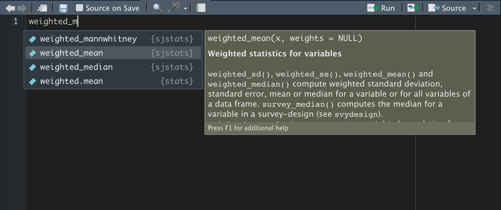
```

Stehst du innerhalb der Klammern einer Funktion und drückst `Tab`, listet RStudio alle Argumente auf. Funktionsargumente sagen einer Funktion, *welche* Daten verarbeitet werden und *wie*. In mariposa-Funktionen heißt das erste Argument typischerweise `data`, gefolgt von den interessierenden Variablen und optional `weights = wghtpew` für eine Gewichtung.

```{r, echo=FALSE, fig.align='center', out.width="75%"}
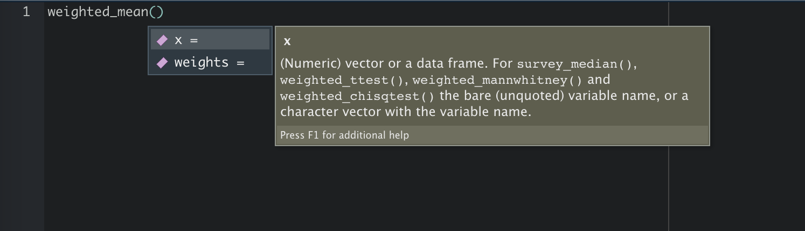
```

Wenn sich zwei Pakete eine Funktionsbezeichnung teilen, kannst du die Mehrdeutigkeit über den Paket-Präfix auflösen — `paketname::funktion`. Das erzeugt auch eine Funktionsliste, wenn du nach `::` `Tab` drückst:

```{r, echo=FALSE, fig.align='center', out.width="75%"}
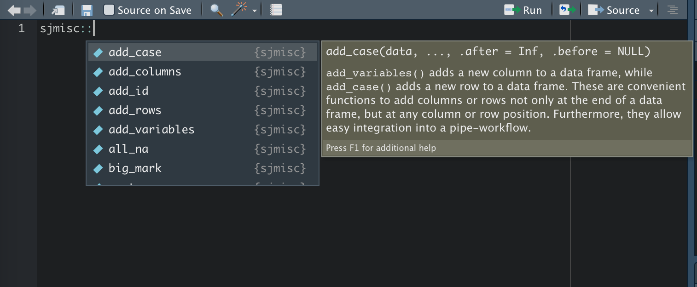
```

### Nützliche Tastenbefehle

Diese Tastenkombinationen sparen dir auf Dauer viel Zeit:

| Befehl                            | Wirkung                          | Wann nützlich                          |
| :-------------------------------- | :------------------------------- | :------------------------------------- |
| `cmd`/`strg` + `Enter`            | Aktuelle Zeile ausführen         | Im Skript                              |
| `cmd`/`strg` + `S`                | Skript-Datei speichern           | Nach jeder Änderung                    |
| `cmd`/`strg` + `shift` + `N`      | Neues Skript erstellen           | Neue Analyse                           |
| `cmd`/`strg` + `shift` + `Enter`  | Gesamtes Skript ausführen        | Vollständiger Re-Run                   |
| `cmd`/`strg` + `↑`                | Vorherige Befehle anzeigen       | In der Konsole                         |
| `control`/`strg` + `L`            | Konsole leeren                   | Wenn es unübersichtlich wird           |
| `cmd`/`strg` + `shift` + `C`      | Zeile als Kommentar setzen       | Code kurz deaktivieren                 |
| `cmd`/`strg` + `shift` + `A`      | Code-Block re-strukturieren      | Eingerückten Code aufräumen            |
| `option`/`alt` + `-`              | Zuweisungspfeil `<-` erzeugen    | Statt manuell tippen                   |
| `cmd`/`strg` + `shift` + `M`      | Pipe `|>` erzeugen               | Beim Pipe-Schreiben (siehe Kap. 3)     |

::: {.callout-tip}
**Tipp.** Eine vollständige Liste aller verfügbaren Tastenkürzel bekommst du in RStudio über `option`/`alt` + `shift` + `K`.
:::

::: {.callout-note}
**Hintergrund: `|>` oder `%>%`?** RStudio bietet seit Version 2021.09 den nativen Pipe `|>` (verfügbar ab R 4.1). Davor war der magrittr-Pipe `%>%` Standard. Wir verwenden in diesem Buch durchgängig `|>`. Unter `Tools` → `Global Options` → `Code` kannst du einstellen, welcher Operator beim Shortcut eingefügt wird — wir empfehlen die *native pipe*.
:::

## Pakete

R bringt von Haus aus — als *base R* — schon eine ganze Reihe nützlicher Funktionen mit. Für viele Analyseschritte sind sie aber zu abstrakt: Wir greifen deshalb auf zusätzliche **Pakete** zurück, die unsere Funktionsbibliothek erweitern. In diesem Buch arbeiten wir bewusst mit nur zwei Ökosystemen: dem **tidyverse** für Datenmanipulation und Visualisierung und **mariposa** für die statistische Analyse.

::: {.callout-note}
**Konzept: Installieren vs. Aktivieren.** Mit einem Paket arbeitest du in zwei Schritten — und es lohnt sich, die Trennung von Anfang an klar zu haben:

- **Installieren** mit `install.packages("name")` — *einmalig* pro Rechner. Stell dir vor, du holst dir ein Werkzeug aus dem Baumarkt und legst es in dein Werkzeugregal.
- **Aktivieren** mit `library(name)` — *einmal pro R-Sitzung*. Du nimmst das Werkzeug aus dem Regal und legst es auf die Werkbank.

Ein Paket nur zu installieren, ohne `library()` aufzurufen, ist wie ein Werkzeug, das ungenutzt im Regal steht. Umgekehrt: Wenn du `library(forcats)` aufrufst, ohne das Paket installiert zu haben, kommt ein Fehler.
:::

### Installation

Das tidyverse ist auf CRAN, dem zentralen R-Paket-Archiv, verfügbar und lässt sich direkt installieren:

```{r, eval=FALSE}
install.packages("tidyverse")
```

Damit hast du in einem Schritt die Pakete `dplyr`, `tidyr`, `ggplot2`, `readr`, `purrr`, `tibble`, `stringr`, `forcats` und `lubridate` installiert.

mariposa liegt ebenfalls auf CRAN und wird genauso installiert:

```{r, eval=FALSE}
install.packages("mariposa")
```

Für die Grafik-Kombinationen in Kap. 9 brauchst du außerdem noch `patchwork`:

```{r, eval=FALSE}
install.packages("patchwork")
```

::: {.callout-note}
**Hintergrund: CRAN und GitHub — was ist der Unterschied?** Pakete leben in R an zwei verschiedenen Orten:

- **CRAN** (*Comprehensive R Archive Network*) ist das offizielle Paket-Archiv — vergleichbar mit einem App Store. Jedes Paket wird vor der Aufnahme automatisch geprüft (baut auf allen Plattformen? Dokumentation vollständig? Tests laufen?). Updates sind stabil, aber zeitversetzt.
- **GitHub** ist die Entwickler:innen-Plattform. Hier liegt der *aktuelle Entwicklungsstand* — neueste Funktionen, frischeste Bugfixes, aber auch weniger Prüfung. Viele Pakete erscheinen dort früher als auf CRAN.

In diesem Buch installierst du beide Pakete von CRAN — das ist die stabile Variante. Die Entwicklungsversion von mariposa holst du bei Bedarf mit dem Hilfspaket `remotes` von GitHub (`remotes::install_github("YannickDiehl/mariposa")`); für das Buch brauchst du sie nicht.
:::

### Aktivierung

Installierte Pakete musst du in jeder R-Sitzung mit `library()` aktivieren:

```{r, eval=FALSE}
library(tidyverse)
library(mariposa)
library(patchwork)
```

Alternativ kannst du Pakete auch über den Reiter `Packages` (rechts unten in RStudio) installieren und aktivieren — das ist gut für einen schnellen Überblick, aber für reproduzierbares Arbeiten ist der Code-Weg besser.

```{r, echo=FALSE, fig.align='center', out.width="75%"}
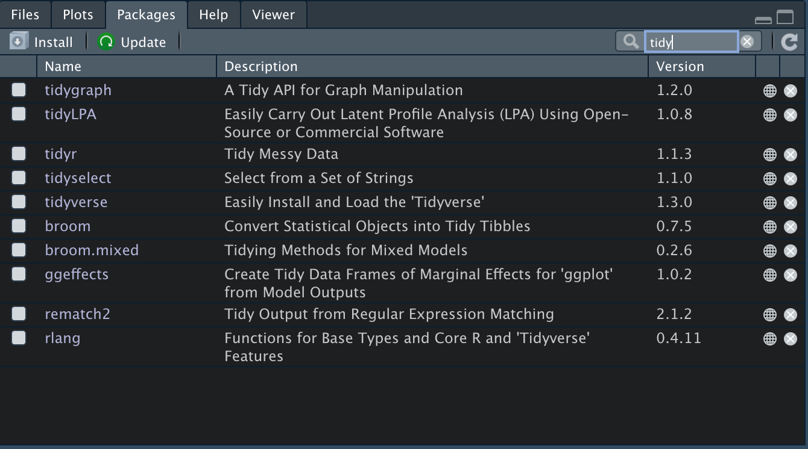
```

### Pakete aktuell halten

Updates lassen sich über den Reiter `Packages` oder per Code anstoßen:

```{r, eval=FALSE}
update.packages(ask = FALSE)     # alle CRAN-Pakete aktualisieren — mariposa inklusive
packageVersion("mariposa")       # welche Version ist installiert?
```

::: {.callout-warning}
**Vorsicht.** Wenn du in der Mitte eines Projekts ein Paket aktualisierst, ändert sich potenziell das Verhalten deiner Funktionen. Pflege Pakete *zwischen* Projekten oder dokumentiere die genutzten Versionen mit `sessionInfo()`. Dieses Buch ist mit mariposa `r packageVersion("mariposa")` gerendert; bei älteren Versionen weichen manche Ausgaben ab.
:::

::: {.callout-tip}
**Tipp: Pakete zitieren.** Wer in einer Hausarbeit mit mariposa rechnet, zitiert das Paket. `citation("mariposa")` gibt dir die fertige Literaturangabe inklusive DOI — mit `toBibtex(citation("mariposa"))` direkt im BibTeX-Format für dein Literaturverzeichnis (siehe @sec-literatur).
:::

## Hilfe finden

Auch wer täglich mit R arbeitet, kann sich nicht alle Funktionen merken. R bietet dir deshalb über den Reiter `Help` eine vollständige Funktionsreferenz. Manche Einträge wirken am Anfang sperrig, sind nach einiger Übung aber die zuverlässigste Quelle.

```{r, echo=FALSE, fig.align='center', out.width="75%"}
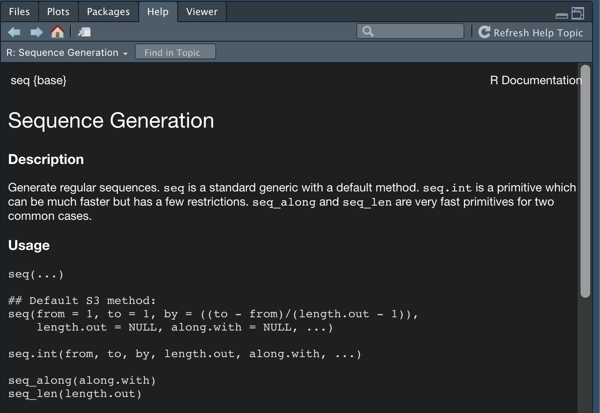
```

Wenn du eine Funktion im Kopf hast, geht es am schnellsten über die Konsole — ein Fragezeichen vor den Funktionsnamen reicht. Hier zum Beispiel für die Mittelwert-Funktion aus base R:

```{r, eval=FALSE}
?mean
```

Die Hilfe öffnet sich unten rechts im `Help`-Reiter und zeigt: Funktionsbeschreibung, Argumente, Default-Werte, am Ende immer Anwendungs-Beispiele. Letztere kannst du direkt in deine Konsole kopieren.

Um alle Funktionen eines Pakets aufzulisten, öffnest du den Reiter `Packages`, suchst das Paket und klickst es an. Du landest in der Paketreferenz.

Viele Entwickler:innen pflegen zusätzlich eigene Webseiten für ihre Pakete — das sind oft die besten Einstiegspunkte:

- [tidyverse.org/packages](https://www.tidyverse.org/packages/) — Übersicht aller tidyverse-Pakete mit Vignetten und Funktionsreferenz.
- [yannickdiehl.github.io/mariposa](https://yannickdiehl.github.io/mariposa/) — Funktionsreferenz, Vignetten zu Labels, Gewichtung, deskriptiver Statistik, Korrelation, Regression, Skalenanalyse und SPSS-Kompatibilität.

::: {.callout-tip}
**Tipp: Vignetten.** Eine **Vignette** ist ein längerer Anwendungs-Artikel zu einem Paket — typischerweise mit durchgerechnetem Beispiel, in das Paket eingebettet. Auf den Paket-Webseiten findest du sie unter *Articles*; direkt in RStudio rufst du sie mit `vignette("name")` auf oder listest alle Vignetten eines Pakets mit `browseVignettes("paketname")`.
:::

Wenn du im Web nach Hilfe suchst, ist [Stack Overflow](https://stackoverflow.com/questions/tagged/r) die zentrale Anlaufstelle. Ergänze deine Suchanfrage mit dem Schlagwort *Stack Overflow* — fast jedes typische R-Problem wurde dort schon einmal beantwortet.

## Erste fünf Schritte nach der Installation {-}

Wenn du dieses Kapitel mit einem frischen Rechner gestartet hast, ist hier die Checkliste, bevor du in Kap. 2 weitergehst:

1. **R installiert** (von [cran.r-project.org](https://cran.r-project.org/)) und **RStudio installiert** (von [posit.co](https://posit.co/download/rstudio-desktop/)). Reihenfolge: R zuerst, dann RStudio.
2. **Global Options gesetzt**: *Restore .RData* aus, *Save workspace on exit* auf *Never*.
3. **Project angelegt** für diesen Workshop (`R-Workshop` o. ä.).
4. **Pakete installiert**: `install.packages("tidyverse")`, `install.packages("mariposa")`, `install.packages("patchwork")`.
5. **Erstes Skript gespeichert** im Projektordner — etwa `01-erste_schritte.R` mit `library(tidyverse)` und `library(mariposa)` in den ersten zwei Zeilen.

Wenn alle fünf Punkte abgehakt sind, kannst du dich entspannt durch den Rest des Buchs arbeiten.

## Übungen {-}

::: {.callout-note title="Übung 1 · Projekt anlegen · Reproduktion"}
Lege ein neues Project mit dem Namen `R-Workshop` an. Falls du den ALLBUS schon hast, schiebe `ALLBUS2023.sav` in den Projektordner. Schließe RStudio, doppelklicke die `.Rproj`-Datei und prüfe, ob alles wieder da ist.
:::

::: {.callout-note title="Übung 2 · Erstes Skript · Reproduktion"}
Erstelle ein neues R-Skript (`cmd`/`strg` + `shift` + `N`), schreibe drei Zeilen — eine Rechnung, eine Zuweisung, einen Aufruf der zugewiesenen Variable — und führe sie nacheinander mit `cmd`/`strg` + `Enter` aus.
:::

::: {.callout-tip title="Lösung" collapse="true"}
```{r ex2-loesung, eval=FALSE}
2 + 3
ergebnis <- 2 + 3
ergebnis
```
:::

::: {.callout-note title="Übung 3 · Pakete installieren und Tab Completion testen · Transfer"}
Installiere (falls noch nicht geschehen) `tidyverse` und `mariposa`, aktiviere sie und tippe in der Konsole `mariposa::` gefolgt von `Tab`. Welche Funktionen schlägt RStudio dir vor? Welche fünf sehen für dich besonders nützlich aus, was vermutest du, was sie tun?
:::

::: {.callout-tip title="Lösung" collapse="true"}
```{r ex3-loesung, eval=FALSE}
install.packages("tidyverse")
install.packages("mariposa")
library(tidyverse)
library(mariposa)
mariposa::   # <- nach den :: TAB drücken
```
:::

::: {.callout-note title="Übung 4 · Setup für eigene Forschung · Mini-Forschungsfrage"}
Stell dir vor, du willst eine kleine empirische Untersuchung beginnen — etwa zu Wahlverhalten, Klimaeinstellungen oder politischem Vertrauen in Deutschland. Welche Schritte würdest du *jetzt* in RStudio tun, um sauber loszulegen?
Formuliere für dich in 4–5 Stichpunkten den idealen Startablauf — Project anlegen, Pakete laden, Skript-Konvention, Daten ablegen, README erstellen. Wende ihn auf deinen eigenen Workshop-Ordner an.

*Keine Musterlösung — der Sinn ist, von Anfang an mit den eigenen Forschungs­interessen zu rechnen.*
:::

## Was du jetzt weißt {-}

- Du kennst die wichtigsten Bereiche der RStudio-Oberfläche und hast sie auf reproduzierbares Arbeiten eingestellt.
- Du legst Projekte an und nutzt das automatische Arbeitsverzeichnis.
- Du arbeitest in R-Skripten — der reproduzierbaren Form, statt nur in der Konsole zu tippen.
- Du installierst, aktivierst und aktualisierst Pakete — insbesondere tidyverse und mariposa.
- Du findest Hilfe über `?funktion`, Paket-Webseiten und Vignetten.
- Du nutzt die wichtigsten Tastenkürzel routiniert.

Im nächsten Kapitel lernst du **Quarto** kennen — das genau diese RStudio-Skripte mit reproduzierbaren Berichten verbindet. Aus deinem Code und deinem Fließtext entsteht ein Dokument, das du als HTML, PDF oder Word veröffentlichen kannst.

## Weiterführend {-}

- Posit, [RStudio User Guide](https://docs.posit.co/ide/user/) — Vollreferenz zur IDE.
- Posit, [RStudio Cheatsheets](https://posit.co/resources/cheatsheets/) — kompakte PDFs zu Shortcuts, tidyverse, ggplot2 und vielen weiteren Themen.
- [Stack Overflow — Tag `r`](https://stackoverflow.com/questions/tagged/r) — die größte R-Frage-Antwort-Datenbank.
