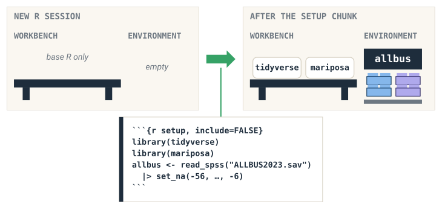

# Quarto and reproducible research {#sec-quarto}

```{r setup-kap2, include=FALSE}
library(tidyverse)
source("R/_common_en.R")
```

## What this chapter is about

Research only counts as *science* if other people can follow it. If you publish an analysis, you should show every step from the data to the result, so that readers do not have to reconstruct intermediate steps or reformat tables from the output window.

Quarto is a tool that puts this into practice. It combines R code and the written report in a single document: you write your term paper, seminar presentation or bachelor's thesis together with the code that produces the numbers. Quarto renders this into HTML, PDF or Word. If you change the data or a methodological decision, all the code in the document runs again the next time you render it, and the numbers, tables and graphics are up to date automatically.

This chapter takes you from your first `.qmd` document to a reproducible project that meets the standards of open science. The book you are reading was built with Quarto, so these pages are themselves an example of what this chapter explains.

::: {.callout-note}
**Research journal: Where are you in your mini study?** You set up the IDE in @sec-rstudio. Now you get to know the format in which you will *publish* your findings on Islamophobia at the end: a reproducible report that combines code, tables and graphics in one document. When you produce coefficient plots and regression tables from @sec-erklaerung onwards, you will want to bring them together in a Quarto document instead of copying them into Word.
:::

## What you will be able to do after this chapter {-}

- Explain the difference between an R script, R Markdown and Quarto.
- Create a `.qmd` document, render it and export it to HTML/PDF/Word.
- Control code chunks with YAML options (`echo`, `eval`, `fig-cap`, …).
- Use inline R code for reproducible numbers in the text.
- Include tables and graphics with captions and cross-references.
- Cite sources with BibTeX and Zotero.
- Apply open science principles (reproducibility, FAIR, OSF, preregistration) to your project.
- Structure a project cleanly (`R/`, `output/`) and keep track of its versions with Git.

## Why Quarto? From script to report

If you work in SPSS, you know the routine: you click through the menus, the output appears in a separate window, and you copy tables and graphics into Word, where you format them again. If you later notice that you recoded a variable incorrectly, the whole process starts again.

In Quarto, analysis and report are no longer separate. Both live in the same document:

|                                       | SPSS workflow                              | Quarto workflow                                |
| :------------------------------------ | :----------------------------------------- | :--------------------------------------------- |
| Where are the calculations done?      | SPSS output window                         | Code chunk in the `.qmd`                       |
| Where is the text written?            | Word                                       | Text in the `.qmd`                             |
| How do tables get into the report?    | Word (copy, format by hand)                | Quarto (automatically when rendering)          |
| What happens when the data change?    | Copy everything again                      | Render button, done                            |
| How does someone else reproduce it?   | Hope that the order of clicks is documented | `.qmd` plus data → identical result           |

Quarto is the successor to R Markdown. R Markdown was centred on R; Quarto works with several languages (R, Python, Julia, Observable) and unifies the configuration. In this book you use Quarto with R. Everything you know from R Markdown tutorials works in Quarto almost unchanged.

::: {.callout-note collapse="true"}
## Background: R Markdown, Quarto, knitr

Internally, Quarto still uses knitr, the R engine that runs code chunks and embeds their results in Markdown. What Quarto adds is the layer *above* it: a uniform YAML format, a consistent output architecture and support for books (like this one), websites, slides and dashboards. Most examples from R Markdown tutorials work the same way in Quarto.
:::

## Markdown: the writing layer

Before you build your first `.qmd`, here is a short cheat sheet for **Markdown**, the markup language in which you write the *text* of a document (everything that is not R code). Markdown is deliberately simple: a few special characters are enough for most formatting.

| Markdown               | Result                                |
| :--------------------- | :------------------------------------ |
| `# Heading 1`          | largest heading                       |
| `## Heading 2`         | next smaller heading                  |
| `**bold**`             | **bold**                              |
| `*italic*`             | *italic*                              |
| `` `inline-code` ``    | `inline-code` (monospace)             |
| `- first item`         | bullet point (with `-`)               |
| `1. first item`        | numbered list                         |
| `[Text](https://…)`    | link                                  |
| `> Quote`              | indented quotation                    |
| blank line             | new paragraph                         |

That is all you need for 90% of term papers. Tables, footnotes and images have their own Markdown syntax; the [Quarto Markdown reference](https://quarto.org/docs/authoring/markdown-basics.html) is the cheat sheet for later.

## Your first `.qmd`

You already created a Quarto document in @sec-quarto-dokument: `File` → `New File` → `Quarto Document…`. In the dialog, you enter a title and an author, choose HTML as the format and click *Create*. RStudio opens an example document, which you can turn into HTML straight away with the Render button (or `cmd`/`ctrl` + `shift` + `K`).

A minimal `.qmd` has exactly three parts:

````markdown
---
title: "My first report"
author: "Anna Schmidt"
format: html
---

## Introduction

In this report I analyse the ALLBUS 2023.

```{{r}}
mean(c(1, 2, 3, 4, 5))
```
````

In the example you can see:

1. **YAML header** between the `---` lines: metadata and format configuration.
2. Markdown text: see the cheat sheet above.
3. Code chunks in triple backticks with `{r}`: they are run when you render, and their output goes straight into the report.

The rendered result shows your text, the line of code *and* its output (`3`), all in one finished HTML file. You can use this workflow for everything from a term paper to a PhD thesis.

Each layer ends up in its own place in the report (@fig-qmd-schichten): the YAML header becomes the title and author, the Markdown text becomes the heading and paragraph, and the chunk becomes the line of code with its output `[1] 3`.

{#fig-qmd-schichten .lightbox fig-alt="On the left the document as a code box with three layers outlined in green. 1 YAML header with the lines ---, title: “My first report”, author: “Anna Schmidt”, format: html and ---. 2 Markdown text with ## Introduction and the sentence In this report I analyse the ALLBUS 2023. 3 Code chunk with the line mean(c(1, 2, 3, 4, 5)) between the backtick lines. An arrow labelled Render leads to the rendered page on the right: 1 the title My first report and the name Anna Schmidt, 2 the heading Introduction and the sentence, 3 the line of code mean(c(1, 2, 3, 4, 5)) and below it the output [1] 3."}

## The YAML header: the control panel

The YAML header controls how your document behaves. Instead of seeing all the fields at once, you build it up in three stages, from “the minimum that renders” to “a complete term paper”.

### Stage 1: Minimal

```yaml
---
title: "My first report"
author: "Anna Schmidt"
format: html
---
```

With this, the document renders as HTML. That is all you need to begin with.

### Stage 2: Term paper level

```yaml
---
title: "Islamophobia in Germany 2023"
subtitle: "An analysis based on the ALLBUS"
author: "Anna Schmidt"
date: today
format:
  html:
    toc: true
    toc-depth: 3
    number-sections: true
lang: en
---
```

- `toc: true` turns on the table of contents, and `toc-depth: 3` includes three levels of headings.
- `number-sections: true` numbers the sections automatically (1, 1.1, 1.1.1).
- `lang: en` gives you English labels (for example *“Table of contents”*; `lang: de` would give *“Inhaltsverzeichnis”*).
- `date: today` sets the render date automatically.

### Stage 3: Full research report

```yaml
---
title: "Islamophobia in Germany 2023"
subtitle: "An analysis based on the ALLBUS"
author:
  - "Anna Schmidt"
  - "Boris Müller"
date: today
date-format: "D MMMM YYYY"

format:
  html:
    toc: true
    number-sections: true
  pdf:
    documentclass: article
    geometry: margin=2.5cm
  docx: default

bibliography: references.bib
csl: apa.csl

execute:
  echo: true
  warning: false
  message: false

lang: en
---
```

New in this stage:

- Several `author` entries as a list (indented, with `-`).
- Several output formats at once: Quarto renders all three in one run.
- `bibliography` points to a BibTeX file (see @sec-literatur).
- `csl` selects the citation style (APA, Chicago, …).
- `execute` sets default options for all code chunks: `echo: true` shows the code, and `warning: false` / `message: false` hide R's warnings and messages.

::: {.callout-warning}
**Caution: YAML indentation.** YAML is sensitive to spaces. Nested fields are indented by *two spaces*; tabs or inconsistent indentation lead to render errors. If a Quarto render stops with “yaml parsing error”, check the indentation first.
:::

## Code chunks in detail

A code chunk has two parts: a **header line** with options and a **code body**.

````markdown
```{{r my-chunk, echo=TRUE, warning=FALSE, fig.width=6}}
mean(mtcars$mpg)
```
````

The most important options:

| Option                   | Effect                                                           |
| :----------------------- | :--------------------------------------------------------------- |
| `echo`                   | Show the code? (`TRUE` shows it, `FALSE` hides it)               |
| `eval`                   | Run the code? (`FALSE` shows the code without running it)        |
| `include`                | Code and output in the document? (`FALSE` hides both but still runs the code) |
| `warning`, `message`     | Show warnings/messages?                                          |
| `fig-cap`                | Figure caption                                                   |
| `fig-width`, `fig-height`| Size of the figure in inches                                     |
| `fig-align`              | `"left"`, `"center"`, `"right"`                                  |

@fig-chunk-optionen shows the chunk with `mean(mtcars$mpg)` without an option and with three settings. With `eval=FALSE` the code appears in the report, but R does not run it; with `include=FALSE` R runs it, but none of it appears in the report.

{#fig-chunk-optionen .lightbox fig-alt="A table with the columns OPTION, IN THE REPORT and EXECUTED and four rows. No option: the code mean(mtcars$mpg) and the output [1] 20.09062, executed yes. echo=FALSE: only the output [1] 20.09062, yes. eval=FALSE: only the code, no. include=FALSE: an empty field, yes."}

Which option you need depends on what should appear in the report:

- *Show code and output.* → Default. No option needed.
- *Show only the output, hide the code.* → `echo: false` (for example graphics in a report).
- *Show the code but do not run it.* → `eval: false` (for example an illustration that would need someone else's data).
- *Hide code and output but still run the code.* → `include: false` (for example a setup chunk that loads packages).
- *Show code and output but suppress warnings.* → `warning: false, message: false`.

**Chunk labels** (such as `my-chunk` above) must be *unique* within a document. They serve as cache keys and as anchors for cross-references to figures.

Since Quarto appeared, a second way of writing chunk options has become common: the **`#|` style**, inside the chunk instead of in the header:

````markdown
```{{r my-chunk}}
#| echo: true
#| warning: false
#| fig-width: 6

mean(mtcars$mpg)
```
````

Both ways are allowed. This book uses the header notation (`{r my-chunk, echo=TRUE}`) because it is more compact. In recent Quarto examples on the web you will more often see the `#|` style, which is easier to read when there are many options.

### Setup chunk

At the start of a document there is usually a **setup chunk** that loads packages and sets defaults. `include=FALSE` hides it from readers:

````markdown
```{{r setup, include=FALSE}}
library(tidyverse)
library(mariposa)
allbus <- read_spss("ALLBUS2023.sav") |>
  set_na(-56, -55, -54, -53, -51, -50, -42, -41,
         -33, -32, -15, -11, -10, -9, -8, -7, -6)
```
````

All later chunks inherit this state. This is why the chapters of this book do not load `tidyverse` and `mariposa` again in every chunk: the setup chunk at the top has already made everything available.

When you render, Quarto starts a new R session in which only base R is loaded. Anything you loaded or imported in the console beforehand does not exist there. The setup chunk is what puts tidyverse and mariposa on the workbench and `allbus` into the Environment (@fig-render-sitzung).

{#fig-render-sitzung .lightbox fig-alt="On the left a box NEW R SESSION with an empty workbench, labelled base R only, and an Environment labelled empty. A green arrow leads to the box AFTER THE SETUP CHUNK: tidyverse and mariposa lie on the workbench, and in the Environment the dark name tag allbus stands above a small baseplate. A green line leads from the arrow to the setup chunk below, with the header line r setup, include=FALSE and the lines library(tidyverse), library(mariposa), allbus <- read_spss(“ALLBUS2023.sav”) and |> set_na(-56, …, -6)."}

**Stop and think.** What happens when you render if the setup chunk has `eval=FALSE` instead of `include=FALSE` and a later chunk runs `nrow(allbus)`?

::: {.callout-tip title="Answer" collapse="true"}
````markdown
```{{r setup, eval=FALSE}}
library(tidyverse)
library(mariposa)
allbus <- read_spss("ALLBUS2023.sav") |>
  set_na(-56, -55, -54, -53, -51, -50, -42, -41,
         -33, -32, -15, -11, -10, -9, -8, -7, -6)
```

```{{r}}
nrow(allbus)
```
````

With `eval=FALSE`, R skips the setup chunk. The new session stays empty, so neither the packages nor `allbus` exist. Rendering therefore stops at the second chunk with the message `object 'allbus' not found`, and no report is produced.
:::

## Inline R code: numbers in the text

Sometimes you only want to give *one number* in a sentence, such as the sample size, a mean or a p-value, instead of including a whole table. Quarto lets you do this with **inline R code**, written in backticks with an `r` at the start:

```markdown
The sample contains `r knitr::inline_expr("nrow(mtcars)")` cars.
Average fuel economy is `r knitr::inline_expr("round(mean(mtcars$mpg), 1)")` mpg.
```

When you render, this becomes:

> The sample contains `r nrow(mtcars)` cars. Average fuel economy is `r round(mean(mtcars$mpg), 1)` mpg.

Inline code is one of the most important tools for reproducible reports: instead of typing a number by hand, you let R calculate it from the data. If you later filter differently or add a new wave of data, all numbers in the report are updated automatically the next time you render, and none is accidentally left at an old value.

R returns numbers with full machine precision (`23.847395`). For the text, you therefore round with `round()` to as many decimal places as readability requires, usually one or two.

## Tables and graphics

### Tables with `kable()`

You create a simple table with `knitr::kable()`:

```{r table-kable}
head(mtcars, 3) |>
  knitr::kable(caption = "First three rows of the mtcars dataset")
```

`kable()` is part of `knitr` and comes with every R Markdown or Quarto installation, so you do not need an additional package. For most term papers this is all you need. If you later need more elaborate tables (column groups, conditional colouring, multi-line headers), the packages [`gt`](https://gt.rstudio.com/) or [`flextable`](https://ardata-fr.github.io/flextabook/) are the next step. Neither is among the packages used in this book.

### Graphics

Every `ggplot2` object that a chunk returns appears as a figure in the report. You control the caption and size with chunk options:

````markdown
```{{r fig-mpg, fig.width=6, fig.height=4, fig.cap="Fuel economy by number of cylinders"}}
ggplot(mtcars, aes(x = factor(cyl), y = mpg)) +
  geom_boxplot()
```
````

The `fig.cap` option (`fig-cap` in the `#|` style) appears as the caption; with `number-sections: true` the figure is numbered automatically, as “Figure 1.1” or similar. With a chunk label such as `fig-mpg` you can refer to it in the text with `@fig-mpg`.

## Citations with BibTeX and Zotero {#sec-literatur}

Quarto places citations directly in the text. You need two things: a **BibTeX file** with your sources and a reference to it in the YAML header.

The BibTeX file `references.bib` is in the project folder:

```bibtex
@article{Goodman2016,
  author  = {Goodman, Steven N. and Fanelli, Daniele and Ioannidis, John P. A.},
  title   = {What does research reproducibility mean?},
  journal = {Science Translational Medicine},
  year    = {2016},
  volume  = {8},
  number  = {341},
  pages   = {341ps12}
}

@book{Wickham2023,
  author    = {Wickham, Hadley and Çetinkaya-Rundel, Mine and Grolemund, Garrett},
  title     = {R for Data Science},
  edition   = {2},
  year      = {2023},
  publisher = {O'Reilly}
}
```

The YAML header points to the file:

```yaml
bibliography: references.bib
csl: apa.csl     # optional: citation style
```

In the text, you cite with `@key`:

```markdown
As @Goodman2016 show, reproducibility can be defined in different ways.
For a detailed discussion, see also [@Wickham2023].
```

Quarto formats the citations automatically and adds a list of references at the end. In HTML, the list appears in a separate appendix at the end of the page. If your document ends with a heading that has no text below it, such as `## References`, this heading becomes the heading of the appendix. If you want the list somewhere else, put an empty block with the ID `refs` there:

```markdown
::: {#refs}
:::
```

`@Goodman2016` becomes a citation with the names in the sentence and the year in brackets; `[@Wickham2023]` becomes a citation entirely in brackets (@fig-zitieren). Without a `csl` line, Quarto uses the *Chicago author-date* style; with `lang: en`, English words such as “and” and “2nd ed.” appear in the citations and the list.

{#fig-zitieren .lightbox fig-alt="At the top the two lines from analysis.qmd: As @Goodman2016 show, reproducibility can be defined in different ways. For a detailed discussion, see also [@Wickham2023]. Below on the left references.bib with the keys Goodman2016 (article) and Wickham2023 (book); their fields are left out. An arrow labelled Render leads to the rendered page: As Goodman, Fanelli, and Ioannidis (2016) show, reproducibility can be defined in different ways. For a detailed discussion, see also (Wickham, Çetinkaya-Rundel, and Grolemund 2023). Below it the heading References with two entries: Goodman, Steven N., Daniele Fanelli, and John P. A. Ioannidis. 2016. “What does research reproducibility mean?” Science Translational Medicine 8 (341): 341ps12. And: Wickham, Hadley, Mine Çetinkaya-Rundel, and Garrett Grolemund. 2023. R for Data Science. 2nd ed. O’Reilly."}

Most students manage their sources in Zotero. With the plugin [Better BibTeX for Zotero](https://retorque.re/zotero-better-bibtex/) you export your library as a `.bib` file and keep it in sync automatically. In the Quarto visual editor in RStudio you can also look up Zotero sources directly via `Insert` → `Citation`.

## Open science: reproducibility as the standard

Quarto is also the technical basis of a research practice that has become established since around 2015 under the name **open science**. There are three concepts you should know.

### Reproducibility vs. replicability

Goodman, Fanelli and Ioannidis (2016) distinguish two terms that are often confused in everyday use:

- **Reproducible** = same code + same data → same result. This is the minimum technical requirement. Quarto gives you this for free.
- **Replicable** = same method + new data → similar result. This is the scientific question: can someone else confirm your finding with a new sample?

Reproducibility is a precondition for replicability, but not the other way round. A study can be perfectly reproducible and still remain a one-off result (often with *p* = .04).

### FAIR principles

The FAIR principles describe what makes good research data and good research software:

- Findable: can be found through persistent identifiers (for example a DOI).
- Accessible: can be retrieved through open, documented protocols.
- Interoperable: stored in standardised formats (`.csv` instead of tricks that only work in `.xlsx`).
- Reusable: can be used again, with sufficient documentation and a clear licence.

For a term paper, one small step is enough: put your code and (if possible) your data on a platform such as OSF and give them an open licence.

### Platforms and preregistration

- [OSF (Open Science Framework)](https://osf.io/): a free platform for research projects. You store code, data and preregistrations there.
- [Zenodo](https://zenodo.org/): assigns persistent DOIs to code releases (often linked to GitHub).
- **Preregistration**: the research question, hypotheses and analysis plan are set down in writing *before* the data are collected or analysed. This protects against p-hacking and HARKing (Hypothesizing After the Results are Known). It is useful for confirmatory studies; exploratory research is labelled as such.

::: {.callout-note collapse="true"}
## Background: The replication crisis

The replication crisis in psychology and the empirical social sciences (from 2011, brought to a head by the Open Science Collaboration in 2015) showed that many published findings cannot be reproduced. In some cases the methods were poorly documented; in others, the incentives in research rewarded significant results more than careful methods. Open science, preregistration and reproducible reports (Quarto, R Markdown) are the structural response to this.
:::

## Project structure and version control

A well-structured Quarto project typically looks like this:

```
my-project/
├── R/
│   ├── _common.R             # shared theme and helper functions
│   └── prep.R                # data preparation as a function
├── output/                   # generated tables and graphics
├── ALLBUS2023.sav            # raw data, never edit
├── README.md                 # description of the data source
├── references.bib
├── analysis.qmd              # the main document
└── my-project.Rproj
```

Three rules that have proved useful:

- Treat raw data as read-only. You never write back to `ALLBUS2023.sav`. Processed data stay in memory (during the analysis) or are saved as a derived file in `output/`.
- Keep code, data and document together. Never use absolute paths (`/Users/anna/...`): they break as soon as you share the project. In RStudio projects, paths are automatically relative to the project folder.
- Shared code goes into `R/`. If three `.qmd` files prepare the same data, the code belongs in `R/prep.R`, and each document loads it with `source("R/prep.R")`.

### Version control with Git: where to start

Git is software that saves every state of your project and lets you go back to any of them at any time. For a single term paper you do not need Git. As soon as *two people* work on the same script, Git becomes indispensable. RStudio has Git built in (the `Git` tab at the top right).

This book does not cover Git in detail; it would fill a chapter of its own. If you want to get started, the best introductions are Jenny Bryan's guide [Happy Git with R](https://happygitwithr.com/) and the [GitHub Student Developer Pack](https://education.github.com/pack) (free private repositories).

## Publishing: HTML, PDF, Word

Which output format is right depends on who will read it:

- HTML: for your own website, for GitHub Pages, for interactive reports with links. Renders fastest.
- PDF: for coursework submissions and formal reports. Quarto uses LaTeX in the background; install it once:

```{r tinytex, eval=FALSE}
install.packages("tinytex")
tinytex::install_tinytex()
```

::: {.callout-warning}
**Caution: The first PDF render can take a while.** `tinytex::install_tinytex()` downloads a small LaTeX distribution (about 5–10 minutes, depending on your internet connection). LaTeX packages that are missing at the *first* PDF render are then installed automatically, which can add a few more minutes to the first run. If the render stops with a cryptic LaTeX error message, it is worth starting it a second time; often only one package was missing the first time.
:::

- Word: for co-authors who want to add comments with Word's review function. You have less control over the layout, but working together is easier.

Several formats at once:

```yaml
format:
  html: default
  pdf:
    documentclass: article
  docx: default
```

Quarto renders all three in the next run. With `quarto publish` you can publish HTML output directly to GitHub Pages, Quarto Pub or Netlify, without setting up a server.

## Exercises {-}

::: {.callout-note title="Exercise 1 · Your first .qmd · Reproduction"}
Create a new Quarto document in your RStudio project, write a short introductory paragraph and add a code chunk with `summary(mtcars)`. Render the document as HTML.
:::

::: {.callout-tip title="Solution sketch" collapse="true"}
`File` → `New File` → `Quarto Document…` → choose HTML → enter a title → Render button.
:::

::: {.callout-note title="Exercise 2 · Practising inline R code · Reproduction"}
Write a sentence for a methods section that uses inline code to include the sample size and the mean of *one* variable from `mtcars`. Round sensibly. (`mtcars` is an example dataset built into R; you do not need to load it.)
:::

::: {.callout-tip title="Solution" collapse="true"}
```markdown
The sample contains `r knitr::inline_expr("nrow(mtcars)")` cars with
an average fuel economy of
`r knitr::inline_expr("round(mean(mtcars$mpg), 1)")` miles per gallon.
```
:::

::: {.callout-note title="Exercise 3 · Citing a political science source · Transfer"}
Create a file `references.bib` with one entry for the populism scale by Schulz et al. (see @sec-datentransformation, Further reading) and one entry for the article on reproducibility by Goodman et al. Cite both in your `.qmd` with `@key` and add a heading `## References` at the end.
:::

::: {.callout-tip title="Solution sketch" collapse="true"}
```bibtex
@article{Schulz2017,
  author  = {Schulz, Anne and Müller, Philipp and Schemer, Christian
             and Wirz, Dominique S. and Wettstein, Martin and Wirth, Werner},
  title   = {Measuring populist attitudes on three dimensions},
  journal = {International Journal of Public Opinion Research},
  year    = {2018}
}
@article{Goodman2016,
  author  = {Goodman, Steven N. and Fanelli, Daniele and Ioannidis, John P. A.},
  title   = {What does research reproducibility mean?},
  journal = {Science Translational Medicine},
  year    = {2016}
}
```

In the YAML: `bibliography: references.bib`. In the text: `[@Schulz2017]` and `[@Goodman2016]`. When you render, Quarto puts the list of references in the appendix at the end of the page, with `## References` as its heading.
:::

::: {.callout-note title="Exercise 4 · Outlining a mini research report · Mini research question"}
Outline the structure of a reproducible research report in a `.qmd` file of your own: a YAML header with title, author and date; the sections *Introduction*, *Data and methods*, *Results*, *Discussion*, *References*. For each section, write 2–3 placeholder sentences on what will go there later, based on a political science or social science question that interests you. Save the outline; you will fill it in over the course of the book.

*No model solution. This exercise gives you the template for your own capstone project at the end of the book.*
:::

## What you know now {-}

- You can explain how Quarto combines analysis and report in one document.
- You build a `.qmd` from a YAML header, text and code chunks.
- You control chunk output with `echo`, `eval`, `include`, `warning`.
- You use inline R code to give numbers in the text reproducibly.
- You create tables with `kable()`/`gt` and graphics with `fig-cap`/`fig-width`.
- You cite with BibTeX, optionally linked to Zotero.
- You know the open science terms (reproducibility, FAIR, OSF, preregistration) and can apply them to your project.
- You structure your project (`R/`, `output/`) and keep track of its versions with Git.
- You publish in HTML, PDF or Word.

In the next chapter you turn to the R programming language itself: variables, functions, data types and the pipe operator. These are the basis for every analysis that follows.

## Further reading {-}

- Posit, [Quarto documentation](https://quarto.org/), the reference for all output formats, YAML options and extensions.
- Hadley Wickham, Mine Çetinkaya-Rundel & Garrett Grolemund, [R for Data Science (2nd edition), chapter “Quarto”](https://r4ds.hadley.nz/quarto.html), a compact introduction to the workflow.
- Kieran Healy, [The Plain Person's Guide to Plain Text Social Science](https://plain-text.co/), on doing social science research with plain-text tools (Quarto, Git, BibTeX) from start to finish.
- Steven Goodman, Daniele Fanelli & John Ioannidis, [“What Does Research Reproducibility Mean?”](https://www.science.org/doi/10.1126/scitranslmed.aaf5027), Science Translational Medicine (2016), the most widely cited definition.
- Open Science Collaboration, [“Estimating the reproducibility of psychological science”](https://www.science.org/doi/10.1126/science.aac4716), Science (2015), the study that made the social sciences aware of the replication crisis.
- [Open Science Framework](https://osf.io/), a platform for data, code and preregistrations.
- [Better BibTeX for Zotero](https://retorque.re/zotero-better-bibtex/), which connects Zotero and Quarto.
