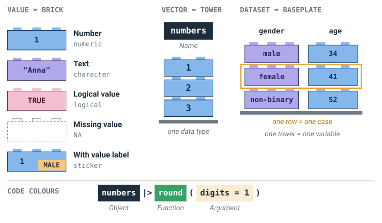
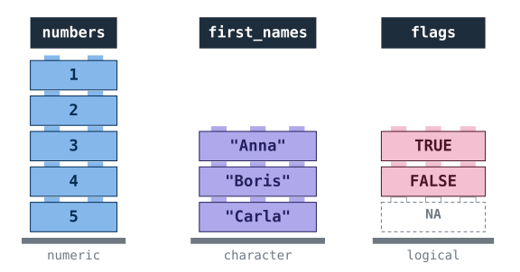
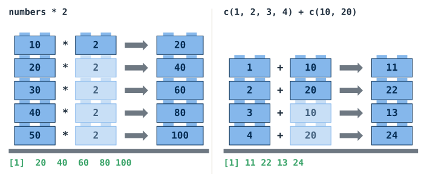
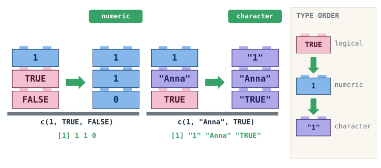
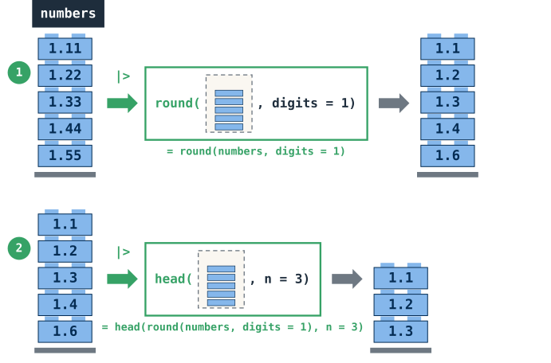
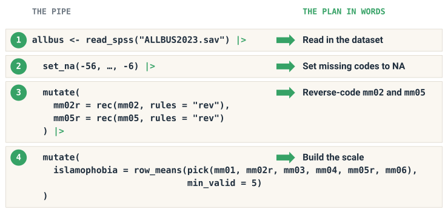

# The R programming language {#sec-r-grundlagen}

```{r setup-kap3, include=FALSE}
library(tidyverse)
library(mariposa)
source("R/_common_en.R")
```

## What this chapter is about

In Chapter 1 you set up RStudio, and in Chapter 2 you built your first Quarto document. Now you turn to the language in which you write everything in this book: R. Variables, functions, data types and the pipe operator are the building blocks you use in the following chapters to import, transform, analyse and visualise datasets.

SPSS syntax is essentially a command language with a fixed vocabulary. In R, you write functions yourself, build values into vectors and combine vectors into datasets. This takes a little effort at the start, and it pays off later: you use the same building blocks from your first steps through to your final thesis.

::: {.callout-note}
**Research journal: Where are you in your mini study?** You set up the IDE in @sec-rstudio and learned the reporting workflow in @sec-quarto. Now you learn the elements of the language that you will soon use to recode survey items, build scales and fit models. The examples in this chapter come from the social and political sciences on purpose. From @sec-datenimport onwards you apply the same operations to real variables from the German General Social Survey (ALLBUS).
:::

## What you will be able to do after this chapter {-}

- Create and name variables and assign values to them.
- Keep your code understandable for your future self with `#` comments.
- Call functions with arguments and understand what they return.
- Use arithmetic, comparison and logical operators (`==`, `&`, `%in%`, …).
- Distinguish the most important R data types: vector, factor, dataset (tibble), list.
- Handle missing values (`NA`) and exclude them from calculations.
- Read and write the native pipe operator `|>`.
- Explain the difference between `|>` and the older `%>%` from `magrittr`.
- Use pipes to structure code in a readable, linear way.

## Defining variables with `<-` {#sec-variablen}

A **variable** stores a value. In R, you assign values with the assignment arrow `<-`:

```{r var1}
var1 <- 2 * 4
var1
```

`var1` (left) is the variable name; `2 * 4` (right) is the expression whose result (`8`) is stored.

So R first calculates `2 * 4` and stores the result under the name `var1` in the `Environment` (@fig-name-inhalt). Wherever `var1` appears after that, R uses the value 8. In the figures, a value is a brick and a name is a dark name tag; @sec-datentypen explains this visual language.

{#fig-name-inhalt .lightbox fig-alt="On the left the code line var1 <- 2 * 4; var1 is dark and labelled Name, 2 * 4 is labelled Expression. An orange arrow leads to a box Environment with a dark name tag var1 next to a blue brick with 8. Below, the second code line var1 with the output [1] 8."}

If you put the assignment in brackets, R also prints the result in the console:

```{r var-paren}
(var2 <- 2 * 4)
```

::: {.callout-warning}
**Caution: `<-` instead of `=`.** You may know `=` as the assignment operator from other programming languages. R accepts it in many contexts, but the idiomatic operator is `<-`. The reason is that R uses `=` *inside* function calls for arguments (`mean(x = data)`). If you keep `<-` strictly for assignment and `=` for arguments, you avoid subtle errors.

Keyboard shortcut for `<-`: `option` + `-` (macOS) or `alt` + `-` (Windows/Linux).
:::

R runs code from top to bottom, line by line. What a variable contains therefore depends on which lines have run before:

```{r reihenfolge}
x <- 5
y <- x + 2
x <- 10
y
```

`y` is 7, although `x` is 10 at the end. In line 2, R calculates `x + 2` with the value that `x` has at that moment and stores the result 7 under `y`. R does not remember the calculation itself, so line 3 does not change `y` (@fig-reihenfolge). The chunks of a Quarto document also run from top to bottom when you render it.

{#fig-reihenfolge .lightbox fig-alt="On the left the chunk with the numbered lines 1 to 4: x <- 5, y <- x + 2, x <- 10, y, below it the output [1] 7. On the right three boxes. After line 1: name tag x with the blue brick 5. After line 2: x with 5 and y with 7. After line 3: x with 10, outlined in orange, and y still with 7."}

**Stop and think.** What value does `a` have after these three lines: `a <- 3`, `a <- a + 1`, `a <- a * 2`?

::: {.callout-tip title="Answer" collapse="true"}
```{r reihenfolge-loesung}
a <- 3
a <- a + 1
a <- a * 2
a
```

`a` is 3 at first, 4 after the second line and 8 after the third. To the right of the arrow, R calculates with the value that `a` has at that moment; on the left, it stores the result under the same name and so replaces the old value.
:::

### Variable names

A variable name must start with a letter and may then contain letters, numbers, dots (`.`) and underscores (`_`). Spaces are not allowed.

For readable code, social scientists usually follow one of two conventions:

1. `snake_case`: everything in lower case, words joined by underscores, as in `mean_age`. This is the tidyverse standard.
2. `camelCase`: the first word in lower case, each further word starting with a capital letter, as in `meanAge`. Common in Stata and JavaScript.

Choose one and stick to it. This book uses `snake_case`.

```{r names, eval=FALSE}
# Good
mean_age
factor_scale
islamophobia_scale

# Bad (inconsistent)
Mean.age
meanAge_new

# Not allowed (space)
mean age
```

### Comments with `#`

R ignores everything after a `#`. You use this to explain your code:

```{r kommentare}
# Sample size of the mini study
n_respondents <- 5246      # ALLBUS 2023, total
```

Comments help your future self (or reviewers) understand the code again three weeks from now. Use them to explain *why* you did something. You do not need to repeat what the code itself already says.

## Calling functions {#sec-funktionen}

> “Everything that exists is an object. Everything that happens is a function call.” — John Chambers

A function is a named tool that you pass **arguments** to and that returns a result. A generic function call looks like this:

```r
function_name(arg1 = value1, arg2 = value2, ...)
```

- `function_name`: what the function does.
- `arg1`, `arg2`: settings that control how it does its work.
- You can pass values by name (`arg1 = value1`) or by position.

Some arguments have **default values**: you do not need to specify them, because the most common value is already set.

```{r fn-basics}
seq(from = 1, to = 10, by = 2)   # by name
seq(1, 10, 2)                    # by position, same result
```

Both calls return the same five numbers. @fig-funktion shows the first one: the values of the three arguments go into `seq()`, and out come the numbers 1, 3, 5, 7 and 9. In the figures, functions are marked in green and arguments in orange.

{#fig-funktion .lightbox fig-alt="At the top three blue bricks 1, 10 and 2, labelled with the orange argument names from, to and by. An arrow leads into a green box seq(), another arrow to a tower of five blue bricks 1, 3, 5, 7 and 9. Below, the call as code blocks: seq in green, labelled Function; from = 1, to = 10 and by = 2 in orange, labelled Arguments; next to it the output [1] 1 3 5 7 9."}

If you have forgotten the arguments of a function, `?function_name` (for example `?seq`) opens its help page in RStudio. Inside the brackets, `Tab` opens a drop-down list of all arguments.

### Basic functions to start with: `c()`, `seq()` and `round()`

| Function              | What it does                                       |
|-----------------------|----------------------------------------------------|
| `c(...)`              | creates a vector from the arguments (*combine*)    |
| `seq(from, to, by)`   | creates a sequence                                 |
| `1:5`                 | regular sequence (1, 2, 3, 4, 5)                   |
| `rep(x, times, each)` | repeats `x`                                        |
| `head(x, n)`          | the first `n` elements                             |
| `tail(x, n)`          | the last `n` elements                              |
| `length(x)`           | number of elements                                 |
| `round(x, digits)`    | rounds numbers                                     |

```{r grundfunktionen}
numbers <- c(1, 2, 3, 4, 5, 6, 7, 8, 9, 10)
head(numbers, n = 3)
seq(from = 1, to = 10, by = 2)
rep(x = 0, times = 5)
round(c(1.222, 2.345, 3.987), digits = 1)
```

In the last line, `round()` receives two arguments (@fig-argumente). `x` is a required field: without `x`, `round()` does not know what to round. `digits` has the default value 0, so if you leave it out, `round()` rounds to whole numbers. Here you set `digits` to 1.

{#fig-argumente .lightbox fig-alt="On the left a tower of three blue bricks 1.222, 2.345 and 3.987. A green arrow leads to a form round(): the dashed field x, labelled required, takes the tower; the field digits contains 1, labelled default: 0. An arrow leads to the result, a tower of 1.2, 2.3 and 4.0. Below, the call round(c(1.222, 2.345, 3.987), digits = 1) and the output [1] 1.2 2.3 4.0."}

**Stop and think.** What do `round(digits = 1, x = 1.222)` and `round(1, 1.222)` return?

::: {.callout-tip title="Answer" collapse="true"}
```{r argumente-loesung}
round(digits = 1, x = 1.222)
round(1, 1.222)
```

With names, the order does not matter: R puts 1.222 into the field `x` and 1 into `digits`, and the result is 1.2. Without names, the position counts. In the second call, 1 ends up in the first field, `x`, and 1.222 in `digits`, so R rounds the number 1 and returns 1.
:::

## Operators {#sec-operatoren}

You will need three groups of operators again and again.

### Arithmetic operators `+`, `-`, `*`, `/`, `^` and `%%`

| Operator | What it does       |
|----------|--------------------|
| `+`      | addition           |
| `-`      | subtraction        |
| `*`      | multiplication     |
| `/`      | division           |
| `^`      | exponentiation     |
| `%%`     | modulo (remainder) |

### Comparison operators `==`, `!=`, `<`, `>` and `%in%`

They return a logical value, `TRUE` or `FALSE`.

| Operator      | What it does                |
|---------------|-----------------------------|
| `==`          | equal                       |
| `!=`          | not equal                   |
| `<`, `<=`     | less than (or equal)        |
| `>`, `>=`     | greater than (or equal)     |
| `%in%`        | contained in a set          |

::: {.callout-warning}
**Caution: `==` is not `=`.** For comparisons you always use `==` (a double equals sign). A single `=` is reserved for function arguments: `mean(x = data)` sets `x` and does not compare anything.
:::

### Logical operators `&`, `|` and `!`

They combine logical values.

| Operator | What it does |
|----------|--------------|
| `&`      | AND          |
| `|`      | OR           |
| `!`      | NOT          |

A small example:

```{r operators-demo}
age <- c(22, 45, 67, 18, 33)
age > 30
age >= 18 & age <= 65
age %in% c(22, 33, 44)
```

@fig-vergleich shows the third line brick by brick. `age >= 18` is `TRUE` for all five values, `age <= 65` for all except 67. `&` combines the two towers of logical values row by row and gives `TRUE` only where both bricks are `TRUE`.

{#fig-vergleich .lightbox fig-alt="On the left the name tag age above a tower of the blue bricks 22, 45, 67, 18 and 33. Next to it two pink towers: age >= 18 with TRUE five times and age <= 65 with TRUE, TRUE, FALSE, TRUE, TRUE. Between the two pink towers there is an & in each row, and an arrow leads from each row to the result tower TRUE, TRUE, FALSE, TRUE, TRUE. The row with 67 is outlined in orange. Below, the code age >= 18 & age <= 65 and the output [1] TRUE TRUE FALSE TRUE TRUE."}

You will need these operators all the time in Chapter 4, when you select cases with `filter()`.

## Objects and data types {#sec-datentypen}

In R, everything is an object: a value, a dataset, a statistical model, even a function. The following sections introduce the data types you need most for social science work.

To show you what R does with your data, the figures present data as building blocks (@fig-legende). A single value is a brick, and its colour shows the data type. Several bricks stacked on top of each other form a vector, that is, a tower; towers of equal height side by side on a baseplate form a dataset. An empty, dashed brick stands for a missing value, and a yellow sticker for a value label (@sec-datenimport). In the code, objects are dark, functions green and arguments orange.

{#fig-legende .lightbox fig-alt="Legend of the visual language. A blue brick with 1 stands for a number (numeric), a purple brick with “Anna” for text (character), a pink brick with TRUE for a logical value (logical), an empty dashed brick for a missing value (NA), and a blue brick with a yellow sticker MALE for a number with a value label. A tower of three blue bricks with the name tag numbers, labelled Name, is a vector. Two towers, gender and age, on a baseplate are a dataset; a marked row is a case, a tower is a variable. Below, code blocks: numbers dark as Object, round green as Function, digits = 1 orange as Argument."}

### Vectors and indexing with `[ ]`

A **vector** is a one-dimensional collection of values of the same data type. You will see three types most often:

```{r vectors}
numbers     <- c(1, 2, 3, 4, 5)              # numeric
first_names <- c("Anna", "Boris", "Carla")   # character
flags       <- c(TRUE, FALSE, NA)            # logical
```

@fig-turm shows the three vectors as towers. Each tower has only one colour, because a vector contains values of a single data type. The first value is at the top; the missing value in `flags` is an empty brick.

{#fig-turm .lightbox fig-alt="Three towers with name tags. numbers: five blue bricks with 1 to 5, below it numeric. first_names: three purple bricks with “Anna”, “Boris” and “Carla”, below it character. flags: two pink bricks TRUE and FALSE and an empty dashed brick NA, below it logical."}

::: {.callout-warning}
**Caution: Use `TRUE`/`FALSE` instead of `T`/`F`.** The short forms work, but they can be overwritten, which makes them error-prone in practice. Always write `TRUE` and `FALSE` in full.
:::

With indices you access individual elements:

```{r indexing}
numbers[1]      # first element
numbers[2:4]    # second to fourth
numbers[-1]     # all except the first
```

Instead of positions, you can also index with *conditions*. With this **Boolean indexing**, you pass a logical vector (`TRUE`/`FALSE`) of the same length, and R keeps only the `TRUE` positions:

```{r boolean-indexing}
numbers <- c(10, 20, 30, 40, 50)
numbers > 25                   # returns a TRUE/FALSE vector
numbers[numbers > 25]          # keeps only values > 25
numbers[!is.na(numbers)]       # keeps only non-NA values
```

`numbers > 25` gives a tower of logical values that is as tall as `numbers`. In `numbers[numbers > 25]`, R places it next to `numbers` like a stencil and keeps only the bricks next to a `TRUE` (@fig-index).

{#fig-index .lightbox fig-alt="On the left the name tag numbers above a tower of 10, 20, 30, 40 and 50; the bricks 10 and 20 are grey, the others blue. Next to it the pink tower numbers > 25 with FALSE, FALSE, TRUE, TRUE, TRUE. A green arrow leads to the result, a blue tower of 30, 40 and 50. Below, numbers > 25 with the output [1] FALSE FALSE TRUE TRUE TRUE and numbers[numbers > 25] with the output [1] 30 40 50."}

This logic is *exactly* what tidyverse functions such as `filter()` (Chapter 4) do internally. Once you are confident with it, you will understand `filter(allbus, age > 30)` straight away.

If you write `numbers * 2` in R, the operation is applied to *each element*, and you get `c(20, 40, 60, 80, 100)` back. This is called **vectorisation** and is one of R's most useful features. You hardly ever need to write a `for` loop to apply an operation to many values.

If you combine two vectors of different lengths, R silently *repeats* the shorter one (**recycling**):

```{r recycling}
c(1, 2, 3, 4) + c(10, 20)   # gives 11, 22, 13, 24, not 11, 22!
```

@fig-recycling shows which values R repeats: for `numbers * 2`, R uses the same 2 for each of the five bricks; for `c(1, 2, 3, 4) + c(10, 20)`, it uses 10 and 20 a second time.

{#fig-recycling .lightbox fig-alt="Two examples. On the left numbers * 2: a tower with 10, 20, 30, 40 and 50, next to it a * and a brick 2 in each row; the top 2 is bright blue, the four below are pale. Arrows lead to the result 20, 40, 60, 80, 100, below it the output [1] 20 40 60 80 100. On the right c(1, 2, 3, 4) + c(10, 20): the tower 1, 2, 3, 4, next to it a + in each row and the bricks 10 and 20, below them, pale, 10 and 20 again. The result is 11, 22, 13, 24, below it the output [1] 11 22 13 24."}

R does this on purpose, but it is a typical beginners' trap that leads to wrong results. If you are not sure, use `length()` to check that both vectors have the same length.

What happens if you mix different data types in `c()`? R then converts all values to a common type. This **coercion** happens without a warning:

```{r coercion}
c(1, TRUE, FALSE)
c(1, "Anna", TRUE)
```

In the first vector, `TRUE` becomes 1 and `FALSE` becomes 0; the result is numeric. In the second, everything becomes text, including the number and the logical value. R always chooses the type that can hold all values, in the order logical, numeric, character (@fig-rangfolge). It does not work the other way round: `"Anna"` cannot be converted into a number. Because every column of a dataset is a vector, each column also has exactly one data type.

{#fig-rangfolge .lightbox fig-alt="Two examples. On the left a mixed tower of 1, TRUE and FALSE; after an arrow a blue tower of 1, 1 and 0, labelled numeric, below it c(1, TRUE, FALSE) and the output [1] 1 1 0. On the right a mixed tower of 1, “Anna” and TRUE; after an arrow a purple tower of “1”, “Anna” and “TRUE”, labelled character, below it c(1, “Anna”, TRUE) and the output [1] “1” “Anna” “TRUE”. Next to it, under the heading Type order, the order from top to bottom: logical, arrow, numeric, arrow, character."}

**Stop and think.** What does `c(TRUE, "yes")` return, and what data type does the result have?

::: {.callout-tip title="Answer" collapse="true"}
```{r coercion-loesung}
c(TRUE, "yes")
```

Both values become text, `"TRUE"` and `"yes"`. The vector is character, because character comes after logical in the order.
:::

### Factors with `factor()`, `levels()` and `fct_relevel()`

A **factor** is a vector with a fixed set of categories, its **levels** (`levels`). You use factors for categorical variables such as gender or education. Why not simply use a character vector? There are three reasons:

1. Fixed order: for an education variable, you want *“low”* to come before *“high”*, even though alphabetically it is the other way round. Factors let you enforce the order.
2. Reference category for models: regressions need a *comparison category*, and factors provide it automatically (the first level).
3. Memory efficiency: instead of storing each entry as text, R internally keeps a small number for each value.

```{r factors}
gender <- factor(c("male", "female", "male", "non-binary"),
                 levels = c("male", "female", "non-binary"))
gender
levels(gender)
```

@fig-faktor shows what is inside `gender`: internally, R stores a number for each value, here 1, 2, 1, 3, and `levels` defines which category each number stands for. The first level, `male`, is the reference category.

{#fig-faktor .lightbox fig-alt="On the left the name tag gender above a purple tower of male, female, male and non-binary; next to it, labelled internal, a blue tower of 1, 2, 1 and 3. On the right a box levels(gender) with three rows: 1 male, 2 female, 3 non-binary; next to male a tag Reference. At the bottom of the box the output [1] “male” “female” “non-binary”. Below, the code gender <- factor(c(“male”, “female”, “male”, “non-binary”), levels = c(“male”, “female”, “non-binary”))."}

**Stop and think.** In which order are the levels of `factor(c("low", "high", "medium"))` if you leave out `levels`?

::: {.callout-tip title="Answer" collapse="true"}
```{r faktor-loesung}
factor(c("low", "high", "medium"))
```

Without `levels`, R sorts the levels alphabetically: `high`, `low`, `medium`. The reference category would then be `high`. You set the substantive order with `levels = c("low", "medium", "high")`.
:::

With `relevel()` (base R) or `forcats::fct_relevel()` (tidyverse) you change the order afterwards. `forcats` is part of the tidyverse and provides a whole set of tools for factors (`fct_recode()`, `fct_lump()`, `fct_reorder()`); you will need them for the graphics in Chapter 6 at the latest.

::: {.callout-note collapse="true"}
## Background: `haven_labelled` vs. factor

When you import data from SPSS (Chapter 4), you get columns of type `<haven_labelled>`. Such a column is a numeric vector that carries the labels as additional information; R does *not* treat it as a factor. With `to_label()` (mariposa) you convert it into a classic factor when you need one.
:::

### Datasets (tibbles) with `tibble()`, `$` and `[[ ]]`

A **tibble** is the tidyverse's modern form of the data frame: a table with rows (cases) and columns (variables). You create one with `tibble()`:

```{r tibble-create}
respondents <- tibble(
  gender = factor(c("male", "female", "male", "non-binary")),
  age    = c(34, 41, 28, 52)
)
respondents
```

A tibble is a baseplate with towers of equal height (@fig-tibble). Each column is a tower with one data type, and each row is a case, here one respondent.

{#fig-tibble .lightbox fig-alt="Baseplate with the name tag respondents, 4 × 2. Two towers: gender (fct) with the purple bricks male, female, male, non-binary and age (dbl) with the blue bricks 34, 41, 28, 52. The second row with female and 41 is outlined in orange: a row is a case, the second respondent, female, 41 years old. The tower age is outlined in green: a tower is a variable, respondents$age gives [1] 34 41 28 52."}

You access a single column with `$` or `[[]]`:

```{r tibble-access}
respondents$age
respondents[["age"]]
respondents[1, "age"]   # first row, column "age"
```

`$` and `[[ ]]` return the same column. The difference lies in how you use them:

- `$age` is more compact and ideal for the interactive console and for scripts.
- `[["age"]]` accepts the column name as a *string*. You need this when the column name is stored in a variable (`column <- "age"; respondents[[column]]`).

In practice, you import ready-made datasets from SPSS, Stata or Excel files (see Chapter 4). You need tibbles that you build yourself almost only for small demonstrations.

### Lists with `list()`

A **list** can hold objects of different types and different lengths. In R, the results of statistical analyses are usually lists: a regression result contains coefficients, residuals, model fit and so on. You will rarely need to create lists yourself, but you will often need to read them:

```{r list}
result <- list(
  coefficient = 0.42,
  p_value     = 0.001,
  conf_int    = c(0.31, 0.53),
  model       = "lm"
)
result$coefficient
result$conf_int[1]
```

A list is a box with compartments (@fig-liste). Each compartment has a name and can hold values of a different type and length. `result$conf_int[1]` accesses the value in two steps: `$conf_int` takes the tower out of its compartment, and `[1]` takes the first brick from that tower.

![The list `result` as a box with four compartments. `result$conf_int[1]` first takes the tower out of the compartment `conf_int` and then its first value.](Bilder/figuren/en/k03-liste.svg){#fig-liste .lightbox fig-alt="A dark name tag result above a box with four compartments: $coefficient with the blue brick 0.42, $p_value with 0.001, $conf_int with a tower of 0.31 and 0.53 outlined in green, $model with the purple brick “lm”. Step 1, $conf_int: an arrow leads to the tower of 0.31 and 0.53. Step 2, [1]: an arrow leads to the brick 0.31. Below, the code result$conf_int[1] and the output [1] 0.31."}

## Missing values: `NA`, `is.na()` and `na.rm` {#sec-na}

In real datasets, individual values are often missing: a respondent skipped a question, a measurement was invalid, someone refused to answer. R codes this with a special value: **`NA`** (*not available*).

```{r na-basic}
x <- c(1, 2, NA, 4, 5)
x
is.na(x)              # which elements are NA?
```

::: {.callout-note collapse="true"}
## Background: Several kinds of missing values

SPSS distinguishes *system-missing* (an empty field) from *user-missing* (for example “no answer” as the code `-9`). By default, R has only a generic `NA`. When you import an SPSS file, however, mariposa keeps the *user-missing* codes as tagged NA, so you can look up the reason a value is missing at any time. Chapter 4 has more on this.
:::

Calculations with `NA` give `NA`. This is intended: the mean of “1, 2, ?, 4, 5” is in fact unknown.

```{r na-arith}
NA + 1
mean(x)
```

To make functions such as `mean()` and `sd()` calculate a result anyway, you pass `na.rm = TRUE`:

```{r na-rm}
mean(x, na.rm = TRUE)
sum(x, na.rm = TRUE)
```

@fig-na shows the two calls to `mean()`. With the empty brick in the tower, `mean(x)` itself returns `NA`. With `na.rm = TRUE`, `mean()` leaves out the missing value and calculates with the remaining four: (1 + 2 + 4 + 5) / 4 = 3.

{#fig-na .lightbox fig-alt="On the left the tower x of five bricks: blue 1 and 2, an empty dashed brick NA, blue 4 and 5. An arrow leads to mean(x); the result is an empty brick NA with the output [1] NA. A second arrow leads to mean(x, na.rm = TRUE), with na.rm = TRUE marked in orange; the result is a blue brick 3 with the output [1] 3."}

::: {.callout-warning}
**Caution: `NA` as a result is not an error.** If `mean(data$age)` suddenly returns `NA`, R gives *no* error message. It simply goes on calculating and prints `NA`. Among beginners, this is the most common “my output looks strange” problem. Two checks help:

```{r na-diagnose, eval=FALSE}
sum(is.na(data$age))   # how many NAs does the variable have?
summary(data$age)      # shows "NA's: 47" at the bottom if there are any
```

The fix: add `na.rm = TRUE` to the calculation, or exclude the missing cases explicitly with `filter(!is.na(age))`.
:::

## Pipe operators {#sec-pipes}

R lets you nest functions inside each other, so that the output of one function becomes the input of the next:

```{r nested, eval=FALSE}
head(round(c(1.11, 1.22, 1.33, 1.44, 1.55), digits = 1), n = 3)
```

This works, but the more steps you nest, the harder the code is to read. You have to read it from the *inside out*, against the usual reading direction. The **pipe operator** solves this problem. A pipe chains function calls one after the other instead of nesting them. R has two variants; this book uses the *native* pipe `|>`.

### Native pipe `|>`

With the native pipe, you write the same pipeline step by step, from left to right instead of from the inside out:

```{r pipe-native}
numbers <- c(1.11, 1.22, 1.33, 1.44, 1.55)

numbers |>
  round(digits = 1) |>
  head(n = 3)
```

Read it like a sentence: “Take `numbers`, *then* round to 1 decimal place, *then* show the first 3.”

@fig-pipe shows what happens: the pipe puts the result on the left into the first field of the function on the right. `numbers` ends up in the first argument of `round()`, and the result of `round()` in the first argument of `head()`. The other arguments, `digits = 1` and `n = 3`, stay in the brackets.

{#fig-pipe .lightbox fig-alt="Two steps. Step 1: the tower numbers with 1.11, 1.22, 1.33, 1.44 and 1.55 moves through the pipe into the dashed first field of round( , digits = 1); below it is = round(numbers, digits = 1); the result is the tower 1.1, 1.2, 1.3, 1.4, 1.6. Step 2: this tower moves into the first field of head( , n = 3); below it is = head(round(numbers, digits = 1), n = 3); the result is the tower 1.1, 1.2, 1.3."}

**Stop and think.** How do you write `sqrt(sum(c(9, 16)))` as a pipe?

::: {.callout-tip title="Answer" collapse="true"}
```{r pipe-loesung}
c(9, 16) |> sum() |> sqrt()
```

Nested code is read from the inside out: first `c()`, then `sum()`, then `sqrt()`. With the pipe, the steps appear in exactly this order from left to right. 9 + 16 makes 25, and its square root is 5.
:::

The keyboard shortcut for the pipe is `cmd`/`ctrl` + `shift` + `M`. In RStudio, tick *Use native pipe operator* under `Tools` → `Global Options` → `Code` so that the shortcut inserts `|>` instead of `%>%`.

::: {.callout-note collapse="true"}
## Background: Passing the value to another argument

By default, `|>` passes the value as the first argument of the next function. If it should go somewhere *else*, you use the placeholder `_`, available since R 4.2. It must be used as a named argument:

```{r placeholder, eval=FALSE}
allbus |>
  lm(islamophobia ~ age, data = _)
```

Most tidyverse functions do not need this, because they take the dataset as their first argument anyway.
:::

### The older `%>%` from magrittr

You will see the pipe `%>%` (from the tidyverse package `magrittr`) everywhere in the R world: in tutorials, in Stack Overflow answers and inside many R packages. `%>%` and `|>` work almost identically:

```{r pipe-magrittr, eval=FALSE}
numbers %>%
  round(digits = 1) %>%
  head(n = 3)
```

Both work in tidyverse code and give the same results. This book uses `|>` throughout, because it is part of the language itself (no package needed) and slightly faster. If you see `%>%` in other people's code, that is no problem.

::: {.callout-note collapse="true"}
## Background: Where `%>%` is different

The magrittr pipe has a placeholder `.` that you can put in any position:
`x %>% lm(y ~ ., data = .)`. Here only the dot after `data =` is the placeholder; the dot in `y ~ .` belongs to the formula and stands for all other variables in the dataset. The native `_` must be named. With most tidyverse functions you do not need a placeholder, because the first argument is always the dataset.

`magrittr` also provides further operators: `%$%`, `%T>%` and `%<>%`. They used to be needed now and then (for example to pass pipes through plotting functions). This book does not use them *anywhere*; mariposa functions all take the data as their first argument and work well with pipes.
:::

### Pipes in practice

Here is an excerpt from the actual data preparation pipeline in Chapter 5 (@sec-pipeline). It shows what pipes are really useful for:

```{r real-pipe, eval=FALSE}
allbus <- read_spss("ALLBUS2023.sav") |>
  set_na(-56, -55, -54, -53, -51, -50, -42, -41,
         -33, -32, -15, -11, -10, -9, -8, -7, -6) |>
  mutate(
    mm02r = rec(mm02, rules = "rev"),
    mm05r = rec(mm05, rules = "rev")
  ) |>
  mutate(
    islamophobia = row_means(pick(mm01, mm02r, mm03, mm04, mm05r, mm06),
                             min_valid = 5)
  )
```

The pipe reads: read in the dataset → set the missing-value codes to `NA` → reverse-code `mm02` and `mm05` → build the scale. Without the pipe, this would be a nested expression that is hard to follow because you have to read it backwards.

In @fig-analyseplan, each step stands next to the lines of code that carry it out. From the second step onwards, each function receives the dataset from the step before through `|>`.

{#fig-analyseplan .lightbox fig-alt="Four numbered steps. 1: allbus <- read_spss(“ALLBUS2023.sav”) |>, on the right Read in the dataset. 2: set_na(-56, …, -6) |>, on the right Set missing codes to NA. 3: mutate( mm02r = rec(mm02, rules = “rev”), mm05r = rec(mm05, rules = “rev”) ) |>, on the right Reverse-code mm02 and mm05. 4: mutate( islamophobia = row_means(pick(mm01, mm02r, mm03, mm04, mm05r, mm06), min_valid = 5) ), on the right Build the scale. The pipe symbols |> are green."}

## Three typical beginner mistakes {#sec-top-fehler}

Before you work through the exercises, here are three pitfalls that almost everyone runs into at some point. If you know them, you save yourself hours of frustration at the start:

| Mistake                                         | Symptom                                              | Fix                                                    |
| :---------------------------------------------- | :--------------------------------------------------- | :----------------------------------------------------- |
| `var = 5` instead of `var <- 5`                 | seems to work, but breaks in function arguments      | Always use `<-` for assignment (shortcut: `option`/`alt` + `-`) |
| `T` / `F` instead of `TRUE` / `FALSE`           | works until someone sets `T <- 1`                    | Always write them in full                              |
| `mean(x)` returns `NA` for no apparent reason   | the variable has missing values                      | `mean(x, na.rm = TRUE)`, or check `sum(is.na(x))` first |

::: {.callout-warning}
**Caution: Typographic quotation marks.** If you copy code from Word or PowerPoint, straight quotation marks (`"`) turn into typographic ones (`“` or `”`). R treats them as a syntax error. If you get the error message *“unexpected input”* or *“unexpected string constant”*, check the quotation marks.
:::

## Exercises {-}

::: {.callout-note title="Exercise 1 · Variables and vectors · Reproduction"}
Create a vector with the numbers 10 to 20, round each number to one decimal place (even if it is already a whole number) and calculate the mean. Write this once nested and once with a pipe.
:::

::: {.callout-tip title="Solution" collapse="true"}
```{r ex1-kap3-loesung, eval=FALSE}
# Nested
mean(round(10:20, digits = 1))

# With a pipe
10:20 |>
  round(digits = 1) |>
  mean()
```
:::

::: {.callout-note title="Exercise 2 · Building a tibble · Reproduction"}
Create a tibble with two variables: `id` (1 to 5) and `value` (random numbers; `runif(5, 0, 10)` is one option). Then access the third row.
:::

::: {.callout-tip title="Solution" collapse="true"}
```{r ex2-kap3-loesung, eval=FALSE}
demo <- tibble(
  id    = 1:5,
  value = runif(5, 0, 10)
)
demo
demo[3, ]
```
:::

::: {.callout-note title="Exercise 3 · Factor and reference category · Reproduction"}
Build a factor `education` with the levels `"low"`, `"medium"`, `"high"`. Set `"medium"` as the reference category. Hint: `levels = ` sets the order in `factor()`.
:::

::: {.callout-tip title="Solution" collapse="true"}
```{r ex3-kap3-loesung, eval=FALSE}
education <- factor(c("high", "low", "medium", "medium", "high"),
                    levels = c("medium", "low", "high"))
levels(education)
```
:::

::: {.callout-note title="Exercise 4 · Operators and NA with typical survey data · Transfer"}
Imagine you have run a small survey on *trust in the Bundestag*, the German federal parliament (0 = no trust, 10 = complete trust), with seven respondents: `trust <- c(3, 8, NA, 7, 5, NA, 9)`. (NA = “no answer”.) Determine (a) the mean without missing values, (b) how many respondents reported high trust (> 5), (c) whether at least one person skipped the question.
:::

::: {.callout-tip title="Solution" collapse="true"}
```{r ex4-kap3-loesung, eval=FALSE}
trust <- c(3, 8, NA, 7, 5, NA, 9)
mean(trust, na.rm = TRUE)            # (a)
sum(trust > 5, na.rm = TRUE)         # (b) TRUE counts as 1
any(is.na(trust))                    # (c)
```
:::

::: {.callout-note title="Exercise 5 · Pipeline on a survey vector · Mini research question"}
In the trust exercise you have just calculated individual statistics. Now write *one* pipeline: filter out all `NA` values, keep only values ≥ 5 (high trust) and calculate the mean. Write the solution both nested and with a pipe. Which version do you find easier to read?

Imagine you later applied the same pipeline to the ALLBUS vector `pt03` (trust in the Bundestag, about 5000 cases). The code would be the same.
:::

::: {.callout-tip title="Solution" collapse="true"}
```{r ex5-kap3-loesung, eval=FALSE}
trust <- c(3, 8, NA, 7, 5, NA, 9)

# Nested
mean(trust[!is.na(trust) & trust >= 5])

# With a pipe (easier to read)
trust[!is.na(trust) & trust >= 5] |>
  mean()
```

*Looking ahead:* In the following chapters you carry out exactly these operations with tidyverse verbs (`filter()`, `summarise()`), and the `|>` pipe stays the same.
:::

## What you know now {-}

- You assign values to variables with `<-` and know the `snake_case` convention.
- You comment code with `#` for your future self and for reviewers.
- You call functions with named arguments and look up help with `?`.
- You use arithmetic, comparison and logical operators, including `%in%`.
- You recognise and create vectors, factors, tibbles and lists.
- You handle `NA` with confidence and use `na.rm = TRUE` in calculation functions.
- You use the native pipe `|>` for readable, linear code.
- You understand how it differs from `%>%` and know that `|>` is the current standard.

In the next chapter you work with real data from ALLBUS 2023.

## Further reading {-}

- Hadley Wickham, [Advanced R](https://adv-r.hadley.nz/), *the* reference on R as a programming language.
- [The Tidyverse Style Guide](https://style.tidyverse.org/), conventions for readable tidyverse code.
- Bruno Rodrigues, [Modern R with the Tidyverse](https://b-rodrigues.github.io/modern_R/), a free online course on the tidyverse as a programming environment.
