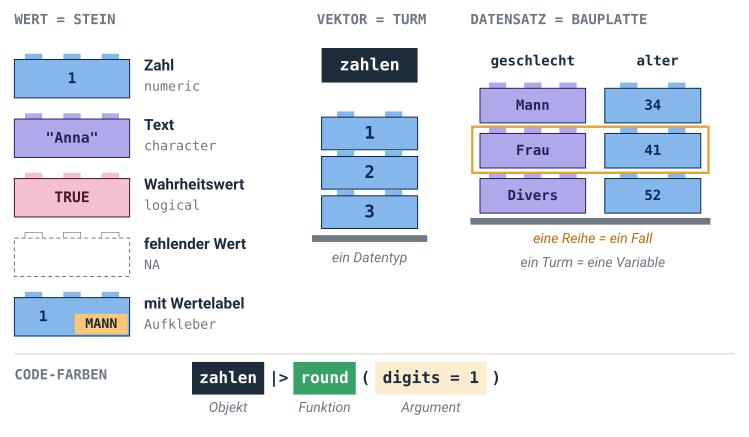
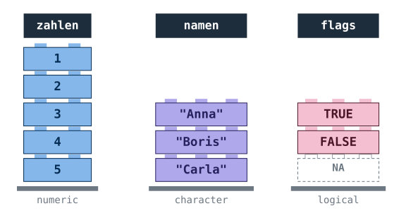
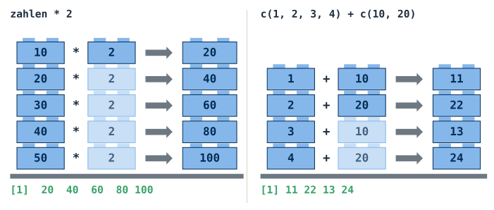
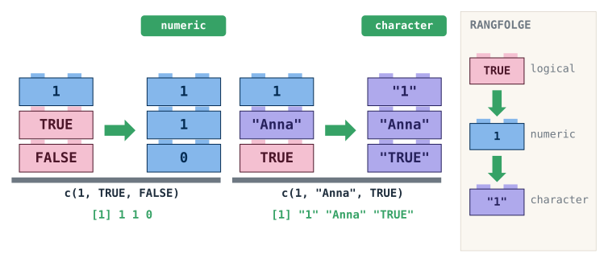
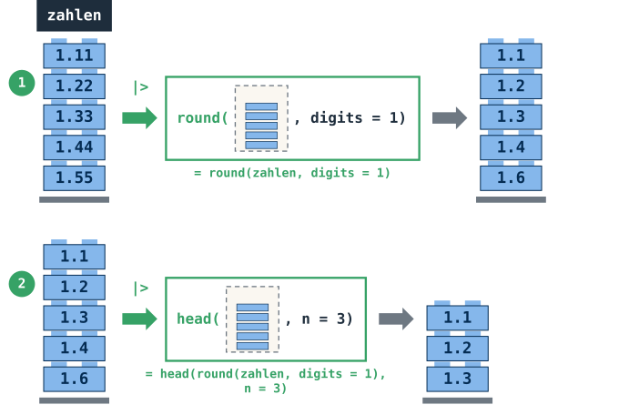
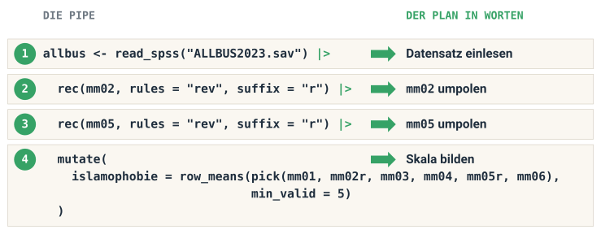

# Programmiersprache R {#sec-r-grundlagen}

```{r setup-kap3, include=FALSE}
library(tidyverse)
library(mariposa)
source("R/_common.R")
```

## Worum es geht

In Kap. 1 hast du RStudio eingerichtet, in Kap. 2 dein erstes Quarto-Dokument gebaut. Jetzt geht es an die Sprache, in der du in diesem Buch alles formulierst: **R**. Variablen, Funktionen, Datentypen und der Pipe-Operator sind die Bausteine, mit denen du in den folgenden Kapiteln Datensätze einliest, transformierst, analysierst und visualisierst.

Anders als die SPSS-Syntax — die im Kern eine Befehlssprache mit festem Vokabular ist — schreibst du in R selbst Funktionen, baust Werte zu Vektoren, kombinierst sie zu Datensätzen. Diese kleine Hürde am Anfang zahlt sich später aus: dieselben Bausteine tragen dich vom Einstieg bis zur Bachelorarbeit.

::: {.callout-note}
**Forschungsjournal: Wo stehst du in deiner Mini-Studie?** Du hast in @sec-rstudio die IDE eingerichtet und in @sec-quarto den Berichts-Workflow verstanden. Jetzt lernst du die Sprachelemente, mit denen du gleich Survey-Items rekodierst, Skalen baust und Modelle rechnest. Beispiele in diesem Kapitel sind bewusst sozial- und politikwissenschaftlich gewählt — du wirst dieselben Operationen ab @sec-datenimport auf echte ALLBUS-Variablen anwenden.
:::

## Was du nach diesem Kapitel kannst {-}

- Variablen anlegen, benennen und Werte zuweisen.
- Code mit `#`-Kommentaren für dein zukünftiges Ich verständlich halten.
- Funktionen mit Argumenten aufrufen und verstehen, was sie zurückgeben.
- Arithmetische, Vergleichs- und Logik-Operatoren (`==`, `&`, `%in%`, …) einsetzen.
- Die wichtigsten R-Datentypen unterscheiden: Vektor, Faktor, Datensatz (Tibble), Liste.
- Mit fehlenden Werten (`NA`) umgehen und sie aus Berechnungen ausschließen.
- Den **nativen Pipe-Operator** `|>` lesen und schreiben.
- Den Unterschied zwischen `|>` und dem älteren `%>%` aus `magrittr` einordnen.
- Code mit Pipes lesbar und linear strukturieren.

## Variablen definieren mit `<-` {#sec-variablen}

Eine **Variable** speichert einen Wert. In R weist du Werte über den Zuweisungspfeil `<-` zu:

```{r var1}
var1 <- 2 * 4
var1
```

`var1` (links) ist der Variablenname; `2 * 4` (rechts) der Ausdruck, dessen Ergebnis (`8`) gespeichert wird.

R rechnet also zuerst `2 * 4` aus und legt das Ergebnis unter dem Namen `var1` im `Environment` ab (@fig-name-inhalt). Wo danach `var1` steht, setzt R den Wert 8 ein. In den Abbildungen ist ein Wert ein Stein und ein Name ein dunkles Schild; mehr zu dieser Bildsprache in @sec-datentypen.

{#fig-name-inhalt .lightbox fig-alt="Links die Code-Zeile var1 <- 2 * 4; var1 ist dunkel markiert und mit Name beschriftet, 2 * 4 mit Ausdruck. Ein orangefarbener Pfeil führt zu einem Kasten Environment mit einem dunklen Namensschild var1 neben einem blauen Stein mit 8. Darunter die zweite Code-Zeile var1 mit der Ausgabe [1] 8."}

Wenn du die Zuweisung in runde Klammern setzt, wird das Ergebnis gleichzeitig in der Konsole angezeigt:

```{r var-paren}
(var2 <- 2 * 4)
```

::: {.callout-warning}
**Vorsicht: `<-` statt `=`.** Aus anderen Programmiersprachen kennst du `=` als Zuweisungsoperator. R akzeptiert es in vielen Kontexten, der idiomatische Operator ist aber `<-`. Grund: `=` wird in R *innerhalb* von Funktionsaufrufen für Argumente verwendet (`mean(x = data)`). Wenn du `<-` für Zuweisung und `=` für Argumente strikt trennst, vermeidest du subtile Fehler.

Tastenkürzel für `<-`: `option` + `-` (macOS) bzw. `alt` + `-` (Windows/Linux).
:::

R führt Code von oben nach unten aus, Zeile für Zeile. Was in einer Variablen steht, hängt deshalb davon ab, welche Zeilen vorher gelaufen sind:

```{r reihenfolge}
x <- 5
y <- x + 2
x <- 10
y
```

`y` ist 7, obwohl `x` am Ende 10 ist. In Zeile 2 rechnet R `x + 2` mit dem Wert, den `x` in diesem Moment hat, und legt das Ergebnis 7 unter `y` ab. Die Rechnung selbst merkt sich R nicht, darum ändert Zeile 3 nichts an `y` (@fig-reihenfolge). Auch die Chunks eines Quarto-Dokuments laufen beim Rendern von oben nach unten.

{#fig-reihenfolge .lightbox fig-alt="Links der Chunk mit den nummerierten Zeilen 1 bis 4: x <- 5, y <- x + 2, x <- 10, y, darunter die Ausgabe [1] 7. Rechts drei Kästen. Nach Zeile 1: Namensschild x mit dem blauen Stein 5. Nach Zeile 2: x mit 5 und y mit 7. Nach Zeile 3: x mit 10, orange umrandet, und y weiterhin mit 7."}

**Kurz überlegen.** Welchen Wert hat `a` nach diesen drei Zeilen: `a <- 3`, `a <- a + 1`, `a <- a * 2`?

::: {.callout-tip title="Auflösung" collapse="true"}
```{r reihenfolge-loesung}
a <- 3
a <- a + 1
a <- a * 2
a
```

`a` ist erst 3, nach der zweiten Zeile 4 und nach der dritten 8. Rechts vom Pfeil rechnet R mit dem Wert, den `a` gerade hat; links legt es das Ergebnis unter demselben Namen ab und ersetzt damit den alten Wert.
:::

### Variablennamen

Eine Variable muss mit einem Buchstaben beginnen und darf danach Buchstaben, Zahlen, Punkte (`.`) und Unterstriche (`_`) enthalten. Leerzeichen sind nicht erlaubt.

Für lesbaren Code halten sich Sozialwissenschaftler:innen meist an eine von zwei Konventionen:

1. **`snake_case`** — alles klein, Worte mit Unterstrich verbunden: `mittelwert_alter`. Tidyverse-Standard.
2. **`camelCase`** — erstes Wort klein, weitere groß beginnend: `mittelwertAlter`. Verbreitet im Stata- und JavaScript-Umfeld.

Wähle eine und bleibe konsequent. In diesem Buch nutzen wir `snake_case`.

```{r names, eval=FALSE}
# Gut
mittelwert_alter
faktor_skala
islamophobie_skala

# Schlecht (inkonsistent)
Mittelwert.alter
mittelwertAlter_neu

# Verboten (Leerzeichen)
mittelwert alter
```

### Kommentare mit `#`

Alles, was hinter einem `#` steht, wird von R ignoriert — du nutzt das, um deinen Code zu erklären:

```{r kommentare}
# Stichprobengröße der Mini-Studie
n_befragte <- 5246      # ALLBUS 2023, gesamt
```

Kommentare sind das, was deinem zukünftigen Ich (oder Reviewer:innen) den Code in drei Wochen wieder verständlich macht. Schreibe sie für die Frage *Warum?* — nicht für das, was der Code ohnehin schon sagt.

## Funktionen aufrufen {#sec-funktionen}

> „Everything that exists is an object. Everything that happens is a function call." — John Chambers

Eine Funktion ist ein benanntes Werkzeug, dem du **Argumente** übergibst und das ein **Ergebnis** zurückgibt. Eine generische Funktion sieht so aus:

```r
funktionsname(arg1 = wert1, arg2 = wert2, ...)
```

- `funktionsname` — was die Funktion macht.
- `arg1`, `arg2` — wie sie ihre Arbeit konfiguriert.
- Werte können explizit benannt (`arg1 = wert1`) oder positional übergeben werden.

Einige Argumente haben **Default-Werte**: sie müssen nicht angegeben werden, weil der häufigste Wert voreingestellt ist.

```{r fn-basics}
seq(from = 1, to = 10, by = 2)   # explizit
seq(1, 10, 2)                    # positional, identisch
```

Beide Aufrufe geben dieselben fünf Zahlen zurück. @fig-funktion zeigt den ersten: Die Werte der drei Argumente gehen in `seq()`, heraus kommen die Zahlen 1, 3, 5, 7 und 9. In den Abbildungen sind Funktionen grün und Argumente orange markiert.

{#fig-funktion .lightbox fig-alt="Oben drei blaue Steine 1, 10 und 2, darüber die orangefarbenen Argumentnamen from, to und by. Ein Pfeil führt in einen grünen Kasten seq(), ein weiterer Pfeil zu einem Turm aus fünf blauen Steinen 1, 3, 5, 7 und 9. Darunter der Aufruf als Code-Bausteine: seq grün, beschriftet Funktion; from = 1, to = 10 und by = 2 orange, beschriftet Argumente; daneben die Ausgabe [1] 1 3 5 7 9."}

::: {.callout-tip}
**Tipp: `?funktion`.** Wenn du die Argumente einer Funktion vergessen hast, gibt `?funktion` (z. B. `?seq`) die Hilfe in RStudio aus. Innerhalb der Klammern öffnet `Tab` ein Dropdown mit allen Argumenten.
:::

### Grundfunktionen für den Einstieg: `c()`, `seq()` und `round()`

| Funktion              | Wirkung                                            |
|-----------------------|----------------------------------------------------|
| `c(...)`              | erzeugt einen Vektor aus den Argumenten (*combine*)|
| `seq(from, to, by)`   | erzeugt eine Sequenz                               |
| `1:5`                 | reguläre Sequenz (1, 2, 3, 4, 5)                   |
| `rep(x, times, each)` | wiederholt `x`                                     |
| `head(x, n)`          | die ersten `n` Elemente                            |
| `tail(x, n)`          | die letzten `n` Elemente                           |
| `length(x)`           | Anzahl der Elemente                                |
| `round(x, digits)`    | rundet Zahlen                                      |

```{r grundfunktionen}
zahlen <- c(1, 2, 3, 4, 5, 6, 7, 8, 9, 10)
head(zahlen, n = 3)
seq(from = 1, to = 10, by = 2)
rep(x = 0, times = 5)
round(c(1.222, 2.345, 3.987), digits = 1)
```

In der letzten Zeile bekommt `round()` zwei Argumente (@fig-argumente). `x` ist ein Pflichtfeld: Ohne `x` weiß `round()` nicht, was es runden soll. `digits` hat den Default-Wert 0; ohne Angabe rundet `round()` also auf ganze Zahlen. Hier setzt du `digits` auf 1.

{#fig-argumente .lightbox fig-alt="Links ein Turm aus drei blauen Steinen 1.222, 2.345 und 3.987. Ein grüner Pfeil führt zu einem Formular round(): Das gestrichelte Feld x, beschriftet Pflichtfeld, nimmt den Turm auf; das Feld digits enthält 1, beschriftet vorausgefüllt mit 0. Ein Pfeil führt zum Ergebnis, einem Turm aus 1.2, 2.3 und 4.0. Darunter der Aufruf round(c(1.222, 2.345, 3.987), digits = 1) und die Ausgabe [1] 1.2 2.3 4.0."}

**Kurz überlegen.** Was geben `round(digits = 1, x = 1.222)` und `round(1, 1.222)` aus?

::: {.callout-tip title="Auflösung" collapse="true"}
```{r argumente-loesung}
round(digits = 1, x = 1.222)
round(1, 1.222)
```

Mit Namen ist die Reihenfolge egal: R setzt 1.222 in das Feld `x` und 1 in `digits`, das Ergebnis ist 1.2. Ohne Namen zählt die Position. Im zweiten Aufruf landet 1 im ersten Feld `x` und 1.222 in `digits`; R rundet also die Zahl 1 und gibt 1 zurück.
:::

## Operatoren {#sec-operatoren}

Drei Gruppen von Operatoren brauchst du immer wieder.

### Arithmetische Operatoren `+`, `-`, `*`, `/`, `^` und `%%`

| Operator | Wirkung           |
|----------|-------------------|
| `+`      | Addition          |
| `-`      | Subtraktion       |
| `*`      | Multiplikation    |
| `/`      | Division          |
| `^`      | Potenzieren       |
| `%%`     | Modulo (Rest)     |

### Vergleichsoperatoren `==`, `!=`, `<`, `>` und `%in%`

Sie geben einen logischen Wert `TRUE`/`FALSE` zurück.

| Operator      | Wirkung                |
|---------------|------------------------|
| `==`          | gleich                 |
| `!=`          | ungleich               |
| `<`, `<=`     | kleiner (gleich)       |
| `>`, `>=`     | größer (gleich)        |
| `%in%`        | enthalten in Menge     |

::: {.callout-warning}
**Vorsicht: `==` ist nicht `=`.** Für Vergleiche verwendest du immer `==` (doppeltes Gleichheitszeichen). Einzelnes `=` ist für Funktionsargumente reserviert — `mean(x = data)` setzt `x`, vergleicht aber nichts.
:::

### Logische Operatoren `&`, `|` und `!`

Sie verknüpfen Wahrheitswerte.

| Operator | Wirkung |
|----------|---------|
| `&`      | UND     |
| `|`      | ODER    |
| `!`      | NICHT   |

Ein kleines Beispiel:

```{r operators-demo}
alter <- c(22, 45, 67, 18, 33)
alter > 30
alter >= 18 & alter <= 65
alter %in% c(22, 33, 44)
```

@fig-vergleich zeigt die dritte Zeile Stein für Stein. `alter >= 18` ist für alle fünf Werte `TRUE`, `alter <= 65` für alle außer 67. `&` verknüpft die beiden Wahrheitstürme Reihe für Reihe und ergibt nur dort `TRUE`, wo beide Steine `TRUE` sind.

{#fig-vergleich .lightbox fig-alt="Links das Namensschild alter über einem Turm aus den blauen Steinen 22, 45, 67, 18 und 33. Daneben zwei rosa Türme: alter >= 18 mit fünfmal TRUE und alter <= 65 mit TRUE, TRUE, FALSE, TRUE, TRUE. Zwischen den beiden rosa Türmen steht in jeder Reihe ein &, ein Pfeil führt jeweils zum Ergebnisturm TRUE, TRUE, FALSE, TRUE, TRUE. Die Reihe mit 67 ist orange umrandet. Darunter der Code alter >= 18 & alter <= 65 und die Ausgabe [1] TRUE TRUE FALSE TRUE TRUE."}

Diese Operatoren wirst du in Kap. 4 ständig brauchen, wenn du Fälle mit `filter()` auswählst.

## Objekte und Datentypen {#sec-datentypen}

In R ist **alles ein Objekt** — ein Wert, ein Datensatz, ein statistisches Modell, sogar eine Funktion. Die wichtigsten Datentypen für sozialwissenschaftliche Arbeit stellen die folgenden Abschnitte vor.

::: {.callout-note}
**Hintergrund: Die Bildsprache dieses Buchs.** Damit du siehst, was R mit deinen Daten macht, zeigen die Abbildungen Daten als Bausteine (@fig-legende). Ein einzelner Wert ist ein Stein, seine Farbe zeigt den Datentyp. Mehrere Steine übereinander sind ein Vektor, also ein Turm; gleich hohe Türme nebeneinander auf einer Bauplatte sind ein Datensatz. Ein leerer, gestrichelter Stein steht für einen fehlenden Wert, ein gelber Aufkleber für ein Wertelabel (@sec-datenimport). Im Code sind Objekte dunkel, Funktionen grün und Argumente orange markiert.

{#fig-legende .lightbox fig-alt="Legende der Bildsprache. Ein blauer Stein mit 1 steht für eine Zahl (numeric), ein lila Stein mit „Anna“ für Text (character), ein rosa Stein mit TRUE für einen Wahrheitswert (logical), ein leerer gestrichelter Stein für einen fehlenden Wert (NA), ein blauer Stein mit gelbem Aufkleber MANN für eine Zahl mit Wertelabel. Ein Turm aus drei blauen Steinen mit dem Namensschild zahlen, beschriftet Name, ist ein Vektor. Zwei Türme geschlecht und alter auf einer Bauplatte sind ein Datensatz; eine markierte Reihe ist ein Fall, ein Turm eine Variable. Darunter Code-Bausteine: zahlen dunkel als Objekt, round grün als Funktion, digits = 1 orange als Argument."}
:::

### Vektoren und Indizierung mit `[ ]`

Ein **Vektor** ist eine eindimensionale Sammlung gleicher Datentypen. Drei Typen wirst du am häufigsten sehen:

```{r vectors}
zahlen <- c(1, 2, 3, 4, 5)              # numeric
namen  <- c("Anna", "Boris", "Carla")   # character
flags  <- c(TRUE, FALSE, NA)            # logical
```

@fig-turm zeigt die drei Vektoren als Türme. Jeder Turm hat nur eine Farbe, denn ein Vektor enthält Werte eines einzigen Datentyps. Der erste Wert steht oben; der fehlende Wert in `flags` ist ein leerer Stein.

{#fig-turm .lightbox fig-alt="Drei Türme mit Namensschildern. zahlen: fünf blaue Steine mit 1 bis 5, darunter numeric. namen: drei lila Steine mit „Anna“, „Boris“ und „Carla“, darunter character. flags: zwei rosa Steine TRUE und FALSE und ein leerer gestrichelter Stein NA, darunter logical."}

::: {.callout-warning}
**Vorsicht: `TRUE`/`FALSE` schreiben, nicht `T`/`F`.** Die Kurzschreibweisen funktionieren — sind aber überschreibbar, deshalb in der Praxis fehleranfällig. Schreibe immer `TRUE` und `FALSE` aus.
:::

Mit Indizes greifst du auf einzelne Elemente zu:

```{r indexing}
zahlen[1]      # erstes Element
zahlen[2:4]    # zweites bis viertes
zahlen[-1]     # alle ausser dem ersten
```

**Boolesche Indizierung — der Schlüssel zu allem, was später kommt.** Statt mit Position kannst du auch mit *Bedingungen* indizieren — du übergibst einen logischen Vektor (`TRUE`/`FALSE`) gleicher Länge, und R behält nur die `TRUE`-Positionen:

```{r boolean-indexing}
zahlen <- c(10, 20, 30, 40, 50)
zahlen > 25                  # gibt TRUE/FALSE-Vektor zurück
zahlen[zahlen > 25]          # behält nur Werte > 25
zahlen[!is.na(zahlen)]       # behält nur Nicht-NA-Werte
```

`zahlen > 25` ergibt einen Turm aus Wahrheitswerten, der so hoch ist wie `zahlen`. In `zahlen[zahlen > 25]` legt R ihn wie eine Schablone neben `zahlen` und behält nur die Steine, neben denen `TRUE` steht (@fig-index).

{#fig-index .lightbox fig-alt="Links das Namensschild zahlen über einem Turm aus 10, 20, 30, 40 und 50; die Steine 10 und 20 sind grau, die übrigen blau. Daneben der rosa Turm zahlen > 25 mit FALSE, FALSE, TRUE, TRUE, TRUE. Ein grüner Pfeil führt zum Ergebnis, einem blauen Turm aus 30, 40 und 50. Darunter zahlen > 25 mit der Ausgabe [1] FALSE FALSE TRUE TRUE TRUE und zahlen[zahlen > 25] mit der Ausgabe [1] 30 40 50."}

Diese Logik ist *exakt* das, was tidyverse-Funktionen wie `filter()` (Kap. 4) intern machen. Wer hier sicher ist, versteht `filter(allbus, age > 30)` sofort.

::: {.callout-note}
**Konzept: Vektorisierung.** Wenn du in R `zahlen * 2` schreibst, wird die Operation auf *jedes Element* angewendet — du bekommst `c(20, 40, 60, 80, 100)` zurück. Das nennt sich **Vektorisierung** und ist eines der Power-Features von R. Du musst fast nie eine `for`-Schleife schreiben, um eine Operation auf vielen Werten auszuführen.

**Recycling als Falle.** Wenn zwei Vektoren unterschiedlicher Länge kombiniert werden, *wiederholt* R den kürzeren stillschweigend:

```{r recycling}
c(1, 2, 3, 4) + c(10, 20)   # ergibt 11, 22, 13, 24 — nicht 11, 22!
```

@fig-recycling zeigt, welche Werte R wiederholt: Bei `zahlen * 2` nimmt R dieselbe 2 für jeden der fünf Steine, bei `c(1, 2, 3, 4) + c(10, 20)` nimmt es 10 und 20 ein zweites Mal.

{#fig-recycling .lightbox fig-alt="Zwei Beispiele. Links zahlen * 2: der Turm zahlen mit 10, 20, 30, 40 und 50, daneben in jeder Reihe ein * und ein Stein 2; die oberste 2 ist kräftig blau, die vier darunter sind blass. Pfeile führen zum Ergebnis 20, 40, 60, 80, 100, darunter die Ausgabe [1] 20 40 60 80 100. Rechts c(1, 2, 3, 4) + c(10, 20): der Turm 1, 2, 3, 4, daneben in jeder Reihe ein + und die Steine 10 und 20, darunter blass noch einmal 10 und 20. Das Ergebnis ist 11, 22, 13, 24, darunter die Ausgabe [1] 11 22 13 24."}

Das ist absichtliches Verhalten — und genau die Anfänger:innen-Falle, die zu falschen Ergebnissen führt. Wenn du dir nicht sicher bist, prüfe mit `length()`, dass beide Vektoren gleich lang sind.
:::

**Gemischte Datentypen.** Was passiert, wenn du in `c()` verschiedene Datentypen mischst? R wandelt dann alle Werte in einen gemeinsamen Typ um. Diese **Typumwandlung** (englisch *coercion*) geschieht ohne Warnung:

```{r coercion}
c(1, TRUE, FALSE)
c(1, "Anna", TRUE)
```

Im ersten Vektor wird `TRUE` zu 1 und `FALSE` zu 0; das Ergebnis ist numeric. Im zweiten wird alles zu Text, auch die Zahl und der Wahrheitswert. R wählt immer den Typ, der alle Werte aufnehmen kann, in der Rangfolge logical, numeric, character (@fig-rangfolge). Umgekehrt geht das nicht: `"Anna"` lässt sich in keine Zahl umwandeln. Weil jede Spalte eines Datensatzes ein Vektor ist, hat auch sie genau einen Datentyp.

{#fig-rangfolge .lightbox fig-alt="Zwei Beispiele. Links ein gemischter Turm aus 1, TRUE und FALSE; nach einem Pfeil ein blauer Turm aus 1, 1 und 0, beschriftet numeric, darunter c(1, TRUE, FALSE) und die Ausgabe [1] 1 1 0. Rechts ein gemischter Turm aus 1, „Anna“ und TRUE; nach einem Pfeil ein lila Turm aus „1“, „Anna“ und „TRUE“, beschriftet character, darunter die Ausgabe [1] „1“ „Anna“ „TRUE“. Daneben die Rangfolge von oben nach unten: logical, Pfeil, numeric, Pfeil, character."}

**Kurz überlegen.** Was ergibt `c(TRUE, "ja")`, und welchen Datentyp hat das Ergebnis?

::: {.callout-tip title="Auflösung" collapse="true"}
```{r coercion-loesung}
c(TRUE, "ja")
```

Beide Werte werden zu Text, `"TRUE"` und `"ja"`. Der Vektor ist character, weil character in der Rangfolge nach logical kommt.
:::

### Faktoren mit `factor()`, `levels()` und `fct_relevel()`

Ein **Faktor** ist ein Vektor mit definierten **Ausprägungen** (`levels`) — für kategoriale Variablen wie Geschlecht oder Bildung. Warum nicht einfach ein Character-Vektor? Drei Gründe:

1. **Feste Reihenfolge.** Bei einer Bildungs-Variable willst du, dass *„niedrig"* vor *„hoch"* steht — auch wenn alphabetisch das Gegenteil gilt. Faktoren erlauben dir, die Reihenfolge zu erzwingen.
2. **Referenzkategorie für Modelle.** Regressionen brauchen eine *Vergleichs-Kategorie*; Faktoren liefern sie automatisch (= die erste Ausprägung).
3. **Speichereffizienz.** Statt jeden Eintrag als Text zu speichern, hält R intern eine kleine Zahl pro Wert.

```{r factors}
geschlecht <- factor(c("Mann", "Frau", "Mann", "Divers"),
                     levels = c("Mann", "Frau", "Divers"))
geschlecht
levels(geschlecht)
```

@fig-faktor zeigt, was in `geschlecht` steckt: Intern speichert R für jeden Wert eine Zahl, hier 1, 2, 1, 3, und `levels` legt fest, für welche Ausprägung jede Zahl steht. Die erste Stufe, `Mann`, ist die Referenzkategorie.

{#fig-faktor .lightbox fig-alt="Links das Namensschild geschlecht über einem lila Turm aus Mann, Frau, Mann und Divers; daneben, mit intern beschriftet, ein blauer Turm aus 1, 2, 1 und 3. Rechts ein Kasten levels(geschlecht) mit drei Reihen: 1 Mann, 2 Frau, 3 Divers; neben Mann ein Schild Referenz. Im Kasten unten die Ausgabe [1] „Mann“ „Frau“ „Divers“. Darunter der Code geschlecht <- factor(c(„Mann“, „Frau“, „Mann“, „Divers“), levels = c(„Mann“, „Frau“, „Divers“))."}

**Kurz überlegen.** In welcher Reihenfolge stehen die Stufen von `factor(c("niedrig", "hoch", "mittel"))`, wenn du `levels` weglässt?

::: {.callout-tip title="Auflösung" collapse="true"}
```{r faktor-loesung}
factor(c("niedrig", "hoch", "mittel"))
```

Ohne `levels` sortiert R die Stufen alphabetisch: `hoch`, `mittel`, `niedrig`. Referenzkategorie wäre damit `hoch`. Die inhaltliche Reihenfolge legst du mit `levels = c("niedrig", "mittel", "hoch")` fest.
:::

Mit `relevel()` (Base R) oder `forcats::fct_relevel()` (tidyverse) änderst du die Reihenfolge nachträglich. `forcats` ist Teil des tidyverse und liefert ein ganzes Set an Faktor-Werkzeugen (`fct_recode()`, `fct_lump()`, `fct_reorder()`) — du brauchst sie spätestens bei Grafiken in Kap. 6.

::: {.callout-note}
**Hintergrund: `haven_labelled` vs. Faktor.** Wenn du Daten aus SPSS einliest (Kap. 4), bekommst du Spalten vom Typ `<haven_labelled>`. Das ist *kein* Faktor — sondern ein numerischer Vektor mit Labels als Begleitinformation. Mit `to_label()` (mariposa) wandelst du sie bei Bedarf in einen klassischen Faktor.
:::

### Datensätze (Tibbles) mit `tibble()`, `$` und `[[ ]]`

Ein **Tibble** ist die moderne Form des Data Frames im tidyverse — eine Tabelle mit Zeilen (Fälle) und Spalten (Variablen). Du baust es mit `tibble()`:

```{r tibble-create}
befragte <- tibble(
  geschlecht = factor(c("Mann", "Frau", "Mann", "Divers")),
  alter      = c(34, 41, 28, 52)
)
befragte
```

Ein Tibble ist eine Bauplatte mit gleich hohen Türmen (@fig-tibble). Jede Spalte ist ein Turm mit einem Datentyp, jede Reihe ein Fall, hier eine befragte Person.

{#fig-tibble .lightbox fig-alt="Bauplatte mit dem Namensschild befragte, 4 × 2. Zwei Türme: geschlecht (fct) mit den lila Steinen Mann, Frau, Mann, Divers und alter (dbl) mit den blauen Steinen 34, 41, 28, 52. Die zweite Reihe mit Frau und 41 ist orange umrandet: eine Reihe ist ein Fall. Der Turm alter ist grün umrandet: Ein Turm ist eine Variable, befragte$alter ergibt [1] 34 41 28 52."}

Auf eine einzelne Spalte greifst du mit `$` oder `[[]]` zu:

```{r tibble-access}
befragte$alter
befragte[["alter"]]
befragte[1, "alter"]   # erste Zeile, Spalte "alter"
```

**Faustregel `$` vs. `[[ ]]`.** Beide geben dieselbe Spalte zurück — der Unterschied ist die Bedienung:

- **`$alter`** ist kompakter, ideal für interaktive Konsole und Skripte.
- **`[["alter"]]`** akzeptiert den Spaltennamen als *String* — unverzichtbar, wenn der Spaltenname in einer Variable steckt (`spalte <- "alter"; befragte[[spalte]]`).

In der Praxis liest du Datensätze fertig aus SPSS-, Stata- oder Excel-Dateien ein (siehe Kap. 4). Selbst-gebaute Tibbles brauchst du fast nur für kleine Demonstrationen.

### Listen mit `list()`

Eine **Liste** kann verschiedene Objekttypen unterschiedlicher Länge sammeln. Ergebnisse statistischer Analysen sind in R meistens Listen — ein Regressionsergebnis enthält Koeffizienten, Residuen, Modellgüte usw. Du musst sie selten selbst erstellen, aber regelmäßig lesen können:

```{r list}
ergebnis <- list(
  koeffizient = 0.42,
  p_wert      = 0.001,
  konfidenz   = c(0.31, 0.53),
  modell      = "lm"
)
ergebnis$koeffizient
ergebnis$konfidenz[1]
```

Eine Liste ist eine Kiste mit Fächern (@fig-liste). Jedes Fach hat einen Namen und kann Werte eines anderen Typs und einer anderen Länge enthalten. `ergebnis$konfidenz[1]` greift in zwei Schritten zu: `$konfidenz` nimmt den Turm aus seinem Fach, `[1]` davon den ersten Stein.

![Die Liste `ergebnis` als Kiste mit vier Fächern. `ergebnis$konfidenz[1]` holt erst den Turm aus dem Fach `konfidenz` und davon den ersten Wert.](Bilder/figuren/k03-liste.svg){#fig-liste .lightbox fig-alt="Ein dunkles Namensschild ergebnis über einer Kiste mit vier Fächern: $koeffizient mit dem blauen Stein 0.42, $p_wert mit 0.001, $konfidenz mit einem grün umrandeten Turm aus 0.31 und 0.53, $modell mit dem lila Stein „lm“. Schritt 1, $konfidenz: Ein Pfeil führt zum Turm aus 0.31 und 0.53. Schritt 2, [1]: Ein Pfeil führt zum Stein 0.31. Darunter der Code ergebnis$konfidenz[1] und die Ausgabe [1] 0.31."}

## Fehlende Werte: `NA`, `is.na()` und `na.rm` {#sec-na}

In echten Datensätzen fehlen oft einzelne Werte — eine Befragte hat eine Frage übersprungen, ein Messwert war ungültig, eine Auskunft wurde verweigert. R kodiert das mit einem speziellen Wert: **`NA`** (*Not Available*).

```{r na-basic}
x <- c(1, 2, NA, 4, 5)
x
is.na(x)              # welche Elemente sind NA?
```

**Rechnungen mit `NA` ergeben `NA`.** Das ist Absicht: der Mittelwert von „1, 2, ?, 4, 5" ist eigentlich unbekannt.

```{r na-arith}
NA + 1
mean(x)
```

Damit Funktionen wie `mean()`, `sd()` & Co. trotzdem rechnen, übergibst du `na.rm = TRUE`:

```{r na-rm}
mean(x, na.rm = TRUE)
sum(x, na.rm = TRUE)
```

@fig-na zeigt die beiden Aufrufe von `mean()`. Mit dem leeren Stein im Turm gibt `mean(x)` selbst `NA` zurück. Mit `na.rm = TRUE` lässt `mean()` den fehlenden Wert weg und rechnet mit den übrigen vier: (1 + 2 + 4 + 5) / 4 = 3.

{#fig-na .lightbox fig-alt="Links der Turm x aus fünf Steinen: blau 1 und 2, ein leerer gestrichelter Stein NA, blau 4 und 5. Ein Pfeil führt zu mean(x); das Ergebnis ist ein leerer Stein NA mit der Ausgabe [1] NA. Ein zweiter Pfeil führt zu mean(x, na.rm = TRUE), na.rm = TRUE orange markiert; das Ergebnis ist ein blauer Stein 3 mit der Ausgabe [1] 3."}

::: {.callout-warning}
**Vorsicht: `NA` als Ergebnis ist kein Fehler.** Wenn `mean(daten$age)` plötzlich `NA` zurückgibt, hat R *keine* Fehlermeldung — es rechnet brav weiter und gibt `NA` aus. Das ist der häufigste „mein Output sieht komisch aus"-Fehler bei Anfänger:innen. Zwei Diagnosen helfen:

```{r na-diagnose, eval=FALSE}
sum(is.na(daten$age))   # wie viele NAs hat die Variable?
summary(daten$age)      # zeigt unten "NA's: 47" wenn vorhanden
```

Heilmittel: `na.rm = TRUE` an die Berechnung, oder die fehlenden Fälle gezielt mit `filter(!is.na(age))` ausschließen.
:::

::: {.callout-note}
**Hintergrund: Mehrere Arten von Missing.** SPSS unterscheidet *system-missing* (leeres Feld) von *user-missing* (z. B. „keine Angabe" als Code `-9`). In R gibt es per Default nur ein generisches `NA` — beim SPSS-Import behält mariposa die *user-missing*-Codes aber als **tagged NA**, sodass du den Grund des Fehlens jederzeit nachschauen kannst. Mehr dazu in Kap. 4.
:::

## Pipe-Operatoren {#sec-pipes}

R erlaubt es, Funktionen ineinander zu verschachteln — der Output einer Funktion wird zum Input der nächsten:

```{r nested, eval=FALSE}
head(round(c(1.11, 1.22, 1.33, 1.44, 1.55), digits = 1), n = 3)
```

Das funktioniert, aber je mehr Schritte du verschachtelst, desto schwerer wird der Code zu lesen — du musst ihn von *innen nach außen* lesen, was unserer natürlichen Leserichtung widerspricht. Für genau dieses Problem gibt es eine elegante Lösung: den **Pipe-Operator**. Ein Pipe verkettet Funktionsaufrufe linear, statt sie zu verschachteln. R kennt zwei Varianten — wir nutzen die *native* Pipe `|>`.

### Native Pipe `|>`

Mit der nativen Pipe schreibst du dieselbe Pipeline linear — von links nach rechts statt von innen nach außen:

```{r pipe-native}
zahlen <- c(1.11, 1.22, 1.33, 1.44, 1.55)

zahlen |>
  round(digits = 1) |>
  head(n = 3)
```

Lies das wie einen Satz: „Nimm `zahlen`, **dann** runde auf 1 Nachkommastelle, **dann** zeige die ersten 3."

@fig-pipe zeigt, was dabei passiert: Die Pipe setzt das Ergebnis links in das erste Feld der Funktion rechts. `zahlen` landet im ersten Argument von `round()`, das Ergebnis von `round()` im ersten Argument von `head()`. Die übrigen Argumente, `digits = 1` und `n = 3`, bleiben in der Klammer.

{#fig-pipe .lightbox fig-alt="Zwei Schritte. Schritt 1: Der Turm zahlen mit 1.11, 1.22, 1.33, 1.44 und 1.55 wandert über die Pipe in das gestrichelte erste Feld von round( , digits = 1); darunter steht = round(zahlen, digits = 1); das Ergebnis ist der Turm 1.1, 1.2, 1.3, 1.4, 1.6. Schritt 2: Dieser Turm wandert in das erste Feld von head( , n = 3); darunter steht = head(round(zahlen, digits = 1), n = 3); das Ergebnis ist der Turm 1.1, 1.2, 1.3."}

**Kurz überlegen.** Wie schreibst du `sqrt(sum(c(9, 16)))` als Pipe?

::: {.callout-tip title="Auflösung" collapse="true"}
```{r pipe-loesung}
c(9, 16) |> sum() |> sqrt()
```

Verschachtelt liest du von innen nach außen: erst `c()`, dann `sum()`, dann `sqrt()`. Mit der Pipe stehen die Schritte in genau dieser Reihenfolge von links nach rechts. 9 + 16 ergibt 25, die Wurzel daraus 5.
:::

**Tastenkürzel:** `cmd`/`strg` + `shift` + `M`. Stelle in RStudio unter `Tools` → `Global Options` → `Code` → *Use native pipe operator* die Option ein, damit das Shortcut `|>` statt `%>%` einfügt.

::: {.callout-note}
**Hintergrund: Wert nicht ans erste Argument?** Standardmäßig übergibt `|>` den Wert als **erstes Argument** der nächsten Funktion. Wenn er an eine *andere* Stelle gehen soll, nutzt du seit R 4.2 den Platzhalter `_` — er muss als benanntes Argument stehen:

```{r placeholder, eval=FALSE}
allbus |>
  lm(islamophobie ~ age, data = _)
```

Bei den meisten Tidyverse-Funktionen brauchst du das nicht — sie nehmen den Datensatz ohnehin als erstes Argument.
:::

### Das ältere `%>%` aus magrittr

Du wirst in der R-Welt überall den Pipe `%>%` (aus dem tidyverse-Paket `magrittr`) sehen — in Tutorials, in Stack-Overflow-Antworten, in vielen R-Paketen intern. `%>%` und `|>` sind funktional fast identisch:

```{r pipe-magrittr, eval=FALSE}
zahlen %>%
  round(digits = 1) %>%
  head(n = 3)
```

Beide funktionieren in tidyverse-Code, beide liefern dieselben Ergebnisse. Wir nutzen in diesem Buch durchgängig `|>`, weil er Teil der Sprache selbst ist (kein Paket nötig) und ein klein wenig schneller — aber wenn du in fremdem Code `%>%` siehst, ist das kein Problem.

::: {.callout-note}
**Hintergrund: Wo `%>%` etwas anders ist.** Der magrittr-Pipe hat einen Platzhalter `.`, der überall positionierbar ist:
`x %>% lm(y ~ ., data = .)`. Platzhalter ist hier nur der Punkt hinter `data =`; der Punkt in `y ~ .` gehört zur Formel und steht für alle übrigen Variablen im Datensatz. Der native `_` muss benannt sein. Bei den meisten Tidyverse-Funktionen brauchst du den Platzhalter nicht — das erste Argument ist immer der Datensatz.
:::

::: {.callout-warning}
**Verschwundene Operatoren.** `%$%`, `%T>%`, `%<>%` aus `magrittr` waren früher gelegentlich nötig (z. B. um Pipes durch Plotting-Funktionen zu führen). In diesem Buch brauchen wir sie *nirgends* — mariposa-Funktionen sind durchgehend data-first und pipe-freundlich.
:::

### Pipes in der Praxis

Hier ein Ausschnitt der echten Datenpräp-Pipeline aus Kap. 5 (@sec-pipeline), der zeigt, wofür Pipes wirklich nützlich sind:

```{r real-pipe, eval=FALSE}
allbus <- read_spss("ALLBUS2023.sav") |>
  mutate(
    mm02r = rec(mm02, rules = "rev"),
    mm05r = rec(mm05, rules = "rev")
  ) |>
  mutate(
    islamophobie = row_means(pick(mm01, mm02r, mm03, mm04, mm05r, mm06),
                             min_valid = 5)
  )
```

Du liest: Datensatz einlesen → `mm02` und `mm05` umpolen → Skala bilden. Ohne Pipe wäre das ein verschachteltes Etwas, das du nur mit Mühe rückwärts lesen könntest.

In @fig-analyseplan steht jeder Schritt neben den Code-Zeilen, die ihn ausführen. Ab dem zweiten Schritt bekommt jede Funktion über `|>` den Datensatz aus dem Schritt davor.

{#fig-analyseplan .lightbox fig-alt="Drei nummerierte Schritte. 1: allbus <- read_spss(„ALLBUS2023.sav“) |>, rechts Datensatz einlesen. 2: mutate( mm02r = rec(mm02, rules = „rev“), mm05r = rec(mm05, rules = „rev“) ) |>, rechts mm02 und mm05 umpolen. 3: mutate( islamophobie = row_means(pick(mm01, mm02r, mm03, mm04, mm05r, mm06), min_valid = 5) ), rechts Skala bilden. Die Pipe-Zeichen |> sind grün."}

## Drei typische Anfänger:innen-Fehler {#sec-top-fehler}

Bevor du die Übungen rechnest — drei Stolpersteine, die fast alle einmal treffen. Wenn du sie kennst, sparst du dir die ersten Stunden Frust:

| Fehler                                          | Symptom                                              | Heilmittel                                             |
| :---------------------------------------------- | :--------------------------------------------------- | :----------------------------------------------------- |
| `var = 5` statt `var <- 5`                      | scheinbar funktioniert, aber kaputt in Funktionsargumenten | Konsequent `<-` für Zuweisung (Shortcut: `option`/`alt` + `-`) |
| `T` / `F` statt `TRUE` / `FALSE`                | funktioniert — bis jemand `T <- 1` setzt              | Immer ausschreiben                                     |
| `mean(x)` gibt `NA` zurück, scheinbar grundlos  | Variable hat fehlende Werte                          | `mean(x, na.rm = TRUE)` oder vorher `sum(is.na(x))` prüfen |

::: {.callout-tip}
**Anführungszeichen-Falle.** Wenn du Code aus Word oder Powerpoint kopierst, werden gerade Anführungszeichen (`"`) zu typografischen (`"`/`"`). R sieht das als Syntaxfehler. Bei der Fehlermeldung *„unexpected input"* oder *„unexpected string constant"* — Anführungszeichen prüfen.
:::

## Übungen {-}

::: {.callout-note title="Übung 1 · Variablen und Vektoren · Reproduktion"}
Erstelle einen Vektor mit den Zahlen 10 bis 20, runde jede Zahl auf eine Dezimalstelle (auch wenn schon ganzzahlig), berechne den Mittelwert. Schreibe das einmal verschachtelt und einmal mit Pipe.
:::

::: {.callout-tip title="Lösung" collapse="true"}
```{r ex1-kap3-loesung, eval=FALSE}
# Verschachtelt
mean(round(10:20, digits = 1))

# Mit Pipe
10:20 |>
  round(digits = 1) |>
  mean()
```
:::

::: {.callout-note title="Übung 2 · Tibble basteln · Reproduktion"}
Erzeuge ein Tibble mit zwei Variablen: `id` (1 bis 5) und `wert` (zufällige Zahlen — `runif(5, 0, 10)` ist eine Möglichkeit). Greife danach auf die dritte Zeile zu.
:::

::: {.callout-tip title="Lösung" collapse="true"}
```{r ex2-kap3-loesung, eval=FALSE}
demo <- tibble(
  id   = 1:5,
  wert = runif(5, 0, 10)
)
demo
demo[3, ]
```
:::

::: {.callout-note title="Übung 3 · Faktor und Referenzkategorie · Reproduktion"}
Baue einen Faktor `bildung` mit den Ausprägungen `"niedrig"`, `"mittel"`, `"hoch"`. Setze `"mittel"` als Referenzkategorie. Tipp: `levels = ` setzt die Reihenfolge bei `factor()`.
:::

::: {.callout-tip title="Lösung" collapse="true"}
```{r ex3-kap3-loesung, eval=FALSE}
bildung <- factor(c("hoch", "niedrig", "mittel", "mittel", "hoch"),
                  levels = c("mittel", "niedrig", "hoch"))
levels(bildung)
```
:::

::: {.callout-note title="Übung 4 · Operatoren und NA mit Survey-typischen Daten · Transfer"}
Stell dir vor, du hast eine kleine Umfrage zu *Vertrauen in den Bundestag* (0 = kein Vertrauen, 10 = volles Vertrauen) bei sieben Befragten gemacht: `vertrauen <- c(3, 8, NA, 7, 5, NA, 9)`. (NA = „keine Angabe".) Bestimme (a) den Mittelwert ohne fehlende Werte, (b) wie viele Befragte hohes Vertrauen (> 5) angegeben haben, (c) ob mindestens eine Person die Frage übersprungen hat.
:::

::: {.callout-tip title="Lösung" collapse="true"}
```{r ex4-kap3-loesung, eval=FALSE}
vertrauen <- c(3, 8, NA, 7, 5, NA, 9)
mean(vertrauen, na.rm = TRUE)            # (a)
sum(vertrauen > 5, na.rm = TRUE)         # (b) TRUE zählt als 1
any(is.na(vertrauen))                    # (c)
```
:::

::: {.callout-note title="Übung 5 · Pipe-Pipeline auf Survey-Vektor · Mini-Forschungsfrage"}
Du hast in der Vertrauens-Übung gerade einzelne Kennwerte berechnet. Schreibe nun in *einer* Pipeline: filtere alle `NA`-Werte heraus, behalte nur Werte ≥ 5 (hohes Vertrauen), berechne den Mittelwert. Schreibe die Lösung sowohl verschachtelt als auch mit Pipe — welche Version findest du lesbarer?

Stelle dir vor, du würdest später dieselbe Pipeline auf den ALLBUS-Vektor `pt03` (Vertrauen in den Bundestag, ~5.000 Fälle) anwenden — der Code wäre derselbe.
:::

::: {.callout-tip title="Lösung" collapse="true"}
```{r ex5-kap3-loesung, eval=FALSE}
vertrauen <- c(3, 8, NA, 7, 5, NA, 9)

# Verschachtelt
mean(vertrauen[!is.na(vertrauen) & vertrauen >= 5])

# Mit Pipe (lesbarer)
vertrauen[!is.na(vertrauen) & vertrauen >= 5] |>
  mean()
```

*Anschluss:* In den folgenden Kapiteln rufst du genau diese Operationen mit tidyverse-Verben (`filter()`, `summarise()`) auf — die `|>`-Pipe bleibt dieselbe.
:::

## Was du jetzt weißt {-}

- Du weist Werte mit `<-` Variablen zu und kennst die Konvention `snake_case`.
- Du kommentierst Code mit `#` für dein zukünftiges Ich und Reviewer:innen.
- Du rufst Funktionen mit benannten Argumenten auf und schlägst Hilfe mit `?` nach.
- Du nutzt arithmetische, Vergleichs- und Logik-Operatoren — inklusive `%in%`.
- Du erkennst und erstellst Vektoren, Faktoren, Tibbles und Listen.
- Du gehst sicher mit `NA` um und nutzt `na.rm = TRUE` in Berechnungsfunktionen.
- Du nutzt den nativen Pipe `|>` für lesbaren, linearen Code.
- Du verstehst den Unterschied zu `%>%` und weißt, dass `|>` der heutige Standard ist.

Im nächsten Kapitel arbeiten wir mit echten Daten: dem ALLBUS 2023.

## Weiterführend {-}

- Hadley Wickham, [Advanced R](https://adv-r.hadley.nz/) — *die* Referenz zu R als Programmiersprache.
- [The Tidyverse Style Guide](https://style.tidyverse.org/) — Konventionen für gut lesbaren tidyverse-Code.
- Bruno Rodrigues, [Modern R with the Tidyverse](https://b-rodrigues.github.io/modern_R/) — freier Online-Kurs zum tidyverse als Programmierumgebung.
