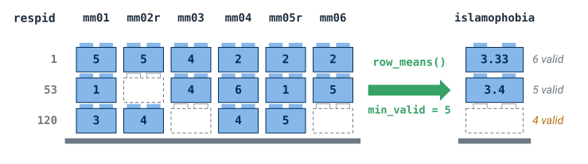

# Transforming data and building scales {#sec-datentransformation}

```{r setup-kap5, include=FALSE}
library(tidyverse)
library(mariposa)
source("R/_common_en.R")
allbus <- read_spss("ALLBUS2023.sav") |>
  set_na(-56, -55, -54, -53, -51, -50, -42, -41,
         -33, -32, -15, -11, -10, -9, -8, -7, -6)
```

> *How do six individual items become a measurable attitude?*

In @sec-datenimport you imported the dataset, found variables and declared missing values. This chapter is about what quantitative social research calls **operationalisation**: an abstract idea (“Islamophobia”) becomes concrete variables that you can calculate with.

::: {.callout-note}
**Research journal: Where are you in your mini study?** You have the raw data. Now you build what will become your *dependent variable*. Building the scales is the central methodological step: it decides whether your models in the later chapters rest on something stable. At the end of this chapter you have `islamophobia` and `populism` as clean variables.
:::

## What this chapter is about

If you ask someone directly, *“Are you Islamophobic?”*, you will almost always get a no, even from people who say in election surveys that they vote for right-wing populist parties and who make clearly exclusionary statements in discussions. There are two reasons for this. First, nobody wants to describe themselves publicly as “Islamophobic”, because the term has negative connotations. Second, attitudes are not as clear-cut as a yes or a no. Someone can find *some* aspects of a religion problematic and others not, and is therefore *a little* sceptical of Islam without accepting the whole label.

Social research solves this problem with an old trick: instead of asking about the construct directly, it asks about several concrete statements that capture the construct indirectly. In place of “Are you Islamophobic?”, it asks for agreement with statements such as:

> *“I think the practice of Islam in Germany should be restricted.”*

and

> *“Islam fits into our society.”*

and

> *“The presence of Muslims leads to conflicts.”*

Together, six such **items** give a picture of how a person views the Muslim population in Germany. From the answers you calculate a single scale score that is more robust and more nuanced than any single answer.

Quantitative social research calls this step from an abstract construct to a measurable variable operationalisation. It is the methodological core of every empirical study: you can only test a theory against data once you have translated it into measurable quantities.

This chapter takes you from the six raw items to the finished scale in five steps:

1. Create new variables (`mutate()`), for example derive a new quantity from two existing variables.
2. Conditional logic (`case_when()`, `if_else()`): define new categories (“anyone under 30 counts as young”).
3. Recoding (`rec()`), the central operation: change values, merge categories, reverse the direction of items (reverse coding).
4. Building scales (`row_means()`): one mean per respondent from several items.
5. Making scales comparable (`pomps()`): put scales with different ranges on a common 0–100 basis.

At the end of the chapter you have built and documented the two scales of the mini study: Islamophobia (`islamophobia`, 1–7) and populism (`populism`, 1–5). With these, you start the analysis in @sec-univbivar.

## What you will be able to do after this chapter {-}

- Create new variables with `mutate()`.
- Write conditional logic with `case_when()`, `recode_values()` and `if_else()`.
- Compute subgroup aggregates with `summarise(.by = ...)`.
- Recode variables with `rec()` inside `mutate()`, from simple recoding through `"dicho"`/`"quart"` to reverse coding.
- Create dummy variables for regressions with `to_dummy()`.
- Standardise (`std()`) and centre (`center()`) variables.
- Combine two datasets with `left_join()`, for example individual data and context data.
- Reshape datasets between wide and long format with `pivot_longer()` and `pivot_wider()`.
- Build a mean scale from several items with `row_means()` and a controlled `min_valid`.
- Put scales with different ranges on a common 0–100 scale with `pomps()`.
- Follow the complete data preparation pipeline of the mini study and apply it to your own constructs.

## Transforming data

A handful of functions from `dplyr` covers most data transformations:

| Function                       | Effect                                                 |
| ------------------------------ | ------------------------------------------------------ |
| `mutate()`                     | Create or change variables (SPSS: `COMPUTE`)           |
| `case_when()` / `recode_values()` | Vectorised conditional logic (SPSS: `IF`)           |
| `if_else()`                    | Short form for conditions with two outcomes            |
| `summarise()`                  | Summaries per group (SPSS: `AGGREGATE`)                |
| `group_by()`                   | Grouping for the operations that follow                |
| `distinct()`                   | Unique values of a variable                            |
| `rename()`                     | Rename variables                                       |

### New variables with `mutate()` and `across()`

`mutate()` is the R counterpart of `COMPUTE` in SPSS. You give the tibble one or more assignments of the form *“new column name = expression”*, and mariposa/dplyr adds the new column(s) to the tibble. Note that `mutate()` returns the *whole* tibble, so you need to assign the result (`allbus <- allbus |> mutate(...)`) if the new column is to be kept. Without an assignment, the change is printed once and then disappears.

```{r mutate}
allbus |>
  select(age) |>
  mutate(birth_year = 2023 - age) |>
  head(3)
```

`mutate()` computes the new column row by row: for the first respondent 2023 − 50 = 1973, for the second 2023 − 51 = 1972 (@fig-mutate). The new tower `birth_year` is a number without value labels (`<dbl>`).

{#fig-mutate .lightbox fig-alt="At the top the code allbus |> select(age) |> mutate(birth_year = 2023 - age) |> head(3). Below it a baseplate with two towers: on the left age, dbl+lbl, with the bricks 50, 51 and 69; on the right the tower birth_year, dbl, outlined in green, with 1973, 1972 and 1954, labelled new tower. Between the towers, each row shows the calculation 2023 - 50, 2023 - 51 and 2023 - 69 with an arrow to the result."}

The chunk above has no `allbus <-`. R prints the result with `birth_year`, but `allbus` itself keeps its 579 columns (@fig-zuweisung). Only `allbus <- allbus |> mutate(...)` saves the new tower in `allbus`; the dataset then has 580 columns.

{#fig-zuweisung .lightbox fig-alt="Two halves. On the left, under WITHOUT <-, the code allbus |> mutate(birth_year = 2023 - age); below it the baseplate allbus, 5,246 × 579, with the tower age with 50, 51 and 69, an ellipsis and a grey tower birth_year with 1973, 1972 and 1954, labelled shown only. On the right, under WITH <-, the code allbus <- allbus |> mutate(birth_year = 2023 - age); below it the same baseplate with 5,246 × 580; the tower birth_year is blue, outlined in green and labelled saved."}

**Stop and think.** You write `allbus_new <- allbus |> mutate(birth_year = 2023 - age)`. How many columns do `allbus` and `allbus_new` have afterwards?

::: {.callout-tip title="Answer" collapse="true"}
```{r zuweisung-loesung}
allbus_new <- allbus |> mutate(birth_year = 2023 - age)
ncol(allbus)
ncol(allbus_new)
```

R saves the result under the name to the left of the arrow. `allbus_new` has the new tower and therefore 580 columns; `allbus` stays at 579. This way you keep an intermediate result without overwriting the original.
:::

If the same transformation is to apply to *several* variables, use `across()`:

```{r mutate-across, eval=FALSE}
allbus |>
  mutate(across(c(mm01, mm02, mm03), as.numeric))
```

### Conditional logic with `case_when()`, `if_else()` and `recode_values()`

`case_when()` is the R equivalent of `IF` in SPSS. You list conditions in the form `condition ~ value`; the first one that applies wins.

```{r case-when}
allbus |>
  select(educ) |>
  mutate(
    education = case_when(
      educ %in% 1:2 ~ "low",
      educ == 3 ~ "medium",
      educ %in% 4:5 ~ "high",
      .default = NA
    )
  ) |>
  count(education)
```

::: {.callout-warning}
**Caution: Order matters.** `case_when()` checks the conditions *from top to bottom* and takes the first one that applies; all later ones are ignored for that case. If you put a general condition *before* a specific one, the general one hides the specific one:

```{r case-when-falle, eval=FALSE}
# WRONG: the first line catches everyone aged 18 and over, "senior" is never reached
case_when(
  age >= 18 ~ "adult",
  age >= 65 ~ "senior",
  .default = "under 18"
)

# RIGHT: more specific first
case_when(
  age >= 65 ~ "senior",
  age >= 18 ~ "adult",
  .default = "under 18"
)
```

When a recoding gives strange results, check the order of the conditions first.
:::

@fig-case-when runs through both orders from the box with the first five respondents. In the wrong order, all five stop at the first condition, `age >= 18`, including the respondents aged 69 and 72. In the right order, `case_when()` checks `age >= 65` first; only those who do not stop there move on to the next line.

{#fig-case-when .lightbox fig-alt="Two parts, WRONG and RIGHT. At the top of each, five blue bricks age: 50, 51, 69, 72 and 18. Below them three rows with the conditions from top to bottom; a dashed line leads from each brick to the row where it stops, and there lies a purple brick with the result. WRONG: first age >= 18 ~ “adult”, then age >= 65 ~ “senior”, then .default = “under 18”. All five bricks become adult in the first row; the senior row reads: “senior” is never reached. RIGHT: first age >= 65 ~ “senior”. 69 and 72 become senior there; 50, 51 and 18 continue and become adult in the second row. The .default row stays empty in both parts."}

For only *two* outcomes, `if_else(condition, value_if_true, value_if_false)` is shorter:

```{r if-else-demo}
allbus |>
  mutate(young = if_else(age < 30, "young", "30+")) |>
  count(young)
```

If you only map individual values to new values (without comparison operators), `recode_values()` is shorter than `case_when()`, with the old value on the left and the new one on the right:

```{r case-match}
allbus |>
  select(eastwest) |>
  mutate(region = recode_values(eastwest, 1 ~ "West", 2 ~ "East")) |>
  count(region)
```

::: {.callout-note collapse="true"}
## Background: `recode_values()` instead of `case_match()`

In older tutorials you will find `case_match()` for the same task. Since dplyr 1.2 it is deprecated and gives a warning; `recode_values()` is its successor and is written the same way. For recoding *whole scales*, mariposa's `rec()` (next section) remains the more convenient tool.
:::

### Aggregating with `group_by()`, `summarise()` and `n()`

```{r group-summarise}
allbus |>
  group_by(eastwest) |>
  summarise(
    n_cases         = n(),
    n_distinct_educ = n_distinct(educ),
    mean_age        = mean(age, na.rm = TRUE)
  )
```

`n()` counts all cases in the group, `n_distinct()` counts the unique values of a variable.

`summarise()` turns each group into one row (@fig-summarise): the 3567 respondents in the west become one row with a mean age of 51.7 years, the 1679 in the east one row with 54.3 years.

{#fig-summarise .lightbox fig-alt="At the top the code group_by(eastwest) |> summarise(…, mean_age = mean(age, na.rm = TRUE)). On the left a baseplate with the towers eastwest and age in two blocks: three rows with 1, the sticker OLD FEDERAL STATES and the ages 50, 51 and 69, below them 3567 cases; three rows with 2, the sticker NEW FEDERAL STATES and the ages 72, 44 and 60, below them 1679 cases. A green arrow mean() leads to a baseplate with two rows and the columns eastwest and mean_age: 1 OLD FEDERAL STATES with 51.7 and 2 NEW FEDERAL STATES with 54.3."}

::: {.callout-note collapse="true"}
## Background: Grouping with `.by`

Since dplyr 1.1 you can also set the grouping directly in the call to `summarise()` or `mutate()`, without `group_by()` before it:

```{r dot-by}
allbus |>
  summarise(
    mean_age = mean(age, na.rm = TRUE),
    .by = eastwest
  )
```

This is shorter, and you cannot forget `ungroup()`.
:::

### `distinct()` and `rename()`

`distinct()` shows you all unique values of a variable. It is the quickest answer to “which codes are there?”:

```{r distinct}
allbus |>
  distinct(eastwest)
```

`rename()` renames variables, with the new name on the left and the old name on the right:

```{r rename}
allbus |>
  rename(gender = sex, age_years = age) |>
  select(gender, age_years) |>
  head(3)
```

Both are small tools that you will use often, especially when you turn cryptic ALLBUS names into meaningful short names for your analysis dataset.

## Recoding with `rec()` {#sec-rekodierung}

Imagine you have the school education of 5246 people in the variable `educ`. The values 1 to 5 stand for school-leaving certificates, from “no certificate” through the lowest level, the intermediary level and the qualification for a university of applied sciences up to the qualification for university; in addition there are 6 (“other school certificate”) and 7 (“still at school”). For a regression, you want coarser categories than these seven: low / medium / high. You *recode* the variable.

This is the most common data operation in social research, and one of the most error-prone. If you swap one value or forget one category, your whole analysis runs on the wrong scale. SPSS has the `RECODE` command with its own small syntax for this. mariposa's `rec()` function does the same but is built for tidyverse workflows: you use it inside `mutate()`, it keeps labels, and it understands a compact **rule syntax** in which you express a whole recoding in a single string.

The syntax:

```r
data |>
  mutate(new = rec(old, rules = "1=1; 2:3=2; else=NA"))
```

`rec()` takes the old variable and the rule and returns the recoded values. `mutate()` stores them under the name to the left of the `=`.

The rule syntax at a glance:

| Pattern             | Effect                                  | Example                                 |
| ------------------- | --------------------------------------- | --------------------------------------- |
| `old=new`           | Recode a single value                   | `"1=10; 2=20"`                          |
| `lo:hi=new`         | Recode a range of values                | `"1:3=1"`                               |
| `a,b=new`           | Recode a list of values/ranges          | `"1,2=1; 3,4:5=2"`                      |
| `min:x=new`, `x:max=new` | Dynamic limits                     | `"min:5=1; 6:max=2"`                    |
| `[Label]`           | Assign an inline value label            | `"1:2=1 [low]; 3:5=2 [high]"`           |
| `else=copy`         | Keep all values not mentioned unchanged | `"1:3=1; else=copy"`                    |
| `else=NA`           | All values not mentioned become NA      | `"1=1; else=NA"`                        |
| `NA=new`            | Replace NA with a value                 | `"NA=0; else=copy"`                     |
| `val=NA`            | Turn specific values into NA            | `"-9=NA; -8=NA; else=copy"`             |
| `"rev"`             | Reverse a scale (`hi + lo - x`, limits from the value labels) | `rules = "rev"`   |
| `"rev(lo, hi)"`     | Reverse a scale with explicitly given limits | `rules = "rev(1, 5)"`              |
| `"dicho"`           | Dichotomise at the median (0/1)         | `rules = "dicho"`                       |
| `"dicho(x)"`        | Dichotomise at a fixed cut point (≤ x → 0, > x → 1) | `rules = "dicho(3)"`        |
| `"mean"`            | Dichotomise at the mean                 | `rules = "mean"`                        |
| `"quart"`           | Split into four quartile groups         | `rules = "quart"`                       |

Rules are checked in order; the first matching rule wins. Valid values that *no* rule matches become `NA`; mariposa then warns you and names the values concerned. With `else=copy` you keep them; with `else=NA` you confirm explicitly that they are dropped. Missing values declared on import (the tagged NAs that `set_na()` created) keep their missing type when you recode, unless an `NA=` or `else=` rule covers them. `else=NA` therefore also turns “no answer” or “cannot be coded” into a plain `NA`, and the distinction between the missing types is gone. If you want to keep it, name the codes to drop explicitly (for example `6:7=NA`) and leave out the `else` rule or write `else=copy`.

### Example: categorising education

```{r rec-bildung}
allbus |>
  mutate(
    educ = rec(educ, rules = "1:2=1 [low]; 3=2 [medium]; 4:5=3 [high]; else=NA",
               as_factor = TRUE)
  ) |>
  count(educ)
```

With `as_factor = TRUE`, the recoded variable becomes a factor straight away; the `[…]` notation in the rules assigns the value labels in the same step. The 153 `NA` consist of the 44 respondents with code 6 or 7 and the 109 missing values declared on import (DATA ERROR, CANNOT BE CODED, NO ANSWER). In the result, all 153 are plain `NA`.

@fig-rec breaks the rule down into its parts. Each part takes the codes it names: `1:2=1 [low]` combines 1 and 2 into the level low, and `else=NA` takes everything else, including the missing values declared on import.

{#fig-rec .lightbox fig-alt="At the top the code mutate( educ = rec(educ, rules = “1:2=1 [low]; 3=2 [medium]; 4:5=3 [high]; else=NA”, as_factor = TRUE) ). On the left the tower educ, dbl+lbl, with seven blue bricks and their stickers: 1 NO CERTIFICATE, 2 LOWEST LEVEL, 3 INTERMEDIARY LEVEL, 4 QUALI.UNIV.APPL.SCI., 5 QUALI.FOR UNIVERSITY, 6 OTHER SCHOOL CERTIF., 7 STILL AT SCHOOL, below them an empty dashed brick. Brackets group the bricks. Each group leads through one part of the rule and a green arrow to a brick of the factor educ, fct, with the number n next to it: 1 and 2 through 1:2=1 [low] to low, 982; 3 through 3=2 [medium] to medium, 1639; 4 and 5 through 4:5=3 [high] to high, 2472; 6, 7 and the empty brick through else=NA to an empty brick, 153."}

### Special modes: dichotomising and quartiles

Instead of writing a chain of rules, you can split a variable at the median, at a fixed cut point, at the mean or into quartiles in a single call:

```{r rec-dicho}
allbus |>
  mutate(age_d = rec(age, rules = "dicho(50)")) |>
  count(age_d)
```

Here `age_d` becomes 0 for everyone up to and including 50 years and 1 for everyone over 50, so the cut point itself belongs to the lower group. The name `age_d` to the left of the `=` creates a new variable; the original `age` is kept.

In @fig-dicho the cut lies between 51 and 50. The 23 respondents without a valid age (CANNOT BE GENERATED) also stay missing in `age_d`.

{#fig-dicho .lightbox fig-alt="At the top the code allbus |> mutate(age_d = rec(age, rules = “dicho(50)”)) |> count(age_d). Below it two towers, age and age_d. The bricks of age, 72, 69, 51, 50 and 18, lead with arrows to 1, 1, 1, 0 and 0. An orange dashed line labelled dicho(50) separates 51 and 50. On the right a bracket around the three ones with n 2942 and above 50, and a bracket around the two zeros with n 2281 and up to 50. At the very bottom of both towers an empty dashed brick with the sticker CANNOT BE GENERATED, n 23."}

```{r rec-quart}
allbus |>
  mutate(age_q = rec(age, rules = "quart")) |>
  count(age_q)
```

`age_q` is now a categorical variable with the values 1–4 for the age quartiles.

### Worked example: reverse coding

What happens if you combine six items into a scale when four of them are worded in the same direction and two in the *opposite* direction? You get rubbish. The positively worded items pull the mean in one direction, the negative ones in the other, and in the end effects that should add up cancel each other out.

This is exactly the case with our Islamophobia scale. The researchers deliberately worded the six items in mixed directions: four negatively (“restrict Islam”), two positively (“Islam fits into society”). It is a way of countering a classic survey bias called **acquiescence**: the tendency of some respondents to agree with statements across the board, whatever they are about. If all six items pointed in the same direction, this tendency would distort the result. Mixing the directions cancels it out.

For *you*, this means that before you combine the items into a scale, you need to **reverse-code** the two positively worded items, that is, recode them so that in the end all six point in the same direction.

```{r mm-items, echo=FALSE}
tibble::tribble(
  ~Item, ~Wording, ~Direction,
  "mm01", "Restrict the practice of Islam in Germany",       "high = Islamophobic",
  "mm02", "Islam fits in with German society",               "high = TOLERANT, reverse-code",
  "mm03", "Presence of Muslims leads to conflicts",          "high = Islamophobic",
  "mm04", "State should monitor Muslim communities",         "high = Islamophobic",
  "mm05", "Would not object to a Muslim mayor",              "high = TOLERANT, reverse-code",
  "mm06", "Many religious fanatics among Muslims",           "high = Islamophobic"
) |> knitr::kable()
```

Before you form a mean from the six items, you *must* reverse-code `mm02` and `mm05`; otherwise the effects cancel each other out. mariposa has the special mode `"rev"` for this:

```{r reverse}
allbus <- allbus |>
  mutate(
    mm02r = rec(mm02, rules = "rev"),
    mm05r = rec(mm05, rules = "rev")
  )
```

::: {.callout-note collapse="true"}
## Background: What `allbus <- allbus |> …` overwrites

When you write `allbus <-`, you add the recoded columns to the tibble *in memory*. The original file `ALLBUS2023.sav` on your hard drive stays untouched, so you can restart the pipeline at any time. If you want to keep intermediate results alongside, assign to a new variable (`allbus_mm <- allbus |> mutate(...)`).
:::

`"rev"` computes `hi + lo - x` internally. mariposa takes the scale limits `lo` and `hi` from the value labels of the valid codes; for the `mm` items, these are 1 (COMPLETELY DISAGREE) and 7 (COMPLETELY AGREE). This gives `8 - x`, exactly the reversal you want. The value labels are mirrored as well: in `mm02r`, the 7 now carries the label COMPLETELY DISAGREE. Missing values (`-9`, `-11`, …) stay missing and keep their missing type.

::: {.callout-warning}
**Caution: Scale limits come from the labels.** Because `"rev"` reads the limits from the value labels, it protects you from a subtle trap: if nobody had chosen the extreme value 7 for an item, reversing on the basis of the *observed* maximum (6) would shift the scale (`7 - x` instead of `8 - x`). If a variable has *no* value labels (for example after an import from Excel), mariposa falls back on the observed minimum and maximum and tells you so in a message. In that case it is better to give the theoretical limits yourself: `rules = "rev(1, 7)"`.
:::

The `mutate()` has one line per item. The names `mm02r` and `mm05r` to the left of the `=` create two new variables; the originals `mm02` and `mm05` stay unchanged. This is the clean approach: you lose nothing and can trace the reversal at any time. If you write the same name on the left (`mm02 = rec(mm02, rules = "rev")`), you overwrite the original instead. To check the result, cross-tabulate the original and the reversed version. Every 1 must have become a 7, every 2 a 6, and so on:

```{r reverse-check}
allbus |> count(mm02, mm02r)
```

In @fig-umpolen, each row of the cross-tabulation is a pair of old and new value. The tower `mm02r` is `mm02` turned upside down, and the stickers move with the values: COMPLETELY DISAGREE is now on the 7. The last row combines all 1842 missing values; they stay missing.

{#fig-umpolen .lightbox fig-alt="At the top the code mutate(mm02r = rec(mm02, rules = “rev”)). Below it two towers, mm02 and mm02r, both dbl+lbl, with green arrows labelled 8 - x between them. On the left, from the top, 1 to 7; on the right 7 to 1. The 1 on the left and the 7 on the right carry the sticker COMPLETELY DISAGREE, the 7 on the left and the 1 on the right the sticker COMPLETELY AGREE. At the very bottom of both towers an empty dashed brick with the sticker NAP: SPLIT. On the right the column n with 954, 515, 494, 629, 350, 235, 227 and 1842. Below, the code allbus |> count(mm02, mm02r)."}

**Stop and think.** The `pa` items, which you reverse-code in @sec-skalen, have the values 1 to 5. What does `rules = "rev"` turn a 2 into there?

::: {.callout-tip title="Answer" collapse="true"}
```{r umpolen-loesung}
allbus |>
  mutate(pa29r = rec(pa29, rules = "rev")) |>
  count(pa29, pa29r)
```

The 2 becomes a 4. `"rev"` computes `hi + lo - x`; with the limits 1 and 5 this is `6 - x`, so 6 − 2 = 4. Here too the value labels move with the values: TEND TO AGREE is now on the 4.
:::

### Dummy variables with `to_dummy()`

For regressions you often need **dummy variables**: a categorical variable with `k` values is split into `k-1` indicator columns (0/1 per value). mariposa's `to_dummy()` does this in one call:

```{r to-dummy-demo, eval=FALSE}
allbus |>
  to_dummy(eastwest, ref = 1)        # West (=1) as reference, dummy for East
```

The new columns are added automatically; with `ref =` you set which value is left out as the *reference*. You only need dummy variables in @sec-erklaerung for regression, and `lm()` and `linear_regression()` from mariposa also create them automatically in the background for factors (@fig-dummy).

## Standardising and centring with `std()` and `center()`

Before some analyses it makes sense to put a variable on a uniform scale. There are two related operations:

- `std()` (standardisation) turns each variable into a *z-standardised* one (mean 0, SD 1). You need it when you want to make variables on *different scales* comparable, for example so that a standardised beta coefficient in a regression stays interpretable (Chapter 9).
- `center()` (mean centring) only subtracts the mean, without dividing by the SD. The main use is before *interaction terms* in regressions, because centred variables reduce the multicollinearity between main effects and interactions.

```{r std-center}
allbus |>
  std(age, suffix = "_z") |>     # new variable age_z (mean 0, SD 1)
  select(age, age_z) |>
  head(3)
```

`center()` works the same way for mean-centred variables:

```{r center, eval=FALSE}
allbus |>
  center(age, suffix = "_c")     # new variable age_c (mean 0)
```

In ALLBUS, `age` has a mean of 52.51 years and a standard deviation of 18.25. `center()` subtracts the mean from each value: 50 becomes -2.51, 69 becomes 16.49. `std()` also divides the result by the standard deviation, so the 69 lies 0.903 standard deviations above the mean (@fig-std). The respondents keep their positions relative to each other; only the zero point and the unit of the scale change.

{#fig-std .lightbox fig-alt="Three horizontal rulers, one below the other. At the top age from 30 to 70 with blue arrows at 50 and 69 and an orange arrow Mean 52.51; below it a bracket from the mean one standard deviation to the right, labelled SD 18.25. A grey arrow with - 52.51 leads to the middle ruler age_c, center(), with ticks from -20 to 20; the blue arrows stand in the same place and show -2.51 and 16.49. A grey arrow with / 18.25 leads to the bottom ruler age_z, std(), with ticks from -1 to 1; the arrows show -0.138 and 0.903. Dashed guide lines connect the mean to the 0 and the end of the bracket to the 1."}

Without the `suffix` argument, both functions *overwrite* the original variable, which is rarely what you want. Both also accept a `weights =` argument if you want a weighted standardisation.

## Joining datasets with `left_join()`, `inner_join()` and `full_join()` {#sec-joins}

In research practice, your information rarely comes from *one* file. You have individual data (ALLBUS respondents), but you want to add context information: election results by federal state, economic data, regional migration shares. The two tables are linked through a **key variable** that occurs in both.

The tool for this is `left_join()` from dplyr. The name describes what it does: the *left* table is kept in full, and the *right* one is attached row by row where the key matches. Where there is no match, the new columns stay `NA`.

**Question:** You want to add context information to each ALLBUS respondent, for example an estimated share of the Muslim population and the GDP per capita, separately by region. First the small context table:

```{r join-kontext}
region_context <- tibble(
  eastwest       = c(1, 2),
  muslim_share   = c(7.2, 1.4),     # share in per cent (synthetic)
  gdp_per_capita = c(45000, 32000)  # euros (synthetic, rounded)
)
region_context
```

This table has two rows. Now the join: on the left ALLBUS (5246 cases), on the right `region_context` (2 rows), key `eastwest`:

```{r join-demo}
allbus_with_context <- allbus |>
  left_join(region_context, by = "eastwest")

allbus_with_context |>
  select(eastwest, age, muslim_share, gdp_per_capita) |>
  head(6)
```

**Interpretation.** Compare the table before and after the join. Before, the context table had only two rows; now the context values are attached *to each case*. Respondents in western Germany get `muslim_share = 7.2` and `gdp_per_capita = 45000`, respondents in eastern Germany the corresponding other values. The original 5246 ALLBUS rows stay unchanged; only two new columns have been added.

For each row of `allbus`, `left_join()` looks for the row in `region_context` with the same value of `eastwest` and attaches its other columns (@fig-join). The fourth row belongs to the new federal states (`eastwest` 2) and therefore gets 1.4 and 32000.

{#fig-join .lightbox fig-alt="Top right the name tag region_context and a baseplate with the towers eastwest, muslim_share and gdp_per_capita and two rows: 1, 7.2, 45000 and 2, 1.4, 32000; the second row is outlined in orange. On the left the baseplate allbus with eastwest 1, 1, 1, 2, age 50, 51, 69, 72 and an ellipsis. A green arrow left_join() leads to the result with eastwest, age, an ellipsis and the new towers, outlined in green: muslim_share with 7.2, 7.2, 7.2, 1.4 and gdp_per_capita with 45000, 45000, 45000, 32000. Green arrows lead from region_context into these towers; the fourth row of the result is outlined in orange. Below, the code allbus_with_context <- allbus |> left_join(region_context, by = “eastwest”)."}

::: {.callout-tip}
**SPSS → R: Merging datasets.** In SPSS this is `MATCH FILES /TABLE = ... /BY = eastwest.`. In R it is exactly `left_join()`. The concept and the arguments translate directly; only the syntax is more compact.
:::

dplyr has four join verbs. They differ only in *which rows* remain at the end:

| Function          | Which rows remain?                                        | When useful                                   |
| :---------------- | :-------------------------------------------------------- | :-------------------------------------------- |
| `left_join(x, y)` | all rows from `x`, matching ones from `y`                 | Standard: context data for individual data    |
| `inner_join(x, y)` | only rows that occur in both                             | Intersection: only cases with complete information |
| `right_join(x, y)` | all from `y`, matching ones from `x`                     | Rare; usually easier to read as `left_join(y, x)` |
| `full_join(x, y)` | all rows from both                                        | Union: typical when consolidating data        |

For two small tables `x` (key `id` 1, 2, 3) and `y` (`id` 1, 2, 4), @fig-join-familie shows the results of `left_join()`, `inner_join()` and `full_join()`. If a key occurs in only one table, the columns of the other table stay empty (`NA`).

{#fig-join-familie .lightbox fig-alt="On the left two small baseplates: x with id 1, 2, 3 and a 10, 20, 30; y with id 1, 2, 4 and the purple bricks b A, B, D. On the right three results with the towers id, a and b. left_join(x, y): id 1, 2, 3, a 10, 20, 30, b A, B and an empty brick. inner_join(x, y): id 1 and 2, a 10 and 20, b A and B. full_join(x, y): id 1, 2, 3, 4, a 10, 20, 30 and an empty brick, b A, B, an empty brick and D."}

In 90 % of social research, `left_join()` is what you need: individual data on the left, context data on the right.

::: {.callout-warning}
**Caution: Keys must be *unique* in the right table.** If the right table has several rows per key, *every* match is duplicated, and 5246 cases suddenly become 10000. Before every join, check `region_context |> count(eastwest)`: each key value should occur only once.
:::

## Reshaping datasets: wide and long with `pivot_*()` {#sec-pivot}

Data can come in two fundamentally different formats, and the choice matters: some operations only work in one format, some only in the other.

- **Wide format**: one row per respondent, one column per variable. This is how ALLBUS comes by default: `mm01` to `mm06` are six columns side by side.
- **Long format**: one row per *observation*, that is, per respondent × item. Instead of six columns there are two: one for *“which item?”* and one for *“which value?”*. 5246 rows with 6 item columns become 5246 × 6 = 31476 rows with 2 columns.

Why this matters at all: ggplot2 usually expects long format (one aesthetic = one column), while statistical functions often need wide format (one variable = one column). Two functions from `tidyr` do the reshaping:

### `pivot_longer()`: wide → long

**Question:** You want to show all six `mm` items together in one ggplot2 graphic, for example as a boxplot per item. For this you need long format.

First a look at the wide format, the way ALLBUS comes by default, with one column per item and one row per person:

```{r pivot-wide-show}
allbus |>
  select(mm01, mm02r, mm03, mm04, mm05r, mm06) |>
  head(4)
```

Now turn the same data into long format, with one row per person × item, so six rows per person instead of one:

```{r pivot-longer-demo}
allbus_long <- allbus |>
  select(mm01, mm02r, mm03, mm04, mm05r, mm06) |>
  unlabel() |>                      # drop value labels (see the caution below)
  pivot_longer(
    cols      = everything(),       # which columns to reshape?
    names_to  = "item",             # new column for the old column names
    values_to = "response"          # new column for the values
  )

allbus_long |> head(8)
```

**Interpretation.** Before: 6 columns × 5246 rows, a wide table. After: 2 columns × 31476 rows. The *column names* (`mm01`, `mm02r`, …) have moved into the new column `item`, the original *values* into the column `response`. The first six rows above belong to the first person, the next six to the second person.

The column names become values: the six name tags turn into bricks in the tower `item`, and each person gets six rows (@fig-pivot-longer).

{#fig-pivot-longer .lightbox fig-alt="On the left the wide form, 5,246 × 6: six dark name tags mm01, mm02r, mm03, mm04, mm05r and mm06, below them the first person with 5, 5, 4, 2, 2, 2, outlined in orange, and the second person with six empty bricks. A green arrow pivot_longer() leads to the long form, 31,476 × 2, with the towers item (chr) and response (dbl): the six names stand one below the other as purple bricks, next to them 5, 5, 4, 2, 2, 2; these six rows are outlined in orange. Below them mm01 and mm02r of the second person with empty bricks. Bottom left the code pivot_longer(cols = everything(), names_to = “item”, values_to = “response”)."}

::: {.callout-warning}
**Caution: Stacking labelled columns.** `pivot_longer()` writes all items into *one* column, `response`, and that column can carry only *one* set of value labels. The items, however, have different labels: in the reversed `mm02r` and `mm05r`, COMPLETELY DISAGREE is on the 7, in the others on the 1, and the labels of the missing values also differ from item to item. Without `unlabel()`, R therefore gives warnings such as *“`mm01` and `mm02r` have conflicting value labels”* and silently uses the labels of the first item, which would be wrong for `mm02r`. With `unlabel()` (see @sec-datentypen-verstehen) you stack the plain numbers; missing values stay `NA`.
:::

This is exactly what you need to visualise all six items *in one ggplot*, with `aes(x = item, y = response)`:

```{r pivot-plot-demo, fig.height=3.5}
allbus_long |>
  filter(!is.na(response)) |>
  ggplot(aes(x = item, y = response, fill = item)) +
  geom_boxplot() +
  labs(x = NULL, y = "Response (1–7)") +
  theme(legend.position = "none")
```

### `pivot_wider()`: long → wide

You need the reverse when aggregated data from a `summarise()` (which typically comes out in long format) is to go into a report as a wide comparison table.

First the intermediate result in long format, the means per region × item:

```{r pivot-mw-long}
means_long <- allbus |>
  filter(!is.na(eastwest)) |>
  select(eastwest, mm01, mm03, mm06) |>
  to_label(eastwest) |>                     # region with labels instead of 1/2
  unlabel(mm01, mm03, mm06) |>              # stack items as plain numbers
  pivot_longer(c(mm01, mm03, mm06),
               names_to = "item", values_to = "response") |>
  summarise(m = round(mean(response, na.rm = TRUE), 2),
            .by = c(eastwest, item))

means_long
```

Six rows: three items × two regions. This is readable, but impractical for a direct comparison of east and west. `pivot_wider()` turns it into a comparison table:

```{r pivot-wider-demo}
means_long |>
  pivot_wider(names_from = eastwest, values_from = m)
```

Now each item is in one row and the regions are in two columns, with east and west side by side. This is the format that looks good in an essay or a report.

`names_from = eastwest` sets where the new column names come from: the two levels of `eastwest` become name tags. `values_from = m` supplies the bricks below them (@fig-pivot-wider).

{#fig-pivot-wider .lightbox fig-alt="On the left the long form with the towers eastwest (fct), item (chr) and m (dbl) and six rows: three times OLD FEDERAL STATES with mm01, mm03, mm06 and 3.19, 3.97, 4.14, three times NEW FEDERAL STATES with 4.01, 4.63, 4.58. Below eastwest it says names_from, below m values_from. A green arrow leads to the wide form, headed pivot_wider(): the tower item with mm01, mm03, mm06 and two dark name tags OLD FEDERAL STATES and NEW FEDERAL STATES, each dbl, below them 3.19, 3.97, 4.14 and 4.01, 4.63, 4.58. At the bottom the code pivot_wider(names_from = eastwest, values_from = m)."}

Which format you need depends on the task:

- *Plotting?* → usually long. ggplot2 maps aesthetics to columns, for example an item variable to the x-axis.
- *Computing statistics?* → usually wide. `pearson_cor(mm01, mm02)` needs two columns.
- *A table for the report?* → usually wide. It is easier for people to read.

If exactly one step in a pipeline needs the other format, you reshape with `pivot_*()` in between and, if necessary, back again afterwards. This is completely normal.

## Building scales with `row_means()`, `row_sums()` and `pick()` {#sec-skalen}

Now comes the moment this chapter has been leading up to: six items, now all coded in the same direction, become *one* scale. Methodologically this is simple, and conceptually it is the most important step towards understanding what social research actually does.

The logic is as follows. If the six items all measure the same construct (which you check with factor analysis in @sec-latente), then *the mean across the six items* is a better estimate of the underlying attitude than any single item on its own. Individual items are noisy: every person understands a question slightly differently, has a bad day or reacts strongly to a particular word. Across six items the noise averages out, and what remains is the common signal, the underlying attitude.

In SPSS this would be a short `COMPUTE` statement. In R you use `row_means()` from mariposa, which is built for exactly this purpose. There are three related functions:

| Function                                | What it does                                         |
| --------------------------------------- | ---------------------------------------------------- |
| `row_means(data, ..., min_valid = N)`   | Mean per case across the given variables             |
| `row_sums(data, ..., min_valid = N)`    | Sum per case                                         |
| `row_count(data, ..., count = value)`   | How often a particular value occurs in the row       |

The argument `min_valid` sets *how many valid answers* there must be at least for the mean to be computed. Otherwise the scale score stays `NA`. As a rule of thumb, use at least 80 % of the items: `min_valid = 5` for 6 items, `min_valid = 6` for 7 items.

Why this threshold? For someone who answered 3 of 6 items, the scale score would rest half on what they said and half on what is missing, and this shifts the mean systematically. With `min_valid = 5` you only lose the cases with *many* missing answers and gain a more robust measure in return. The trade-off is always the same: too strict a `min_valid` leaves few cases, too lenient a one gives unreliable values. 80 % is the methodological consensus.

Note that `row_means()` (and its siblings) return a numeric vector, so they belong inside a `mutate()` call, with `pick()` to select the variables. This is idiomatic tidyverse code and makes it clear that a new column is created.

### Islamophobia scale

```{r scale-islam}
allbus <- allbus |>
  mutate(
    islamophobia = row_means(pick(mm01, mm02r, mm03, mm04, mm05r, mm06),
                             min_valid = 5)
  )
```

`row_means()` computes for each person the mean of the items they answered (@fig-skala). With six valid answers this is all six, with five it is the five available. Anyone with only four valid answers gets no scale score with `min_valid = 5`.

{#fig-skala .lightbox fig-alt="Six towers mm01, mm02r, mm03, mm04, mm05r and mm06 with three rows, on the left the respid 1, 53 and 120. Row 1: 5, 5, 4, 2, 2, 2. Row 53: 1, an empty brick, 4, 6, 1, 5. Row 120: 3, 4, an empty brick, 4, 5, an empty brick. A green arrow row_means() with min_valid = 5 leads to the tower islamophobia: 3.33 with the note 6 valid, 3.4 with 5 valid, and an empty brick with 4 valid in orange."}

**Stop and think.** Which scale score would the person with `respid` 120 from @fig-skala get if you set `min_valid = 4`?

::: {.callout-tip title="Answer" collapse="true"}
```{r skala-loesung}
allbus |>
  mutate(scale_4 = row_means(pick(mm01, mm02r, mm03, mm04, mm05r, mm06),
                             min_valid = 4)) |>
  filter(respid == 120) |>
  select(respid, islamophobia, scale_4)
```

With `min_valid = 4`, their four valid answers are enough: (3 + 4 + 4 + 5) / 4 = 4. With `min_valid = 5` the value stays missing. A lower threshold brings more respondents into the scale, but their scores rest on fewer items.
:::

A quick check of whether the scale is plausible:

```{r scale-check}
allbus |> describe(islamophobia)
```

Values close to 1 mean little agreement with Islamophobic statements, values close to 7 strong agreement. Because the positively worded items (`mm02r`, `mm05r`) are reverse-coded, a favourable attitude towards Muslims pulls the scale score down, as it should for a scale of *Islamophobia*.

::: {.callout-note collapse="true"}
## Background: Who measured this?

The six `mm` items are established in German-language research on group-focused enmity (Decker & Brähler; Pickel and Pickel). They measure a coherent construct; you check this with factor analysis in @sec-efa-1 and with Cronbach's α in @sec-reliabilitaet. The mini study uses the scale under the name `islamophobia` (short and understood internationally). Its subject is hostility towards Islam and Muslims as a specific facet of group-focused enmity.
:::

### Checking response style with `row_count()`

Before you build the populism scale, here is a small data quality check: how often did someone choose the most extreme answer (7) on the `mm` items? A high value points to a *response style*: someone ticks COMPLETELY AGREE throughout, whatever the item.

```{r row-count-demo}
allbus |>
  mutate(n_extreme = row_count(pick(mm01, mm02, mm03, mm04, mm05, mm06),
                               count = 7)) |>
  count(n_extreme)
```

`row_count()` counts in each row how many of the six answers are a 7 (@fig-row-count). The person with `respid` 95 chose 7 three times, the person with `respid` 1 not once. The person with `respid` 2 was not shown the items and also gets 0; `row_means()` would have given them a missing value.

{#fig-row-count .lightbox fig-alt="Six towers mm01 to mm06 with three rows, on the left the respid 1, 2 and 95. Row 1: 5, 3, 4, 2, 6, 2, all grey. Row 2: six empty bricks. Row 95: 7, 1, 6, 7, 4, 7; the three sevens are blue, the other bricks grey. A green arrow row_count() with count = 7 leads to the tower n_extreme (int) with 0, 0 and 3, next to them no 7, no answer and three 7s."}

Most respondents show *no* such pattern; those who answer all six items with 7 are a small minority. Read the row `0` with care, though. It also contains the roughly 1650 respondents who were not shown the items at all because of the split design, since missing values never count as hits. `row_count()` is generally useful for data quality checks: how many “don't know” answers, how many extreme answers, how many answers in the middle? You can count several values at once with `count = c(1, 7)`; *both* extremes then go into the sum.

### Populism scale

::: {.callout-note collapse="true"}
## Background: Measuring populism

The seven `pa` items are based on a scale by Schulz et al. (2017) and cover three classic dimensions of populism: anti-elitism, people-centrism and Manichaeism (the people versus a corrupt elite). High values indicate populist attitude patterns. Such an *attitude* can occur across the whole party spectrum and is *not* the same as a preference for populist parties.
:::

Here a second direction trap is waiting, and it is the reason why you look at the codebook before building any scale. First look at the value labels of a `pa` item:

```{r pa-labels}
val_labels(allbus$pa29)
```

The `pa` module uses a 5-point scale on which 1 = COMPLETELY AGREE and 5 = COMPLETELY DISAGREE. This is the *reverse* of the `mm` items, where `1` meant disagreement and `7` agreement. For `pa29` (“MPs are bound only to the will of the people”), a *low* value therefore means populist.

::: {.callout-warning}
**Caution: Check the labels first, then build the scale.** The items of an item battery are not always coded in the same direction, not even within the same wave of the same dataset. So before building any scale, look at the value labels (`val_labels()`) and the wording (`var_label()`) of the items, even for items you have seen a hundred times. A forgotten reversal shows up later when the item correlates *negatively* with the others and Cronbach's α (@sec-reliabilitaet) drops sharply.
:::

So that `populism` works like `islamophobia` in the end (high = more of the measured attitude), you reverse-code all seven `pa` items. They are all coded in the same (inverse) direction, so the reversal is identical for all of them (`6 - x`; the limits 1 and 5 again come from the value labels):

```{r scale-pop}
allbus <- allbus |>
  mutate(
    pa29r = rec(pa29, rules = "rev"),
    pa30r = rec(pa30, rules = "rev"),
    pa31r = rec(pa31, rules = "rev"),
    pa32r = rec(pa32, rules = "rev"),
    pa33r = rec(pa33, rules = "rev"),
    pa34r = rec(pa34, rules = "rev"),
    pa35r = rec(pa35, rules = "rev")
  ) |>
  mutate(
    populism = row_means(pick(pa29r, pa30r, pa31r, pa32r, pa33r, pa34r, pa35r),
                         min_valid = 6)
  )

allbus |> describe(populism)
```

@fig-polung shows the value labels side by side. For `mm01`, agreement is at the highest value; for `pa29`, it is at the lowest. After reverse coding, agreement is at the highest value for `pa29r` as well. Without this step, `populism` would measure the opposite: high values would stand for rejecting populist statements.

{#fig-polung .lightbox fig-alt="Three towers with value labels, each with the 1 at the top. mm01: 1 COMPLETELY DISAGREE, 2 to 6 without stickers, 7 COMPLETELY AGREE, below it high = Islamophobic. pa29: 1 COMPLETELY AGREE, 2 TEND TO AGREE, 3 A BIT OF BOTH, 4 TEND TO DISAGREE, 5 COMPLETELY DISAGREE, below it in orange low = populist. A green arrow with 6 - x leads to pa29r: 1 COMPLETELY DISAGREE, 2 TEND TO DISAGREE, 3 A BIT OF BOTH, 4 TEND TO AGREE, 5 COMPLETELY AGREE, below it in green high = populist. Below the two pa towers the code mutate(pa29r = rec(pa29, rules = “rev”))."}

::: {.callout-important collapse="true"}
## mariposa tip: Reverse-coding several variables with `across()`

The seven reversals are written out one below the other here on purpose, so that each step of the pipeline is visible. It is more compact with `across()`, which you met with `mutate()`. `~ rec(.x, rules = "rev")` applies `rec()` to each variable from `pa29` to `pa35`; `.x` stands for the variable in question. `.names = "{.col}r"` sets the new names: `{.col}` is the old name, followed by an `r`. This one line is equivalent to the seven `rec()` lines above and also creates `pa29r` to `pa35r`:

```{r rec-multi, eval=FALSE}
allbus |> mutate(across(pa29:pa35, ~ rec(.x, rules = "rev"), .names = "{.col}r"))
```
:::

## Making scales comparable with `pomps()` {#sec-pomps}

Imagine you are asked to judge which attitude is *more* pronounced among the respondents: their Islamophobia or their populism. With the original scale scores, this is a trap. Islamophobia runs from 1 to 7, populism from 1 to 5. A mean of 4 means “around the middle” on the first scale and “upper half” on the second. A direct comparison of the means is therefore misleading; you would be comparing apples with oranges.

The solution is a methodological classic: both scales are converted to a common range, typically 0 to 100. A person with the minimum value of their original scale ends up at 0, one with the maximum value at 100, and everything in between is converted linearly. This makes the values directly comparable, much like converting school marks from two different grading systems to the same percentage scale.

The method is called **POMPS** (*percent of maximum possible scores*). It has been established in the methods literature since Cohen et al. (1999) and is a standard tool for comparing scales.

The formula itself is simple. All values are converted into a proportion of the theoretical range:

$$
\text{POMPS} = \frac{x - \text{min}}{\text{max} - \text{min}} \times 100
$$

mariposa has this built in as `pomps()`:

```{r pomps-demo}
allbus <- allbus |>
  mutate(
    islamophobia_p = pomps(islamophobia, scale_min = 1, scale_max = 7),
    populism_p     = pomps(populism,     scale_min = 1, scale_max = 5)
  )

allbus |>
  summarise(
    islam_orig = round(mean(islamophobia,   na.rm = TRUE), 2),
    islam_p    = round(mean(islamophobia_p, na.rm = TRUE), 2),
    pop_orig   = round(mean(populism,       na.rm = TRUE), 2),
    pop_p      = round(mean(populism_p,     na.rm = TRUE), 2)
  )
```

Now you can read the comparison directly: if the POMPS mean for Islamophobia is higher than the one for populism, the average respondent is more Islamophobic than populist in *relative intensity*, and vice versa.

On their own scales, the means are 4.11 out of 7 and 3.4 out of 5; on the common scale from 0 to 100 they are 51.9 and 60.0 (@fig-pomps).

{#fig-pomps .lightbox fig-alt="Three rulers one below the other. At the top islamophobia from 1 to 7 with an orange arrow at 4.11. Below it the shorter ruler populism from 1 to 5 with a green arrow at 3.4. Dashed lines lead from the ends of both rulers to a common ruler from 0 to 100, labelled on the left with a green box pomps() and the names islamophobia_p and populism_p. On it the orange arrow points to 51.9, the green one to 60.0."}

POMPS is a *linear* transformation: the distribution of the values does not change, only the scale. Correlations, effect sizes and all linear models give exactly the same results on the POMPS variables as on the originals. You lose nothing, and scales with different ranges become comparable.

::: {.callout-warning}
**Caution: Always give `scale_min` and `scale_max`.** Without these arguments, `pomps()` uses the *observed* range (`min(x)`, `max(x)`). On a 1–7 scale on which nobody ticked the value 1, the value 2 would become the “new zero”, which distorts the scale and makes results incomparable across samples. For Likert items, always give the theoretical range.
:::

## The complete data preparation pipeline {#sec-pipeline}

Everything you have built step by step in this chapter can be combined into a single clean pipeline. This pipeline is the anchor for Chapters 6–9: you will find it as a setup block at the start of each of the following chapters, included through `source("R/prep.R")`.

Where is `R/prep.R`? In the project folder there is a subfolder `R/` with two scripts: `_common.R` (theme setup) and `prep.R` (the pipeline below). Both are read in the setup chunk of every methods chapter with `source()`. If you use the book's code in your own project, copy the `R/` folder along with it, and the setup chunks work unchanged.

```{r full-pipeline, eval=FALSE}
allbus <- read_spss("ALLBUS2023.sav") |>                          # <1>
  set_na(-56, -55, -54, -53, -51, -50, -42, -41,                  # <1>
         -33, -32, -15, -11, -10, -9, -8, -7, -6) |>              # <1>
  mutate(
    mm02r = rec(mm02, rules = "rev"),                             # <2>
    mm05r = rec(mm05, rules = "rev"),                             # <2>
    pa29r = rec(pa29, rules = "rev"),                             # <3>
    pa30r = rec(pa30, rules = "rev"),                             # <3>
    pa31r = rec(pa31, rules = "rev"),                             # <3>
    pa32r = rec(pa32, rules = "rev"),                             # <3>
    pa33r = rec(pa33, rules = "rev"),                             # <3>
    pa34r = rec(pa34, rules = "rev"),                             # <3>
    pa35r = rec(pa35, rules = "rev")                              # <3>
  ) |>
  mutate(
    islamophobia   = row_means(pick(mm01, mm02r, mm03, mm04, mm05r, mm06),
                               min_valid = 5),                     # <4>
    populism       = row_means(pick(pa29r, pa30r, pa31r, pa32r, pa33r, pa34r, pa35r),
                               min_valid = 6),                     # <5>
    islamophobia_p = pomps(islamophobia, scale_min = 1, scale_max = 7),  # <6>
    populism_p     = pomps(populism,     scale_min = 1, scale_max = 5)   # <6>
  )
```
1. Read ALLBUS 2023. `set_na()` turns the negative missing-value codes into missing values (tagged NAs).
2. Reverse-code the inverse `mm` items (`mm02`, `mm05`) into `mm02r`/`mm05r`; 7-point scale.
3. Reverse-code all `pa` items, because they are coded in the inverse direction on a 5-point scale (`1 = agree`, `5 = disagree`). After reverse coding, high = populist.
4. Islamophobia scale as the mean of the six items (now all in the same direction); at least 5 of 6 must be valid.
5. Populism scale as the mean of the seven reverse-coded `pa` items; at least 6 of 7 must be valid.
6. POMPS versions of both scales on 0–100 for direct comparison (optional; the original scales are kept).

With this pipeline, the dataset is ready for analysis. @fig-pipeline assigns the six steps to the sections in which you learned them. Together they are in `R/prep.R`; the setup chunk of each of the following chapters reads the script with `source("R/prep.R")`.

{#fig-pipeline .lightbox fig-alt="A timeline with six green numbered dots: 1 read in, read_spss() and set_na(), 4.3; 2 reverse-code mm02, mm05, rec(), 5.3.3; 3 reverse-code pa29 to pa35, rec(), 5.7.3; 4 islamophobia scale, row_means(), 5.7.1; 5 populism scale, row_means(), 5.7.3; 6 POMP versions, pomps(), 5.8. A line combines all the steps, and a green arrow leads to the file R/prep.R, labelled Script in the project folder. Another arrow leads to a code box with library(tidyverse), library(mariposa), source(“R/_common.R”) and source(“R/prep.R”), labelled Setup chunk in Ch. 6 to 9."}

::: {.callout-note collapse="true"}
## Background: What belongs in the methods report?

In a methods report you would document exactly these steps: Which items? Which were reverse-coded, and why? What minimum number of valid answers? Which direction does the scale run in? If you make this transparent, you give reviewers the means to assess the operationalisation. Reporting only `Cronbach's α = 0.87` does *not* fulfil that obligation.
:::

## Exercises {-}

::: {.callout-note title="Exercise 1 · Political efficacy scale · Reproduction"}
The `pe` items (`pe01`, `pe04`, `pe05`, `pe06`, `pe07`, `pe08`) measure political efficacy (cognitive component). First check the variable labels with `var_label()`, identify whether any items need to be reverse-coded, and build a scale `pol_efficacy` in the same way, with `min_valid = 5`. *Tip: look closely at the wording.*
:::

::: {.callout-tip title="Solution" collapse="true"}
```{r ex1-kap5-loesung, eval=FALSE}
allbus |>
  select(pe01, pe04, pe05, pe06, pe07, pe08) |>
  var_label()
# Items pe05 and pe07 point in the positive direction and need to be reverse-coded.
allbus <- allbus |>
  mutate(
    pe05r = rec(pe05, rules = "rev"),
    pe07r = rec(pe07, rules = "rev")
  ) |>
  mutate(
    pol_efficacy = row_means(pick(pe01, pe04, pe05r, pe06, pe07r, pe08),
                             min_valid = 5)
  )
```
:::

::: {.callout-note title="Exercise 2 · Categorising ISCED education · Reproduction"}
Instead of `educ`, you can also use the internationally comparable ISCED variable `isced97` (1–6) as a measure of education. Create three categories from it: ISCED 1–2 = “low”, 3–4 = “medium”, 5–6 = “high”.
:::

::: {.callout-tip title="Solution" collapse="true"}
```{r ex2-kap5-loesung, eval=FALSE}
allbus |>
  mutate(
    isced97 = rec(isced97, rules = "1:2=1 [low]; 3:4=2 [medium]; 5:6=3 [high]",
                  as_factor = TRUE)
  ) |>
  count(isced97)
```
:::

::: {.callout-note title="Exercise 3 · Making scales comparable · Transfer"}
In the mini study, do respondents in Germany in 2023 score *higher* on the populism scale or on the Islamophobia scale? Convert both scales to POMPS and compare the weighted means (hint: `w_mean()` from mariposa for weighted means, argument `weights = wghtpew`).
:::

::: {.callout-tip title="Solution" collapse="true"}
```{r ex3-kap5-loesung, eval=FALSE}
allbus |>
  summarise(
    islam = w_mean(islamophobia_p, weights = wghtpew),
    pop   = w_mean(populism_p,     weights = wghtpew)
  )
```
:::

::: {.callout-note title="Exercise 4 · Building your own scale · Mini research question"}
Choose a political science or sociological construct that interests you (satisfaction with democracy, trust in institutions, attitudes to gender roles, …). Use `find_var()` to find at least three suitable items in ALLBUS 2023, check their direction, build a scale with `row_means(min_valid = ...)` and describe in 3–4 sentences *how* you operationalised the construct and which items you included or excluded, and *why*.

*There is no model solution here. The exercise trains operationalisation, the core skill of empirical social research.*
:::

::: {.callout-note}
**Research journal: Where your mini study stands.** You have two scales that you built yourself: `islamophobia` (1–7) and `populism` (1–5), both with a controlled minimum number of valid answers and with POMPS versions for direct comparison. Building the scales is *your* methodological step; everything from @sec-univbivar onwards builds on it. What comes next: before you test the scales statistically, you learn the grammar of ggplot2 in @sec-grafiken-basics, the tools you use to make distributions and relationships visible.
:::

## What you know now {-}

- You transform variables with `mutate()`, `case_when()`, `recode_values()` and `if_else()`.
- You aggregate subgroups with `summarise(.by = ...)` and use `n()`/`n_distinct()`.
- You recode variables with `rec()` inside `mutate()`, from simple recoding through `"dicho"`/`"quart"` to clean reverse coding.
- You create dummy variables with `to_dummy()`.
- You standardise and centre variables with `std()` and `center()`.
- You join datasets by a key with `left_join()` (and know the family of joins).
- You reshape data between wide and long format with `pivot_longer()` and `pivot_wider()`.
- You build mean scales with `row_means()` and a controlled `min_valid`.
- You check response styles and data quality with `row_count()`.
- You make scales with different ranges directly comparable with `pomps()`.
- You know the complete data preparation pipeline for the mini study; it is stored in `R/prep.R` and included in the following chapters with `source()`.

In the next chapter (@sec-grafiken-basics) you get to know the ggplot2 graphics system. You need it from the chapter after that onwards to visualise distributions, group comparisons and relationships.

## Further reading {-}

- mariposa vignettes [“Data Transformation”](https://yannickdiehl.github.io/mariposa/articles/data-transformation.html) and [“Scale Analysis”](https://yannickdiehl.github.io/mariposa/articles/scale-analysis.html) (section “Creating Scale Scores”).
- Hadley Wickham, Mine Çetinkaya-Rundel & Garrett Grolemund, [R for Data Science (2nd edition), chapter “Data transformation”](https://r4ds.hadley.nz/data-transform.html).
- Cohen, P., Cohen, J., Aiken, L. S., & West, S. G. (1999). *The Problem of Units and the Circumstance for POMP.* Multivariate Behavioral Research, 34(3), 315–346. The theoretical basis of POMPS.
- Schulz, A., Müller, P., Schemer, C., Wirz, D. S., Wettstein, M., & Wirth, W. (2017). *Measuring populist attitudes on three dimensions.* International Journal of Public Opinion Research, 30(2), 316–326. The source of the populism scale.
- Decker, O., & Brähler, E. (Eds.) (2020). *Autoritäre Dynamiken. Neue Radikalität – alte Ressentiments. Leipziger Autoritarismus-Studie* [Authoritarian dynamics: New radicalism, old resentments. Leipzig Authoritarianism Study]. In German. Research background on group-focused enmity.
