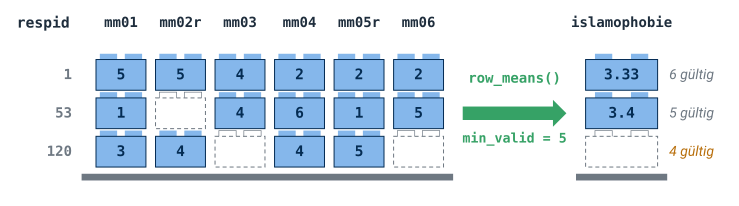

# Daten transformieren und Skalen bilden {#sec-datentransformation}

```{r setup-kap5, include=FALSE}
library(tidyverse)
library(mariposa)
source("R/_common.R")
allbus <- read_spss("ALLBUS2023.sav")
```

> *Wie wird aus sechs einzelnen Items eine messbare Einstellung?*

In @sec-datenimport hast du den Datensatz gelesen, Variablen gefunden und fehlende Werte deklariert. Jetzt geht es um das, was in der quantitativen Sozialforschung **Operationalisierung** heißt: Aus einer abstrakten Idee („Islamfeindlichkeit") werden konkrete Variablen, die du am Ende rechnen kannst.

::: {.callout-note}
**Forschungsjournal: Wo stehst du in deiner Mini-Studie?** Du hast die Rohdaten — jetzt baust du das, was am Ende deine *abhängige Variable* sein wird. Die Skalenbildung ist methodisch *der* zentrale Schritt: hier entscheidet sich, ob deine Modelle in den späteren Kapiteln auf etwas Stabilem aufsetzen. Wenn dieses Kapitel zu Ende ist, hältst du `islamophobie` und `populismus` als saubere Variablen in der Hand.
:::

## Worum es geht

Frag jemanden direkt: *„Sind Sie islamfeindlich?"* — und du wirst fast immer ein Nein bekommen. Selbst von Menschen, die in Wahlumfragen rechtspopulistisch wählen und in Diskussionen klar abgrenzende Aussagen treffen. Das hat zwei Gründe. Erstens: Niemand will sich öffentlich als „islamfeindlich" bezeichnen — das ist ein Begriff, der negativ konnotiert ist. Zweitens: Einstellungen sind nicht so klar umrissen wie ein Ja-oder-Nein. Jemand kann *manche* Aspekte einer Religion problematisch, andere nicht — und ist deshalb *ein bisschen* islamskeptisch, ohne die ganze Etikette anzunehmen.

Die Sozialforschung löst dieses Problem mit einem alten Trick: Sie fragt nicht direkt nach dem Konstrukt, sondern nach mehreren konkreten Aussagen, die das Konstrukt indirekt erfassen. Statt „Sind Sie islamfeindlich?" fragt sie:

> *„Ich finde, dass die Ausübung des Islam in Deutschland beschränkt werden sollte."*

und

> *„Der Islam passt in unsere Gesellschaft."*

und

> *„Die Anwesenheit von Muslimen bringt Konflikte."*

Zusammen ergeben diese sechs **Items** ein Bild davon, wie eine Person zur muslimischen Bevölkerung in Deutschland steht. Aus den Antworten wird ein einziger Skalenwert berechnet, der robuster und differenzierter ist als jede Einzelantwort.

Diesen Übersetzungsschritt — *vom abstrakten Konstrukt zur messbaren Variable* — nennt die quantitative Sozialforschung Operationalisierung. Sie ist der methodische Kern jeder empirischen Studie: Eine Theorie kannst du nur dann an Daten prüfen, wenn du sie vorher in messbare Größen übersetzt hast.

Dieses Kapitel zeigt dir den Weg von den sechs rohen Items bis zur fertigen Skala. Fünf Schritte:

1. Neue Variablen erzeugen (`mutate()`) — etwa aus zwei alten Variablen eine abgeleitete Größe ableiten.
2. Bedingungslogik (`case_when()`, `if_else()`) — Kategorien neu schneiden („wer < 30 ist, gilt als jung").
3. Rekodieren (`rec()`) — die zentrale Operation: Werte umkodieren, Kategorien zusammenfassen, umpolen (Reverse Coding).
4. Skalen bilden (`row_means()`) — aus mehreren Items einen Mittelwert pro Befragte:n.
5. Vergleichbar machen (`pomps()`) — Skalen unterschiedlicher Bandbreite auf eine 0–100-Basis bringen.

Am Ende des Kapitels hast du die zwei Skalen der Mini-Studie — Islamfeindlichkeit (`islamophobie`, 1–7) und Populismus (`populismus`, 1–5) — sauber aufgebaut und dokumentiert. Damit gehst du ab @sec-univbivar in die Analyse.

## Was du nach diesem Kapitel kannst {-}

- Neue Variablen mit `mutate()` erzeugen.
- Mit `case_when()`, `recode_values()` und `if_else()` Bedingungslogik schreiben.
- Subgruppen-Aggregate mit `summarise(.by = ...)` rechnen.
- Variablen mit `rec()` in `mutate()` rekodieren — vom einfachen Umkodieren über `"dicho"`/`"quart"` bis zum Umpolen (Reverse Coding).
- Dummy-Variablen für Regressionen mit `to_dummy()` erzeugen.
- Variablen standardisieren (`std()`) und zentrieren (`center()`).
- Zwei Datensätze mit `left_join()` zusammenführen — etwa Individualdaten und Kontextdaten.
- Datensätze zwischen Wide- und Long-Format umformen mit `pivot_longer()` und `pivot_wider()`.
- Aus mehreren Items eine Mittelwert-Skala mit `row_means()` und kontrolliertem `min_valid` bilden.
- Skalen unterschiedlicher Bandbreite mit `pomps()` auf eine gemeinsame 0–100-Skala bringen.
- Die vollständige Datenpräp-Pipeline der Mini-Studie nachvollziehen und auf eigene Konstrukte übertragen.

## Daten transformieren

Eine Handvoll Funktionen aus `dplyr` deckt den Großteil aller Datentransformationen ab:

| Funktion                       | Wirkung                                                |
| ------------------------------ | ------------------------------------------------------ |
| `mutate()`                     | Variablen neu erzeugen oder ändern (SPSS: `COMPUTE`)   |
| `case_when()` / `recode_values()` | Vektorisierte Bedingungslogik (SPSS: `IF`)          |
| `if_else()`                    | Knappe Form für zwei-stufige Bedingungen               |
| `summarise()`                  | Zusammenfassungen pro Gruppe (SPSS: `AGGREGATE`)       |
| `group_by()`                   | Gruppierung für nachfolgende Operationen               |
| `distinct()`                   | Einzigartige Werte einer Variable                      |
| `rename()`                     | Variablen umbenennen                                   |

### Neue Variablen mit `mutate()` und `across()`

`mutate()` ist das R-Pendant zu SPSS' `COMPUTE`. Du übergibst dem Tibble eine oder mehrere Zuweisungen *„neuer Spaltenname = Ausdruck"*, und mariposa/dplyr hängt die neue(n) Spalte(n) ans Tibble an. Wichtig: `mutate()` liefert das *gesamte* Tibble zurück — das Ergebnis musst du also der Variable zuweisen (`allbus <- allbus |> mutate(...)`), wenn die neue Spalte erhalten bleiben soll. Ohne Zuweisung wird die Änderung nur einmal ausgegeben und verschwindet wieder.

```{r mutate}
allbus |>
  select(age) |>
  mutate(geburtsjahr = 2023 - age) |>
  head(3)
```

`mutate()` rechnet die neue Spalte Reihe für Reihe aus: für die erste befragte Person 2023 − 50 = 1973, für die zweite 2023 − 51 = 1972 (@fig-mutate). Der neue Turm `geburtsjahr` ist eine Zahl ohne Wertelabels (`<dbl>`).

{#fig-mutate .lightbox fig-alt="Oben der Code allbus |> select(age) |> mutate(geburtsjahr = 2023 - age) |> head(3). Darunter eine Bauplatte mit zwei Türmen: links age, dbl+lbl, mit den Steinen 50, 51 und 69, rechts der grün umrandete Turm geburtsjahr, dbl, mit 1973, 1972 und 1954, beschriftet neuer Turm. Zwischen den Türmen steht in jeder Reihe die Rechnung 2023 - 50, 2023 - 51 und 2023 - 69 mit einem Pfeil zum Ergebnis."}

Im Chunk oben steht kein `allbus <-`. R zeigt das Ergebnis mit `geburtsjahr` an, `allbus` selbst behält seine 579 Spalten (@fig-zuweisung). Erst mit `allbus <- allbus |> mutate(...)` wird der neue Turm in `allbus` gespeichert; dann hat der Datensatz 580 Spalten.

{#fig-zuweisung .lightbox fig-alt="Zwei Hälften. Links unter OHNE <- der Code allbus |> mutate(geburtsjahr = 2023 - age), darunter die Bauplatte allbus, 5,246 × 579, mit dem Turm age mit 50, 51 und 69, Auslassungspunkten und einem grauen Turm geburtsjahr mit 1973, 1972 und 1954, beschriftet nur angezeigt. Rechts unter MIT <- der Code allbus <- allbus |> mutate(geburtsjahr = 2023 - age), darunter dieselbe Bauplatte mit 5,246 × 580; der Turm geburtsjahr ist blau, grün umrandet und beschriftet gespeichert."}

**Kurz überlegen.** Du schreibst `allbus_neu <- allbus |> mutate(geburtsjahr = 2023 - age)`. Wie viele Spalten haben danach `allbus` und `allbus_neu`?

::: {.callout-tip title="Auflösung" collapse="true"}
```{r zuweisung-loesung}
allbus_neu <- allbus |> mutate(geburtsjahr = 2023 - age)
ncol(allbus)
ncol(allbus_neu)
```

R speichert das Ergebnis unter dem Namen links vom Pfeil. `allbus_neu` hat den neuen Turm und damit 580 Spalten, `allbus` bleibt bei 579. So behältst du einen Zwischenstand, ohne das Original zu überschreiben.
:::

Soll dieselbe Transformation auf *mehrere* Variablen wirken, hilft `across()`:

```{r mutate-across, eval=FALSE}
allbus |>
  mutate(across(c(mm01, mm02, mm03), as.numeric))
```

### Bedingungslogik mit `case_when()`, `if_else()` und `recode_values()`

`case_when()` ist das R-Äquivalent zu SPSS' `IF`. Du listest Bedingungen in der Form `bedingung ~ wert` auf — die erste zutreffende gewinnt.

```{r case-when}
allbus |>
  select(educ) |>
  mutate(
    bildung = case_when(
      educ %in% 1:2 ~ "niedrig",
      educ == 3 ~ "mittel",
      educ %in% 4:5 ~ "hoch",
      .default = NA
    )
  ) |>
  count(bildung)
```

::: {.callout-warning}
**Vorsicht: Reihenfolge zählt.** `case_when()` prüft die Bedingungen *von oben nach unten* und nimmt die erste, die zutrifft — alle späteren werden für diesen Fall ignoriert. Wer eine allgemeine Bedingung *vor* eine spezifische schreibt, schattet sich selbst aus:

```{r case-when-falle, eval=FALSE}
# FALSCH: erste Zeile fängt alle ab 18 ab, "senior" wird nie erreicht
case_when(
  age >= 18 ~ "erwachsen",
  age >= 65 ~ "senior",
  .default = "unter 18"
)

# RICHTIG: spezifischer zuerst
case_when(
  age >= 65 ~ "senior",
  age >= 18 ~ "erwachsen",
  .default = "unter 18"
)
```

Beim Debuggen einer komischen Rekodierung: zuerst die Reihenfolge der Bedingungen prüfen.
:::

@fig-case-when spielt beide Reihenfolgen aus dem Kasten mit den ersten fünf Befragten durch. In der falschen Reihenfolge bleiben alle fünf schon an der ersten Bedingung `age >= 18` hängen, auch die Befragten mit 69 und 72 Jahren. In der richtigen Reihenfolge prüft `case_when()` zuerst `age >= 65`; nur wer dort nicht hängen bleibt, kommt zur nächsten Zeile.

{#fig-case-when .lightbox fig-alt="Zwei Teile, FALSCH und RICHTIG. Oben jeweils fünf blaue Steine age: 50, 51, 69, 72 und 18. Darunter drei Zeilen mit den Bedingungen von oben nach unten; eine gestrichelte Linie führt von jedem Stein zu der Zeile, an der er hängen bleibt, dort liegt ein lila Stein mit dem Ergebnis. FALSCH: zuerst age >= 18 ~ „erwachsen“, dann age >= 65 ~ „senior“, dann .default = „unter 18“. Alle fünf Steine werden in der ersten Zeile zu erwachsen, in der Zeile senior steht: „senior“ wird nie erreicht. RICHTIG: zuerst age >= 65 ~ „senior“. 69 und 72 werden dort zu senior, 50, 51 und 18 laufen weiter und werden in der zweiten Zeile zu erwachsen. Die Zeile .default bleibt in beiden Teilen leer."}

Bei nur *zwei* Ausprägungen ist `if_else(bedingung, wert_wenn_wahr, wert_wenn_falsch)` knapper:

```{r if-else-demo}
allbus |>
  mutate(jung = if_else(age < 30, "jung", "30+")) |>
  count(jung)
```

Wenn du nur einzelne Werte auf neue Werte abbildest (ohne Vergleichsoperatoren), ist `recode_values()` knapper als `case_when()` — links der alte Wert, rechts der neue:

```{r case-match}
allbus |>
  select(eastwest) |>
  mutate(region = recode_values(eastwest, 1 ~ "West", 2 ~ "Ost")) |>
  count(region)
```

::: {.callout-note collapse="true"}
## Hintergrund: `recode_values()` statt `case_match()`

In älteren Tutorials findest du für dieselbe Aufgabe `case_match()`. Seit dplyr 1.2 ist sie veraltet (*deprecated*) und meldet eine Warnung; `recode_values()` ist ihr Nachfolger mit identischer Schreibweise. Für das Umkodieren *ganzer Skalen* bleibt mariposas `rec()` (nächster Abschnitt) das bequemere Werkzeug.
:::

### Aggregation mit `group_by()`, `summarise()` und `n()`

```{r group-summarise}
allbus |>
  group_by(eastwest) |>
  summarise(
    n_faelle           = n(),
    n_einz_bildung     = n_distinct(educ),
    durchschnitt_alter = mean(age, na.rm = TRUE)
  )
```

`n()` zählt alle Fälle in der Gruppe, `n_distinct()` zählt einzigartige Werte einer Variablen.

`summarise()` macht aus jeder Gruppe eine Reihe (@fig-summarise): Aus den 3.567 Befragten im Westen wird eine Reihe mit einem Durchschnittsalter von 51.7 Jahren, aus den 1.679 im Osten eine mit 54.3 Jahren.

{#fig-summarise .lightbox fig-alt="Oben der Code group_by(eastwest) |> summarise(…, durchschnitt_alter = mean(age, na.rm = TRUE)). Links eine Bauplatte mit den Türmen eastwest und age in zwei Blöcken: drei Reihen mit 1 und dem Aufkleber ALTE BUNDESLAENDER und dem Alter 50, 51 und 69, darunter 3567 Fälle; drei Reihen mit 2 und dem Aufkleber NEUE BUNDESLAENDER und dem Alter 72, 44 und 60, darunter 1679 Fälle. Ein grüner Pfeil mean() führt zu einer Bauplatte mit zwei Reihen und den Spalten eastwest und durchschnitt_alter: 1 ALTE BUNDESLAENDER mit 51.7 und 2 NEUE BUNDESLAENDER mit 54.3."}

::: {.callout-note collapse="true"}
## Hintergrund: Gruppieren mit `.by`

Seit dplyr 1.1 kannst du die Gruppierung auch direkt im Aufruf von `summarise()` oder `mutate()` setzen, ohne `group_by()` davor:

```{r dot-by}
allbus |>
  summarise(
    durchschnitt_alter = mean(age, na.rm = TRUE),
    .by = eastwest
  )
```

Das ist kürzer und vermeidet, dass du `ungroup()` vergisst.
:::

### `distinct()` und `rename()`

`distinct()` zeigt dir alle einzigartigen Ausprägungen einer Variable — die schnellste Antwort auf „welche Codes gibt es eigentlich?":

```{r distinct}
allbus |>
  distinct(eastwest)
```

`rename()` benennt Variablen um — neuer Name links, alter Name rechts:

```{r rename}
allbus |>
  rename(geschlecht = sex, alter = age) |>
  select(geschlecht, alter) |>
  head(3)
```

Beide sind kleine, aber regelmäßig genutzte Werkzeuge — gerade beim Übersetzen von kryptischen ALLBUS-Namen in sprechende Kürzel für deinen Analyse-Datensatz.

## Rekodierung mit `rec()` {#sec-rekodierung}

Stell dir vor, du hast die Bildungsangaben von 5.246 Personen in der Variable `educ`. Die Werte 1 bis 5 stehen für die Schulabschlüsse — von „ohne Abschluss" über Volks-/Hauptschule, mittlere Reife und Fachhochschulreife bis zur Hochschulreife; dazu kommen 6 („anderer Abschluss") und 7 („noch Schüler:in"). Für eine Regression willst du das aber nicht als sieben Kategorien haben, sondern gröber: niedrig / mittel / hoch. Du *rekodierst* die Variable.

Das ist die häufigste Datenoperation in der Sozialforschung — und gleichzeitig eine der fehleranfälligsten. Ein vertauschter Wert, eine vergessene Kategorie, und deine ganze Analyse läuft auf einem falschen Maßstab. SPSS hat dafür den `RECODE`-Befehl mit einer eigenen kleinen Syntax. mariposas `rec()`-Funktion macht dasselbe, ist aber für tidyverse-Workflows gebaut: Du setzt sie in `mutate()` ein, sie behält Labels und versteht eine kompakte **Regel-Syntax**, in der du eine ganze Umkodierung in einer einzigen Zeichenkette ausdrückst.

Die Syntax:

```r
data |>
  mutate(neu = rec(alt, rules = "1=1; 2:3=2; else=NA"))
```

`rec()` bekommt die alte Variable und die Regel und gibt die umkodierten Werte zurück. `mutate()` legt sie unter dem Namen links vom `=` ab.

Die Regel-Syntax im Überblick:

| Muster              | Wirkung                                 | Beispiel                                |
| ------------------- | --------------------------------------- | --------------------------------------- |
| `alt=neu`           | Einzelwert wird umkodiert               | `"1=10; 2=20"`                          |
| `lo:hi=neu`         | Wertebereich umkodieren                 | `"1:3=1"`                               |
| `a,b=neu`           | Liste von Werten/Bereichen umkodieren   | `"1,2=1; 3,4:5=2"`                      |
| `min:x=neu`, `x:max=neu` | Dynamische Grenzen                 | `"min:5=1; 6:max=2"`                    |
| `[Label]`           | Inline-Wertelabel vergeben              | `"1:2=1 [niedrig]; 3:5=2 [hoch]"`       |
| `else=copy`         | Alle nicht erwähnten Werte unverändert  | `"1:3=1; else=copy"`                    |
| `else=NA`           | Alle nicht erwähnten Werte werden NA    | `"1=1; else=NA"`                        |
| `NA=neu`            | NA durch einen Wert ersetzen            | `"NA=0; else=copy"`                     |
| `val=NA`            | Bestimmte Werte zu NA machen            | `"-9=NA; -8=NA; else=copy"`             |
| `"rev"`             | Skala umpolen (`hi + lo - x`, Grenzen aus den Wertelabels) | `rules = "rev"`      |
| `"rev(lo, hi)"`     | Skala mit explizit angegebenen Grenzen umpolen | `rules = "rev(1, 5)"`            |
| `"dicho"`           | Dichotomisieren am Median (0/1)         | `rules = "dicho"`                       |
| `"dicho(x)"`        | Dichotomisieren am festen Cut-Punkt (≤ x → 0, > x → 1) | `rules = "dicho(3)"`     |
| `"mean"`            | Dichotomisieren am Mittelwert           | `rules = "mean"`                        |
| `"quart"`           | In vier Quartilgruppen aufteilen        | `rules = "quart"`                       |

Regeln werden in Reihenfolge geprüft, die erste passende gewinnt. Gültige Werte, auf die *keine* Regel passt, werden `NA` — mariposa warnt dich dann und nennt die betroffenen Werte. Mit `else=copy` behältst du sie, mit `else=NA` bestätigst du das Verwerfen ausdrücklich. Fehlende Werte aus dem SPSS-Import (die tagged NAs) behalten beim Rekodieren ihren Missing-Typ, außer eine `NA=`- oder `else=`-Regel erfasst sie. `else=NA` macht deshalb auch aus „keine Angabe" oder „nicht bestimmbar" ein einfaches `NA`, und die Unterscheidung der Missing-Typen ist weg. Willst du sie behalten, nennst du die zu verwerfenden Codes ausdrücklich (etwa `6:7=NA`) und lässt die `else`-Regel weg oder schreibst `else=copy`.

### Beispiel: Bildung kategorisieren

```{r rec-bildung}
allbus |>
  mutate(
    educ = rec(educ, rules = "1:2=1 [niedrig]; 3=2 [mittel]; 4:5=3 [hoch]; else=NA",
               as_factor = TRUE)
  ) |>
  count(educ)
```

Mit `as_factor = TRUE` wird die rekodierte Variable direkt ein Faktor; die `[…]`-Notation in den Regeln vergibt die Wertelabels in einem Aufwasch. Die 153 `NA` setzen sich aus den 44 Befragten mit Code 6 oder 7 und den 109 Missings aus dem Import zusammen (DATENFEHLER, NICHT BESTIMMBAR, KEINE ANGABE). Im Ergebnis sind alle 153 einfache `NA`.

@fig-rec zerlegt die Regel in ihre Teile. Jeder Teil nimmt die Codes, die er nennt: `1:2=1 [niedrig]` fasst 1 und 2 zur Stufe niedrig zusammen, `else=NA` nimmt alles Übrige, auch die fehlenden Werte aus dem Import.

{#fig-rec .lightbox fig-alt="Oben der Code mutate( educ = rec(educ, rules = „1:2=1 [niedrig]; 3=2 [mittel]; 4:5=3 [hoch]; else=NA“, as_factor = TRUE) ). Links der Turm educ, dbl+lbl, mit sieben blauen Steinen und ihren Aufklebern: 1 OHNE ABSCHLUSS, 2 VOLKS-,HAUPTSCHULE, 3 MITTLERE REIFE, 4 FACHHOCHSCHULREIFE, 5 HOCHSCHULREIFE, 6 ANDERER ABSCHLUSS, 7 NOCH SCHUELER, darunter ein leerer gestrichelter Stein. Klammern fassen die Steine zu Gruppen zusammen. Jede Gruppe führt über einen Teil der Regel und einen grünen Pfeil zu einem Stein des Faktors educ, fct, daneben die Zahl n: 1 und 2 über 1:2=1 [niedrig] zu niedrig, 982; 3 über 3=2 [mittel] zu mittel, 1639; 4 und 5 über 4:5=3 [hoch] zu hoch, 2472; 6, 7 und der leere Stein über else=NA zu einem leeren Stein, 153."}

### Spezial-Modi: Dichotomisieren und Quartile

Statt eine Regel-Kette zu schreiben, kannst du eine Variable in einem Aufruf am Median, an einem festen Cut-Punkt, am Mittelwert oder in Quartile zerlegen:

```{r rec-dicho}
allbus |>
  mutate(age_d = rec(age, rules = "dicho(50)")) |>
  count(age_d)
```

Hier wird `age_d` zu 0 für alle bis einschließlich 50 Jahre und zu 1 für alle über 50 — der Cut-Punkt selbst gehört also zur unteren Gruppe. Der Name `age_d` links vom `=` legt eine neue Variable an; das Original `age` bleibt erhalten.

In @fig-dicho liegt der Schnitt zwischen 51 und 50. Die 23 Befragten ohne gültige Altersangabe (NICHT GENERIERBAR) bleiben auch in `age_d` fehlend.

{#fig-dicho .lightbox fig-alt="Oben der Code allbus |> mutate(age_d = rec(age, rules = „dicho(50)“)) |> count(age_d). Darunter zwei Türme, age und age_d. Die Steine von age, 72, 69, 51, 50 und 18, führen mit Pfeilen zu 1, 1, 1, 0 und 0. Eine orange gestrichelte Linie mit der Beschriftung dicho(50) trennt 51 und 50. Rechts eine Klammer um die drei Einsen mit n 2942 und über 50, eine Klammer um die zwei Nullen mit n 2281 und bis 50. Ganz unten in beiden Türmen ein leerer gestrichelter Stein mit dem Aufkleber NICHT GENERIERBAR, n 23."}

```{r rec-quart}
allbus |>
  mutate(age_q = rec(age, rules = "quart")) |>
  count(age_q)
```

`age_q` ist jetzt eine kategoriale Variable mit den Werten 1–4 für die Altersquartile.

### Lehrstück: Umpolen (Reverse Coding)

Was passiert, wenn du sechs Items zu einer Skala zusammenrechnest, von denen vier in dieselbe Richtung formuliert sind und zwei *entgegengesetzt*? Du bekommst Müll. Die positiv formulierten Items ziehen den Mittelwert in die eine Richtung, die negativen in die andere — und am Ende heben sich Effekte auf, die eigentlich addiert werden sollten.

Genau das ist der Fall bei unserer Islamfeindlichkeits-Skala. Die Forscher:innen haben die sechs Items absichtlich gemischt formuliert — vier negativ („Islam beschränken"), zwei positiv („Islam passt in die Gesellschaft"). Das ist eine bewusste Methode gegen einen klassischen Survey-Bias namens **Akquieszenz**: die Neigung mancher Befragten, Aussagen pauschal zuzustimmen, egal worum es geht. Wenn alle sechs Items gleich gepolt wären, würde diese Tendenz das Ergebnis verzerren. Durch die Mischung neutralisiert sie sich.

Für *dich* heißt das: Bevor du die Items zu einer Skala zusammenrechnest, musst du die zwei positiv formulierten Items **umpolen** — also so umkodieren, dass am Ende alle sechs in dieselbe Richtung zeigen.

```{r mm-items, echo=FALSE}
tibble::tribble(
  ~Item, ~Wortlaut, ~Polung,
  "mm01", "Islamausübung in Deutschland beschränken",        "hoch = islamophob",
  "mm02", "Islam passt in die deutsche Gesellschaft",         "hoch = TOLERANT — umpolen",
  "mm03", "Anwesenheit von Muslimen bringt Konflikt",         "hoch = islamophob",
  "mm04", "Staat sollte islamische Gruppen beobachten",       "hoch = islamophob",
  "mm05", "Muslimischer Bürgermeister in Ordnung",            "hoch = TOLERANT — umpolen",
  "mm06", "Unter Muslimen sind viele rel. Fanatiker",         "hoch = islamophob"
) |> knitr::kable()
```

Bevor du aus den sechs Items einen Mittelwert bildest, *musst* du `mm02` und `mm05` umpolen, sonst heben sich die Effekte auf. mariposa hat dafür den Spezial-Modus `"rev"`:

```{r reverse}
allbus <- allbus |>
  mutate(
    mm02r = rec(mm02, rules = "rev"),
    mm05r = rec(mm05, rules = "rev")
  )
```

::: {.callout-note collapse="true"}
## Hintergrund: Was `allbus <- allbus |> …` überschreibt

Wenn du `allbus <-` schreibst, ergänzt du das Tibble *im Speicher* um die rekodierten Spalten. Die Originaldatei `ALLBUS2023.sav` auf der Festplatte bleibt unangetastet — du kannst die Pipeline jederzeit neu starten. Möchtest du Zwischenstände parallel behalten, weist du einer neuen Variable zu (`allbus_mm <- allbus |> mutate(...)`).
:::

`"rev"` rechnet intern `hi + lo - x`. Die Skalengrenzen `lo` und `hi` nimmt mariposa aus den Wertelabels der gültigen Codes — bei den `mm`-Items also 1 („stimme gar nicht zu") und 7 („stimme voll und ganz zu"). Daraus wird `8 - x`, genau das gewünschte Umpolen. Die Wertelabels werden mitgespiegelt: In `mm02r` trägt jetzt die 7 das Label „stimme gar nicht zu". Fehlende Werte (`-9`, `-11`, …) bleiben fehlend und behalten ihren Missing-Typ.

::: {.callout-warning}
**Vorsicht: Skalengrenzen aus Labels, nicht aus Daten.** Dass `"rev"` die Grenzen aus den Wertelabels liest, schützt dich vor einer subtilen Falle: Hätte niemand bei einem Item den Extremwert 7 angekreuzt, würde ein Umpolen anhand des *beobachteten* Maximums (6) die Skala verschieben (`7 - x` statt `8 - x`). Hat eine Variable *keine* Wertelabels (etwa nach einem Import aus Excel), greift mariposa auf das beobachtete Minimum und Maximum zurück und sagt dir das in einer Meldung. Dann gibst du die theoretischen Grenzen besser selbst an: `rules = "rev(1, 7)"`.
:::

Im `mutate()` steht eine Zeile je Item. Die Namen `mm02r` und `mm05r` links vom `=` legen zwei neue Variablen an; die Originale `mm02` und `mm05` bleiben unverändert. Das ist die saubere Form — du verlierst nichts und kannst die Umpolung jederzeit nachvollziehen. Schreibst du links denselben Namen (`mm02 = rec(mm02, rules = "rev")`), überschreibst du dagegen das Original. Die Gegenprobe ist eine Kreuztabelle aus Original und umgepolter Version — jede 1 muss zur 7 geworden sein, jede 2 zur 6 und so weiter:

```{r reverse-check}
allbus |> count(mm02, mm02r)
```

In @fig-umpolen ist jede Zeile der Kreuztabelle ein Paar aus altem und neuem Wert. Der Turm `mm02r` ist `mm02` auf dem Kopf, und die Aufkleber wandern mit: STIMME GAR NICHT ZU klebt jetzt an der 7. Die letzte Zeile fasst alle 1.842 fehlenden Werte zusammen; sie bleiben fehlend.

{#fig-umpolen .lightbox fig-alt="Oben der Code mutate(mm02r = rec(mm02, rules = „rev“)). Darunter zwei Türme, mm02 und mm02r, beide dbl+lbl, dazwischen grüne Pfeile mit der Beschriftung 8 - x. Links stehen von oben 1 bis 7, rechts 7 bis 1. Die 1 links und die 7 rechts tragen den Aufkleber STIMME GAR NICHT ZU, die 7 links und die 1 rechts den Aufkleber STIMME VOLL+GANZ ZU. Ganz unten in beiden Türmen ein leerer gestrichelter Stein mit dem Aufkleber TNZ: SPLIT. Rechts die Spalte n mit 954, 515, 494, 629, 350, 235, 227 und 1842. Darunter der Code allbus |> count(mm02, mm02r)."}

**Kurz überlegen.** Die `pa`-Items, die du in @sec-skalen umpolst, haben die Werte 1 bis 5. Was macht `rules = "rev"` dort aus einer 2?

::: {.callout-tip title="Auflösung" collapse="true"}
```{r umpolen-loesung}
allbus |>
  mutate(pa29r = rec(pa29, rules = "rev")) |>
  count(pa29, pa29r)
```

Aus der 2 wird eine 4. `"rev"` rechnet `hi + lo - x`; mit den Grenzen 1 und 5 ist das `6 - x`, also 6 − 2 = 4. Auch hier wandern die Wertelabels mit: STIMME EHER ZU steht danach bei der 4.
:::

### Dummy-Variablen mit `to_dummy()`

Für Regressionen brauchst du oft **Dummy-Variablen** — eine kategoriale Variable mit `k` Ausprägungen wird in `k-1` Indikator-Spalten zerlegt (0/1 pro Ausprägung). mariposas `to_dummy()` macht das in einem Aufruf:

```{r to-dummy-demo, eval=FALSE}
allbus |>
  to_dummy(eastwest, ref = 1)        # West (=1) als Referenz, dummy für Ost
```

Die neuen Spalten werden automatisch angehängt; mit `ref =` legst du fest, welche Ausprägung als *Referenz* weggelassen wird. Dummy-Variablen brauchst du erst in @sec-erklaerung für die Regression — `lm()` und `linear_regression()` aus mariposa erstellen sie für Faktoren auch automatisch im Hintergrund (@fig-dummy).

## Standardisieren und zentrieren mit `std()` und `center()`

Vor manchen Analysen ist es sinnvoll, eine Variable auf einen einheitlichen Maßstab zu bringen. Zwei verwandte Operationen:

- `std()` (Standardisierung) macht aus jeder Variable eine *z-standardisierte* (Mittelwert 0, SD 1). Brauchst du, wenn du Variablen *unterschiedlicher Maßstäbe* vergleichbar machen willst — etwa wenn ein standardisierter Beta-Koeffizient in einer Regression interpretierbar bleiben soll (Kap. 9).
- `center()` (Mittelwert-Zentrierung) subtrahiert nur den Mittelwert, ohne durch die SD zu teilen. Hauptanwendungsfall: vor *Interaktionstermen* in Regressionen, weil zentrierte Variablen die Multikollinearität zwischen Haupteffekten und Interaktionen reduzieren.

```{r std-center}
allbus |>
  std(age, suffix = "_z") |>     # neue Variable age_z (Mittelwert 0, SD 1)
  select(age, age_z) |>
  head(3)
```

Mit `center()` analog für mittelwertzentrierte Variablen:

```{r center, eval=FALSE}
allbus |>
  center(age, suffix = "_c")     # neue Variable age_c (Mittelwert 0)
```

`age` hat im ALLBUS einen Mittelwert von 52.51 Jahren und eine Standardabweichung von 18.25. `center()` zieht von jedem Wert den Mittelwert ab: Aus 50 wird -2.51, aus 69 wird 16.49. `std()` teilt das Ergebnis zusätzlich durch die Standardabweichung; die 69 liegt damit 0.903 Standardabweichungen über dem Mittelwert (@fig-std). Die Personen behalten ihre Lage zueinander, es ändern sich nur Nullpunkt und Einheit der Skala.

{#fig-std .lightbox fig-alt="Drei waagerechte Lineale untereinander. Oben age von 30 bis 75 mit blauen Pfeilen bei 50 und 69 und einem orangen Pfeil Mittelwert 52.51, darunter eine Klammer vom Mittelwert um eine Standardabweichung nach rechts, beschriftet SD 18.25. Ein grauer Pfeil mit - 52.51 führt zum mittleren Lineal age_c, center(), mit den Strichen -20 bis 20; die blauen Pfeile stehen an derselben Stelle und zeigen -2.51 und 16.49. Ein grauer Pfeil mit / 18.25 führt zum unteren Lineal age_z, std(), mit den Strichen -1 bis 1; die Pfeile zeigen -0.138 und 0.903. Gestrichelte Hilfslinien verbinden den Mittelwert mit der 0 und das Ende der Klammer mit der 1."}

Ohne `suffix`-Argument *überschreiben* beide Funktionen die Originalvariable — das ist selten gewünscht. Beide akzeptieren außerdem ein `weights =`-Argument, falls du die Standardisierung gewichtet machen willst.

## Datensätze verbinden mit `left_join()`, `inner_join()` und `full_join()` {#sec-joins}

In der Forschungspraxis kommt deine Information selten aus *einer* Datei. Du hast Individualdaten (ALLBUS-Befragte), willst aber Kontextinformationen dazumischen — Bundesländer-Wahlergebnisse, Wirtschaftsdaten, regionale Migrationsanteile. Beide Tabellen werden über eine **Schlüssel-Variable** verknüpft, die in beiden vorkommt.

Das Werkzeug dafür heißt `left_join()` aus dplyr. Der Name beschreibt das Verhalten: die *linke* Tabelle bleibt vollständig erhalten, die *rechte* wird zeilenweise angedockt, wo der Schlüssel passt. Wo kein Match existiert, bleiben die neuen Spalten `NA`.

**Frage:** Wir wollen jedem ALLBUS-Befragten eine Kontextinformation hinzufügen — etwa einen geschätzten Anteil der muslimischen Bevölkerung und das BIP pro Kopf, getrennt nach Region. Erst die kleine Kontext-Tabelle:

```{r join-kontext}
kontext_bl <- tibble(
  eastwest      = c(1, 2),
  muslim_anteil = c(7.2, 1.4),     # Anteil in Prozent (synthetisch)
  bip_pro_kopf  = c(45000, 32000)  # Euro (synthetisch, gerundet)
)
kontext_bl
```

Diese Tabelle hat zwei Zeilen. Jetzt der Join: links ALLBUS (5.246 Fälle), rechts `kontext_bl` (2 Zeilen), Schlüssel `eastwest`:

```{r join-demo}
allbus_mit_kontext <- allbus |>
  left_join(kontext_bl, by = "eastwest")

allbus_mit_kontext |>
  select(eastwest, age, muslim_anteil, bip_pro_kopf) |>
  head(6)
```

**Lesart.** Vergleiche die Tabelle vor und nach dem Join: vorher hatte die Kontext-Tabelle nur zwei Zeilen, jetzt sind die Kontext-Werte *pro Fall* angedockt — Westdeutsche bekommen `muslim_anteil = 7.2` und `bip_pro_kopf = 45000`, Ostdeutsche entsprechend andere Werte. Die ursprünglichen 5.246 ALLBUS-Zeilen bleiben unverändert; nur zwei neue Spalten sind hinzugekommen.

`left_join()` sucht für jede Reihe von `allbus` die Reihe in `kontext_bl` mit demselben Wert von `eastwest` und hängt deren übrige Spalten an (@fig-join). Die vierte Reihe gehört zu den neuen Bundesländern (`eastwest` 2) und bekommt deshalb 1.4 und 32000.

{#fig-join .lightbox fig-alt="Oben rechts das Namensschild kontext_bl und eine Bauplatte mit den Türmen eastwest, muslim_anteil und bip_pro_kopf und zwei Reihen: 1, 7.2, 45000 und 2, 1.4, 32000; die zweite Reihe ist orange umrandet. Links die Bauplatte allbus mit eastwest 1, 1, 1, 2 und age 50, 51, 69, 72 und Auslassungspunkten. Ein grüner Pfeil left_join() führt zum Ergebnis mit eastwest, age, Auslassungspunkten und den grün umrandeten neuen Türmen muslim_anteil mit 7.2, 7.2, 7.2, 1.4 und bip_pro_kopf mit 45000, 45000, 45000, 32000. Grüne Pfeile führen von kontext_bl in diese Türme, die vierte Reihe des Ergebnisses ist orange umrandet. Darunter der Code allbus_mit_kontext <- allbus |> left_join(kontext_bl, by = „eastwest“)."}

::: {.callout-tip}
**SPSS → R: Datensätze zusammenführen.** In SPSS heißt das `MATCH FILES /TABLE = ... /BY = eastwest.`. In R ist das genau `left_join()`. Konzept und Argumente sind direkt übertragbar — nur die Syntax ist kompakter.
:::

dplyr kennt vier Join-Verben. Sie unterscheiden sich nur darin, *welche Zeilen* am Ende bleiben:

| Funktion          | Welche Zeilen bleiben?                                    | Wann sinnvoll                                 |
| :---------------- | :-------------------------------------------------------- | :-------------------------------------------- |
| `left_join(x, y)` | alle Zeilen aus `x`, passende aus `y`                     | Standard: Kontextdaten zu Individualdaten |
| `inner_join(x, y)` | nur Zeilen, die in beiden vorkommen                      | Schnittmenge — nur Fälle mit kompletter Info  |
| `right_join(x, y)` | alle aus `y`, passende aus `x`                            | selten — meist als `left_join(y, x)` lesbarer |
| `full_join(x, y)` | alle Zeilen aus beiden                                    | Vereinigung — typisch für Daten-Konsolidierung |

Für zwei kleine Tabellen `x` (Schlüssel `id` 1, 2, 3) und `y` (`id` 1, 2, 4) zeigt @fig-join-familie die Ergebnisse von `left_join()`, `inner_join()` und `full_join()`. Kommt ein Schlüssel nur in einer Tabelle vor, bleiben die Spalten der anderen Tabelle leer (`NA`).

{#fig-join-familie .lightbox fig-alt="Links zwei kleine Bauplatten: x mit id 1, 2, 3 und a 10, 20, 30; y mit id 1, 2, 4 und den lila Steinen b A, B, D. Rechts drei Ergebnisse mit den Türmen id, a und b. left_join(x, y): id 1, 2, 3, a 10, 20, 30, b A, B und ein leerer Stein. inner_join(x, y): id 1 und 2, a 10 und 20, b A und B. full_join(x, y): id 1, 2, 3, 4, a 10, 20, 30 und ein leerer Stein, b A, B, ein leerer Stein und D."}

In 90 % der Sozialforschung brauchst du `left_join()` — Individualdaten links, Kontextdaten rechts.

::: {.callout-warning}
**Vorsicht: Schlüssel müssen *eindeutig* in der rechten Tabelle sein.** Wenn die rechte Tabelle pro Schlüssel mehrere Zeilen hat, wird *jede* Übereinstimmung dupliziert — aus 5.246 Fällen werden plötzlich 10.000. Vor jedem Join: `kontext_bl |> count(eastwest)` prüfen — jeder Schlüsselwert sollte nur einmal vorkommen.
:::

## Datensätze umformen: Wide und Long mit `pivot_*()` {#sec-pivot}

Daten können in zwei grundsätzlich verschiedenen Formaten vorliegen — und die Wahl ist nicht egal: manche Operationen funktionieren nur im einen, manche nur im anderen Format.

- **Wide-Format**: eine Zeile pro Befragte:r, eine Spalte pro Variable. So liegt der ALLBUS standardmäßig vor — `mm01` bis `mm06` sind sechs Spalten nebeneinander.
- **Long-Format**: eine Zeile pro *Beobachtung* — also pro Befragte:r × Item. Statt sechs Spalten gibt es zwei: eine *„welches Item?"* und eine *„welcher Wert?"*. Aus 5.246 Zeilen mit 6 Item-Spalten werden 5.246 × 6 = 31.476 Zeilen mit 2 Spalten.

Warum das überhaupt eine Frage ist: ggplot2 erwartet meist Long-Format (eine Aesthetic = eine Spalte), während statistische Funktionen oft Wide-Format brauchen (eine Variable = eine Spalte). Die Umformung übernehmen zwei Funktionen aus `tidyr`:

### `pivot_longer()`: wide → long

**Frage:** Wir wollen alle sechs `mm`-Items zusammen in einem ggplot2 darstellen — etwa als Boxplot pro Item. Dafür brauchen wir Long-Format.

Erst der Blick auf das Wide-Format, so wie ALLBUS standardmäßig vorliegt — eine Spalte pro Item, eine Zeile pro Person:

```{r pivot-wide-show}
allbus |>
  select(mm01, mm02r, mm03, mm04, mm05r, mm06) |>
  head(4)
```

Jetzt dieselben Daten ins Long-Format drehen — eine Zeile pro Person × Item, also pro Person sechs Zeilen statt einer:

```{r pivot-longer-demo}
allbus_long <- allbus |>
  select(mm01, mm02r, mm03, mm04, mm05r, mm06) |>
  unlabel() |>                      # Wertelabels ablegen (siehe Hinweis unten)
  pivot_longer(
    cols      = everything(),       # welche Spalten umformen?
    names_to  = "item",             # neue Spalte für die alten Spaltennamen
    values_to = "antwort"           # neue Spalte für die Werte
  )

allbus_long |> head(8)
```

**Lesart.** Vorher: 6 Spalten × 5.246 Zeilen = breite Tabelle. Nachher: 2 Spalten × 31.476 Zeilen — die *Spaltennamen* (`mm01`, `mm02r`, …) sind in die neue Spalte `item` gewandert, die ursprünglichen *Werte* in die Spalte `antwort`. Die ersten sechs Zeilen oben gehören zur ersten Person, die nächsten sechs zur zweiten Person.

Die Spaltennamen werden dabei zu Werten: Aus den sechs Namensschildern werden Steine im Turm `item`, und jede Person bekommt sechs Reihen (@fig-pivot-longer).

{#fig-pivot-longer .lightbox fig-alt="Links die Wide-Form, 5,246 × 6: sechs dunkle Namensschilder mm01, mm02r, mm03, mm04, mm05r und mm06, darunter die erste Person mit 5, 5, 4, 2, 2, 2, orange umrandet, und die zweite Person mit sechs leeren Steinen. Ein grüner Pfeil pivot_longer() führt zur Long-Form, 31,476 × 2, mit den Türmen item (chr) und antwort (dbl): Die sechs Namen stehen als lila Steine untereinander, daneben 5, 5, 4, 2, 2, 2; diese sechs Reihen sind orange umrandet. Darunter mm01 und mm02r der zweiten Person mit leeren Steinen. Links unten der Code pivot_longer(cols = everything(), names_to = „item“, values_to = „antwort“)."}

::: {.callout-warning}
**Vorsicht: Labelled-Spalten stapeln.** `pivot_longer()` schreibt alle Items in *eine* Spalte `antwort` — und die kann nur *einen* Satz Wertelabels tragen. Die Items haben aber unterschiedliche Labels: In den umgepolten `mm02r` und `mm05r` steht „stimme gar nicht zu" bei der 7, in den übrigen bei der 1, und auch die Missing-Labels unterscheiden sich von Item zu Item. Ohne `unlabel()` meldet R deshalb Warnungen wie *„`mm01` and `mm02r` have conflicting value labels"* und übernimmt kommentarlos die Labels des ersten Items — für `mm02r` wären sie dann falsch. Mit `unlabel()` (siehe @sec-datentypen-verstehen) stapelst du die reinen Zahlen; fehlende Werte bleiben `NA`.
:::

Genau das brauchst du, um alle sechs Items *in einem ggplot* zu visualisieren — `aes(x = item, y = antwort)`:

```{r pivot-plot-demo, fig.height=3.5}
allbus_long |>
  filter(!is.na(antwort)) |>
  ggplot(aes(x = item, y = antwort, fill = item)) +
  geom_boxplot() +
  labs(x = NULL, y = "Antwort (1–7)") +
  theme(legend.position = "none")
```

### `pivot_wider()`: long → wide

Die Umkehrung brauchst du, wenn aggregierte Daten aus einem `summarise()` (das typisch im Long-Format ankommt) als breite Vergleichstabelle in einen Bericht sollen.

Erst der Long-Zwischenstand: Mittelwerte pro Region × Item:

```{r pivot-mw-long}
mittelwerte_long <- allbus |>
  filter(!is.na(eastwest)) |>
  select(eastwest, mm01, mm03, mm06) |>
  to_label(eastwest) |>                     # Region mit Labels statt 1/2
  unlabel(mm01, mm03, mm06) |>              # Items als reine Zahlen stapeln
  pivot_longer(c(mm01, mm03, mm06),
               names_to = "item", values_to = "antwort") |>
  summarise(mw = round(mean(antwort, na.rm = TRUE), 2),
            .by = c(eastwest, item))

mittelwerte_long
```

Sechs Zeilen — drei Items × zwei Regionen. Lesbar, aber für einen direkten Ost-West-Vergleich unpraktisch. `pivot_wider()` dreht es zur Vergleichs-Tabelle:

```{r pivot-wider-demo}
mittelwerte_long |>
  pivot_wider(names_from = eastwest, values_from = mw)
```

Jetzt steht jedes Item in einer Zeile, Region in zwei Spalten — Ost und West direkt nebeneinander. Genau das Format, das in einer Hausarbeit gut aussieht.

`names_from = eastwest` legt fest, woher die neuen Spaltennamen kommen: Die beiden Stufen von `eastwest` werden zu Namensschildern. `values_from = mw` liefert die Steine darunter (@fig-pivot-wider).

{#fig-pivot-wider .lightbox fig-alt="Links die Long-Form mit den Türmen eastwest (fct), item (chr) und mw (dbl) und sechs Reihen: dreimal ALTE BUNDESLAENDER mit mm01, mm03, mm06 und 3.19, 3.97, 4.14, dreimal NEUE BUNDESLAENDER mit 4.01, 4.63, 4.58. Unter eastwest steht names_from, unter mw values_from. Ein grüner Pfeil führt zur Wide-Form, überschrieben mit pivot_wider(): der Turm item mit mm01, mm03, mm06 und zwei dunkle Namensschilder ALTE BUNDESLAENDER und NEUE BUNDESLAENDER, jeweils dbl, darunter 3.19, 3.97, 4.14 und 4.01, 4.63, 4.58. Unten der Code pivot_wider(names_from = eastwest, values_from = mw)."}

Welches Format du brauchst, hängt von der Aufgabe ab:

- *Plotten?* → meist long. ggplot2 mappt Aesthetics auf Spalten — eine Item-Variable als x-Achse.
- *Statistik rechnen?* → meist wide. `pearson_cor(mm01, mm02)` braucht zwei Spalten.
- *Tabelle für den Bericht?* → meist wide. Lesbarer für Menschen.

Braucht in einer Pipeline genau ein Schritt das andere Format, formst du zwischendurch mit `pivot_*()` um und danach gegebenenfalls zurück. Das ist völlig normal.

## Skalen bilden mit `row_means()`, `row_sums()` und `pick()` {#sec-skalen}

Jetzt kommt der Moment, auf den dieses Kapitel zugelaufen ist: aus sechs umgepolten Items wird *eine* Skala. Das ist methodisch einfach — und konzeptionell der wichtigste Schritt zum Verstehen, was die Sozialforschung eigentlich macht.

Die Logik ist die folgende: Wenn die sechs Items alle dasselbe Konstrukt messen (was du in @sec-latente noch faktorenanalytisch prüfst), dann ist *der Mittelwert über die sechs Items* eine bessere Schätzung der zugrundeliegenden Einstellung als jedes einzelne Item für sich. Einzelne Items rauschen — jeder Mensch versteht eine Frage etwas anders, hat einen schlechten Tag oder reagiert besonders auf einen Begriff. Über sechs Items mittelt sich das Rauschen raus, und übrig bleibt das gemeinsame Signal: die Hintergrundeinstellung.

In SPSS würde das eine kurze `COMPUTE`-Anweisung sein. In R nutzt du `row_means()` aus mariposa, das genau für diesen Zweck gebaut ist. Es gibt drei verwandte Funktionen:

| Funktion                                | Was sie tut                                          |
| --------------------------------------- | ---------------------------------------------------- |
| `row_means(data, ..., min_valid = N)`   | Mittelwert pro Fall über die angegebenen Variablen   |
| `row_sums(data, ..., min_valid = N)`    | Summe pro Fall                                       |
| `row_count(data, ..., count = wert)`    | Wie oft ein bestimmter Wert in der Zeile vorkommt    |

Das Argument `min_valid` gibt vor, *wie viele gültige Antworten* mindestens da sein müssen, damit der Mittelwert berechnet wird. Andernfalls bleibt der Skalenwert `NA`. Faustregel: mindestens 80 % der Items — bei 6 Items also `min_valid = 5`, bei 7 Items `min_valid = 6`.

Warum diese Schwelle? Wer auf 3 von 6 Items geantwortet hat, lieferte einen Skalenwert, der zur Hälfte auf Annahme und zur Hälfte auf Wegfall basiert — das verschiebt den Mittelwert systematisch. Mit `min_valid = 5` verlierst du nur die Fälle mit *vielen* fehlenden Antworten und gewinnst dafür ein robusteres Maß. Der Trade-off ist immer der gleiche: zu strenges `min_valid` → wenige Fälle, zu lockeres → unzuverlässige Werte. 80 % ist der Methoden-Konsens.

Wichtig: `row_means()` (und ihre Geschwister) geben einen numerischen Vektor zurück — sie wollen also in einem `mutate()`-Aufruf eingebettet werden, mit `pick()` zur Variablenauswahl. Das ist tidyverse-idiomatisch und macht klar, dass eine neue Spalte entsteht.

### Islamfeindlichkeits-Skala

```{r scale-islam}
allbus <- allbus |>
  mutate(
    islamophobie = row_means(pick(mm01, mm02r, mm03, mm04, mm05r, mm06),
                             min_valid = 5)
  )
```

`row_means()` rechnet für jede Person den Mittelwert der Items, die sie beantwortet hat (@fig-skala). Bei sechs gültigen Antworten sind das alle sechs, bei fünf die fünf vorhandenen. Wer nur vier gültige Antworten hat, bekommt mit `min_valid = 5` keinen Skalenwert.

{#fig-skala .lightbox fig-alt="Sechs Türme mm01, mm02r, mm03, mm04, mm05r und mm06 mit drei Reihen, links die respid 1, 53 und 120. Reihe 1: 5, 5, 4, 2, 2, 2. Reihe 53: 1, ein leerer Stein, 4, 6, 1, 5. Reihe 120: 3, 4, ein leerer Stein, 4, 5, ein leerer Stein. Ein grüner Pfeil row_means() mit min_valid = 5 führt zum Turm islamophobie: 3.33 mit der Notiz 6 gültig, 3.4 mit 5 gültig und ein leerer Stein mit 4 gültig in Orange."}

**Kurz überlegen.** Welchen Skalenwert bekäme die Person mit der `respid` 120 aus @fig-skala, wenn du `min_valid = 4` setzt?

::: {.callout-tip title="Auflösung" collapse="true"}
```{r skala-loesung}
allbus |>
  mutate(skala_4 = row_means(pick(mm01, mm02r, mm03, mm04, mm05r, mm06),
                             min_valid = 4)) |>
  filter(respid == 120) |>
  select(respid, islamophobie, skala_4)
```

Mit `min_valid = 4` reichen ihre vier gültigen Antworten: (3 + 4 + 4 + 5) / 4 = 4. Mit `min_valid = 5` bleibt der Wert fehlend. Eine niedrigere Schwelle bringt mehr Befragte in die Skala, dafür stützt sich ihr Wert auf weniger Items.
:::

Schnelle Prüfung, ob die Skala plausibel ist:

```{r scale-check}
allbus |> describe(islamophobie)
```

Werte nahe 1 bedeuten geringe Zustimmung zu islamfeindlichen Aussagen, Werte nahe 7 hohe Zustimmung. Weil die positiv formulierten Items (`mm02r`, `mm05r`) umgepolt sind, „zieht" hohes Wohlwollen gegenüber Muslimen den Skalenwert nach unten — wie es bei einer Skala für *Islamfeindlichkeit* sein soll.

::: {.callout-note collapse="true"}
## Hintergrund: Wer hat das gemessen?

Die sechs `mm`-Items sind etabliert in der deutschsprachigen Forschung zu gruppenbezogener Menschenfeindlichkeit (Decker & Brähler; Pickel/Pickel). Sie messen einen kohärenten Konstruktbereich — wir prüfen das in @sec-efa-1 noch faktorenanalytisch und in @sec-reliabilitaet mit Cronbachs α. Die Mini-Studie nutzt die Skala unter dem Namen `islamophobie` (kürzer, international anschlussfähig) — der inhaltliche Gegenstand bleibt jedoch Islam- bzw. Muslimfeindlichkeit als spezifische Facette gruppenbezogener Menschenfeindlichkeit.
:::

### Antwortstil prüfen mit `row_count()`

Bevor wir die Populismus-Skala bilden, ein kleiner Daten-Qualitäts-Check: Wie oft hat jemand bei den `mm`-Items die extremste Antwort (7) gewählt? Hoher Wert deutet auf eine *response style* hin — jemand kreuzt durchgängig „voll und ganz zu" an, unabhängig vom Item.

```{r row-count-demo}
allbus |>
  mutate(n_extrem = row_count(pick(mm01, mm02, mm03, mm04, mm05, mm06),
                              count = 7)) |>
  count(n_extrem)
```

`row_count()` zählt in jeder Reihe, wie viele der sechs Antworten eine 7 sind (@fig-row-count). Die Person mit der `respid` 95 hat dreimal 7 gewählt, die mit der `respid` 1 keinmal. Die Person mit der `respid` 2 hat die Items nicht vorgelegt bekommen und bekommt ebenfalls 0; `row_means()` hätte ihr einen fehlenden Wert gegeben.

{#fig-row-count .lightbox fig-alt="Sechs Türme mm01 bis mm06 mit drei Reihen, links die respid 1, 2 und 95. Reihe 1: 5, 3, 4, 2, 6, 2, alle grau. Reihe 2: sechs leere Steine. Reihe 95: 7, 1, 6, 7, 4, 7; die drei Siebener sind blau, die übrigen Steine grau. Ein grüner Pfeil row_count() mit count = 7 führt zum Turm n_extrem (int) mit 0, 0 und 3, daneben keine 7, keine Antwort und dreimal 7."}

Die meisten Befragten zeigen *kein* solches Muster — wer alle sechs Items mit 7 beantwortet, ist eine kleine Minderheit. Lies die Zeile `0` dabei mit Vorsicht: Darin stecken auch die rund 1.650 Befragten, denen die Items wegen des Split-Designs gar nicht vorgelegt wurden — fehlende Werte zählen nie als Treffer. `row_count()` ist generell nützlich für Daten-Quality-Checks: wie viele „weiß nicht", wie viele Extremantworten, wie viele Mittelantworten? Mehrere Werte zählst du auf einmal mit `count = c(1, 7)` — dann landen *beide* Extreme in der Summe.

### Populismus-Skala

::: {.callout-note collapse="true"}
## Hintergrund: Populismus messen

Die sieben `pa`-Items basieren auf einer Skala von Schulz et al. (2017) und decken drei klassische Populismus-Dimensionen ab: Anti-Elitismus, Volkszentrismus, Manichäismus (Volk vs. korrupte Elite). Hohe Werte bedeuten populistische Einstellungsmuster — das ist *nicht* gleichzusetzen mit Wahlpräferenz für populistische Parteien, sondern eine *Einstellung*, die quer durchs Parteienspektrum vorkommen kann.
:::

Hier wartet eine zweite Polungs-Falle — und genau die ist der Grund, warum du dich vor jeder Skalenbildung mit dem Codebook beschäftigst. Schau dir zuerst die Wertelabels eines `pa`-Items an:

```{r pa-labels}
val_labels(allbus$pa29)
```

Das `pa`-Modul nutzt eine 5-stufige Skala, bei der 1 = „stimme voll zu" und 5 = „lehne ganz ab" steht. Das ist die *umgekehrte* Logik zu den `mm`-Items, wo `1` Ablehnung und `7` Zustimmung bedeutete. Folglich heißt für `pa29` „Abgeordnete nur dem Volk verpflichtet" ein *niedriger* Wert = populistisch.

::: {.callout-warning}
**Vorsicht: Erst die Labels prüfen, dann die Skala bauen.** Items einer Itembatterie sind nicht immer in dieselbe Richtung kodiert — selbst nicht innerhalb derselben Welle desselben Datensatzes. Schau dir deshalb vor jeder Skalenbildung Wertelabels (`val_labels()`) und Wortlaut (`var_label()`) der Items an, auch bei Items, die du schon hundertmal gesehen hast. Eine vergessene Umpolung zeigt sich später daran, dass das Item *negativ* mit den anderen korreliert und Cronbachs α (@sec-reliabilitaet) einbricht.
:::

Damit am Ende `populismus` so funktioniert wie `islamophobie` (hoch = mehr von der gemessenen Einstellung), polen wir alle sieben `pa`-Items um — sie sind alle gleich (invers) kodiert, die Umpolung ist also für alle identisch (`6 - x`, die Grenzen 1 und 5 kommen wieder aus den Wertelabels):

```{r scale-pop}
allbus <- allbus |>
  mutate(
    pa29r = rec(pa29, rules = "rev"),
    pa30r = rec(pa30, rules = "rev"),
    pa31r = rec(pa31, rules = "rev"),
    pa32r = rec(pa32, rules = "rev"),
    pa33r = rec(pa33, rules = "rev"),
    pa34r = rec(pa34, rules = "rev"),
    pa35r = rec(pa35, rules = "rev")
  ) |>
  mutate(
    populismus = row_means(pick(pa29r, pa30r, pa31r, pa32r, pa33r, pa34r, pa35r),
                           min_valid = 6)
  )

allbus |> describe(populismus)
```

@fig-polung stellt die Wertelabels nebeneinander. Bei `mm01` steht die Zustimmung beim höchsten Wert, bei `pa29` beim niedrigsten. Nach dem Umpolen steht sie auch bei `pa29r` beim höchsten Wert. Ohne diesen Schritt würde `populismus` das Gegenteil messen: Hohe Werte stünden für Ablehnung populistischer Aussagen.

{#fig-polung .lightbox fig-alt="Drei Türme mit Wertelabels, die 1 jeweils oben. mm01: 1 STIMME GAR NICHT ZU, 2 bis 6 ohne Aufkleber, 7 STIMME VOLL+GANZ ZU, darunter hoch = islamophob. pa29: 1 STIMME VOLL ZU, 2 STIMME EHER ZU, 3 TEILS/TEILS, 4 LEHNE EHER AB, 5 LEHNE GANZ AB, darunter in Orange niedrig = populistisch. Ein grüner Pfeil mit 6 - x führt zu pa29r: 1 LEHNE GANZ AB, 2 LEHNE EHER AB, 3 TEILS/TEILS, 4 STIMME EHER ZU, 5 STIMME VOLL ZU, darunter in Grün hoch = populistisch. Unter den beiden pa-Türmen der Code mutate(pa29r = rec(pa29, rules = „rev“))."}

::: {.callout-important collapse="true"}
## mariposa-Tipp: Mehrere Variablen mit `across()` umpolen

Wir schreiben die sieben Umpolungen hier bewusst einzeln untereinander — so ist jeder Schritt der Pipeline sichtbar. Kompakter geht es mit `across()`, das du bei `mutate()` kennengelernt hast. `~ rec(.x, rules = "rev")` wendet `rec()` auf jede Variable von `pa29` bis `pa35` an; `.x` steht dabei für die jeweilige Variable. `.names = "{.col}r"` legt die neuen Namen fest: `{.col}` ist der alte Name, dahinter kommt ein `r`. Diese eine Zeile ist gleichwertig zu den sieben `rec()`-Zeilen oben und erzeugt ebenfalls `pa29r` bis `pa35r`:

```{r rec-multi, eval=FALSE}
allbus |> mutate(across(pa29:pa35, ~ rec(.x, rules = "rev"), .names = "{.col}r"))
```
:::

## Skalen vergleichbar machen mit `pomps()` {#sec-pomps}

Stell dir vor, du sollst beurteilen, welcher Eindruck bei den Befragten *stärker* ausgeprägt ist: ihre Islamfeindlichkeit oder ihr Populismus? Mit den Original-Skalenwerten ist das eine Falle. Islamfeindlichkeit läuft von 1 bis 7, Populismus von 1 bis 5. Ein Mittelwert von 4 bedeutet auf der ersten Skala „leicht mittig", auf der zweiten „obere Hälfte". Ein direkter Vergleich der Mittelwerte ist also irreführend — du würdest Birnen mit Äpfeln vergleichen.

Die Lösung ist ein methodischer Klassiker: Beide Skalen werden auf einen gemeinsamen Bereich umgerechnet, typischerweise 0 bis 100. Eine Person mit dem Minimalwert ihrer Original-Skala landet auf 0, eine mit dem Maximalwert auf 100, und alles dazwischen wird linear umgerechnet. So sind die Werte direkt vergleichbar — wie wenn man Schul-Noten von zwei verschiedenen Notenssystemen in dieselbe Prozentschiene überführt.

Die Methode heißt **POMPS** (*Percent of Maximum Possible Scores*). Sie ist in der Methodenliteratur seit Cohen et al. (1999) etabliert und ein Standardwerkzeug für Skalenvergleiche.

Die Formel selbst ist banal — alle Werte werden auf einen Anteil relativ zur theoretischen Spannweite umgerechnet:

$$
\text{POMPS} = \frac{x - \text{min}}{\text{max} - \text{min}} \times 100
$$

mariposa hat das als `pomps()` direkt verbaut:

```{r pomps-demo}
allbus <- allbus |>
  mutate(
    islamophobie_p = pomps(islamophobie, scale_min = 1, scale_max = 7),
    populismus_p   = pomps(populismus,   scale_min = 1, scale_max = 5)
  )

allbus |>
  summarise(
    islam_orig = round(mean(islamophobie,   na.rm = TRUE), 2),
    islam_p    = round(mean(islamophobie_p, na.rm = TRUE), 2),
    pop_orig   = round(mean(populismus,     na.rm = TRUE), 2),
    pop_p      = round(mean(populismus_p,   na.rm = TRUE), 2)
  )
```

Jetzt liest du den Vergleich direkt: liegt der POMPS-Mittelwert für Islamfeindlichkeit höher als der für Populismus, ist die durchschnittliche Bevölkerung in *relativer Intensität* stärker islamophob als populistisch — oder umgekehrt.

Auf den eigenen Skalen liegen die Mittelwerte bei 4.11 von 7 und 3.4 von 5, auf der gemeinsamen Skala von 0 bis 100 bei 51.9 und 60.0 (@fig-pomps).

{#fig-pomps .lightbox fig-alt="Drei Lineale untereinander. Oben islamophobie von 1 bis 7 mit einem orangen Pfeil bei 4.11. Darunter das kürzere Lineal populismus von 1 bis 5 mit einem grünen Pfeil bei 3.4. Gestrichelte Linien führen von den Enden beider Lineale zu einem gemeinsamen Lineal von 0 bis 100, links beschriftet mit einem grünen Kasten pomps() und den Namen islamophobie_p und populismus_p. Darauf zeigt der orange Pfeil auf 51.9, der grüne auf 60.0."}

POMPS ist eine *lineare* Transformation — die Verteilung der Werte verändert sich nicht, nur der Maßstab. Korrelationen, Effektstärken und alle linearen Modelle liefern auf den POMPS-Variablen genau dieselben Ergebnisse wie auf den Originalen. Du verlierst also nichts; du gewinnst nur Vergleichbarkeit zwischen Skalen unterschiedlicher Bandbreite.

::: {.callout-warning}
**Vorsicht: `scale_min` und `scale_max` immer angeben.** Ohne diese Argumente nutzt `pomps()` den *beobachteten* Wertebereich (`min(x)`, `max(x)`) — bei einer 1–7-Skala, in der niemand den Wert 1 angekreuzt hat, würde der Wert 2 zur „neuen Null", was die Skala verzerrt und Ergebnisse zwischen Stichproben unvergleichbar macht. Gib bei Likert-Items immer den theoretischen Wertebereich an.
:::

## Die komplette Datenpräp-Pipeline {#sec-pipeline}

Was du in diesem Kapitel Stück für Stück aufgebaut hast, lässt sich zu einer einzigen sauberen Pipeline zusammenfassen. Diese Pipeline ist der Anker für Kap. 6–9 — du wirst sie als Setup-Block am Anfang jedes weiteren Kapitels wiederfinden, technisch eingebunden über `source("R/prep.R")`.

Wo liegt `R/prep.R`? Im Projektordner gibt es einen Unterordner `R/` mit zwei Skripten: `_common.R` (Theme-Setup) und `prep.R` (die Pipeline unten). Beide werden in jedem Methodenkapitel im Setup-Chunk per `source()` eingelesen. Wenn du das Buch in dein eigenes Projekt übernimmst, kopierst du den `R/`-Ordner mit — und die Setup-Chunks funktionieren unverändert.

```{r full-pipeline, eval=FALSE}
allbus <- read_spss("ALLBUS2023.sav") |>                          # <1>
  mutate(
    mm02r = rec(mm02, rules = "rev"),                             # <2>
    mm05r = rec(mm05, rules = "rev"),                             # <2>
    pa29r = rec(pa29, rules = "rev"),                             # <3>
    pa30r = rec(pa30, rules = "rev"),                             # <3>
    pa31r = rec(pa31, rules = "rev"),                             # <3>
    pa32r = rec(pa32, rules = "rev"),                             # <3>
    pa33r = rec(pa33, rules = "rev"),                             # <3>
    pa34r = rec(pa34, rules = "rev"),                             # <3>
    pa35r = rec(pa35, rules = "rev")                              # <3>
  ) |>
  mutate(
    islamophobie   = row_means(pick(mm01, mm02r, mm03, mm04, mm05r, mm06),
                               min_valid = 5),                     # <4>
    populismus     = row_means(pick(pa29r, pa30r, pa31r, pa32r, pa33r, pa34r, pa35r),
                               min_valid = 6),                     # <5>
    islamophobie_p = pomps(islamophobie, scale_min = 1, scale_max = 7),  # <6>
    populismus_p   = pomps(populismus,   scale_min = 1, scale_max = 5)   # <6>
  )
```
1. ALLBUS 2023 einlesen — fehlende Werte sind automatisch als tagged NAs gesetzt.
2. Umpolen der inversen `mm`-Items (`mm02`, `mm05`) zu `mm02r`/`mm05r` — Skala 7-stufig.
3. Umpolen aller `pa`-Items, weil sie 5-stufig invers kodiert sind (`1 = stimme zu`, `5 = lehne ab`) — nach Umpolung gilt hoch = populistisch.
4. Skala Islamfeindlichkeit als Mittelwert der sechs (jetzt gleichpoligen) Items — mindestens 5 von 6 müssen valide sein.
5. Skala Populismus als Mittelwert der sieben umgepolten `pa`-Items — mindestens 6 von 7 müssen valide sein.
6. POMPS-Versionen beider Skalen auf 0–100 für direkten Vergleich (optional; die Original-Skalen bleiben erhalten).

Mit dieser Pipeline ist der Datensatz fertig für die Analyse. @fig-pipeline ordnet die sechs Schritte den Abschnitten zu, in denen du sie kennengelernt hast. Zusammen stehen sie in `R/prep.R`; der Setup-Chunk jedes folgenden Kapitels liest das Skript mit `source("R/prep.R")` ein.

{#fig-pipeline .lightbox fig-alt="Eine Zeitleiste mit sechs grünen Nummernpunkten: 1 einlesen, read_spss(), 4.3; 2 mm02, mm05 umpolen, rec(), 5.3.3; 3 pa29 bis pa35 umpolen, rec(), 5.7.3; 4 Skala islamophobie, row_means(), 5.7.1; 5 Skala populismus, row_means(), 5.7.3; 6 POMPS-Versionen, pomps(), 5.8. Eine Linie fasst alle Schritte zusammen, ein grüner Pfeil führt zur Datei R/prep.R, beschriftet Skript im Projektordner. Ein Pfeil führt weiter zu einem Code-Kasten mit library(tidyverse), library(mariposa), source(„R/_common.R“) und source(„R/prep.R“), beschriftet Setup-Chunk in Kap. 6 bis 9."}

::: {.callout-note collapse="true"}
## Hintergrund: Was gehört in den Methodenbericht?

In einem Methodenbericht würdest du genau diese Schritte dokumentieren: Welche Items? Welche umgepolt — warum? Welche Mindest-Validität? Welche Skalenrichtung? Wer das transparent macht, gibt Reviewer:innen das Werkzeug in die Hand, die Operationalisierung zu beurteilen. Wer nur `cronbachs α = 0.87` berichtet, hat seine Pflicht *nicht* erfüllt.
:::

## Übungen {-}

::: {.callout-note title="Übung 1 · Skala Politische Effizienz · Reproduktion"}
Die `pe`-Items (`pe01`, `pe04`, `pe05`, `pe06`, `pe07`, `pe08`) messen politische Selbstwirksamkeit (kognitive Komponente). Prüfe zuerst die Variablenlabels mit `var_label()`, identifiziere ob Items umgepolt werden müssen, und baue analog eine Skala `polit_effizienz` mit `min_valid = 5`. *Tipp: schaue dir die Wortlaute genau an.*
:::

::: {.callout-tip title="Lösung" collapse="true"}
```{r ex1-kap5-loesung, eval=FALSE}
allbus |>
  select(pe01, pe04, pe05, pe06, pe07, pe08) |>
  var_label()
# Items pe05 und pe07 sind positiv gepolt, müssen umgepolt werden.
allbus <- allbus |>
  mutate(
    pe05r = rec(pe05, rules = "rev"),
    pe07r = rec(pe07, rules = "rev")
  ) |>
  mutate(
    polit_effizienz = row_means(pick(pe01, pe04, pe05r, pe06, pe07r, pe08),
                                min_valid = 5)
  )
```
:::

::: {.callout-note title="Übung 2 · ISCED-Bildung kategorisieren · Reproduktion"}
Statt `educ` kannst du auch die international vergleichbare ISCED-Variable `isced97` (1–6) als Bildungsmaß nehmen. Erstelle daraus drei Kategorien: ISCED 1–2 = „niedrig", 3–4 = „mittel", 5–6 = „hoch".
:::

::: {.callout-tip title="Lösung" collapse="true"}
```{r ex2-kap5-loesung, eval=FALSE}
allbus |>
  mutate(
    isced97 = rec(isced97, rules = "1:2=1 [niedrig]; 3:4=2 [mittel]; 5:6=3 [hoch]",
                  as_factor = TRUE)
  ) |>
  count(isced97)
```
:::

::: {.callout-note title="Übung 3 · Skalen vergleichbar machen · Transfer"}
Liegen die Befragten in Deutschland 2023 in der Mini-Studie *stärker* auf der Populismus- oder auf der Islamfeindlichkeits-Skala? Rechne beide Skalen auf POMPS um und vergleiche die gewichteten Mittelwerte (Hinweis: `w_mean()` aus mariposa für gewichtete Mittelwerte, Argument `weights = wghtpew`).
:::

::: {.callout-tip title="Lösung" collapse="true"}
```{r ex3-kap5-loesung, eval=FALSE}
allbus |>
  summarise(
    islam = w_mean(islamophobie_p, weights = wghtpew),
    pop   = w_mean(populismus_p,   weights = wghtpew)
  )
```
:::

::: {.callout-note title="Übung 4 · Eigene Skala bauen · Mini-Forschungsfrage"}
Wähle ein politik-/sozialwissenschaftliches Konstrukt, das dich interessiert (Demokratiezufriedenheit, Vertrauen in Institutionen, Geschlechterrolleneinstellungen, …). Suche mit `find_var()` mindestens drei passende Items im ALLBUS 2023, prüfe ihre Polung, baue eine Skala mit `row_means(min_valid = ...)` und beschreibe in 3–4 Sätzen, *wie* du das Konstrukt operationalisiert hast und welche Items du *warum* einbezogen oder ausgeschlossen hast.

*Es gibt hier keine Musterlösung — die Übung trainiert Operationalisierung, das Kernhandwerk empirischer Sozialforschung.*
:::

::: {.callout-note}
**Forschungsjournal: Stand deiner Mini-Studie.** Du hast zwei selbstgebaute Skalen: `islamophobie` (1–7) und `populismus` (1–5), beide mit kontrollierter Mindest-Validität und in POMPS-Versionen für direkten Vergleich. Die Skalenbildung ist *dein* methodischer Schritt — alles, was ab @sec-univbivar folgt, baut darauf auf. Was als Nächstes kommt: Bevor du die Skalen statistisch testest, lernst du in @sec-grafiken-basics die ggplot2-Grammatik — die Werkzeuge, mit denen du Verteilungen und Zusammenhänge sichtbar machst.
:::

## Was du jetzt weißt {-}

- Du transformierst Variablen mit `mutate()`, `case_when()`, `recode_values()` und `if_else()`.
- Du aggregierst Subgruppen mit `summarise(.by = ...)` und nutzt `n()`/`n_distinct()`.
- Du rekodierst Variablen mit `rec()` in `mutate()` — vom einfachen Umkodieren über `"dicho"`/`"quart"` bis zum sauberen Umpolen.
- Du erzeugst Dummy-Variablen mit `to_dummy()`.
- Du standardisierst und zentrierst Variablen mit `std()` und `center()`.
- Du verbindest Datensätze per Schlüssel mit `left_join()` (und kennst die Join-Familie).
- Du formst Daten zwischen Wide- und Long-Format mit `pivot_longer()` und `pivot_wider()` um.
- Du baust Mittelwert-Skalen mit `row_means()` und kontrolliertem `min_valid`.
- Du prüfst Antwort-Stile und Datenqualität mit `row_count()`.
- Du machst Skalen unterschiedlicher Bandbreite mit `pomps()` direkt vergleichbar.
- Du kennst die vollständige Datenpräp-Pipeline für die Mini-Studie — sie ist in `R/prep.R` gekapselt und wird in den folgenden Kapiteln per `source()` eingebunden.

Im nächsten Kapitel (@sec-grafiken-basics) lernst du das ggplot2-Grafiksystem kennen — du brauchst es ab dem Kapitel danach, um Verteilungen, Gruppenvergleiche und Zusammenhänge zu visualisieren.

## Weiterführend {-}

- mariposa-Vignetten [„Data Transformation"](https://yannickdiehl.github.io/mariposa/articles/data-transformation.html) und [„Scale Analysis"](https://yannickdiehl.github.io/mariposa/articles/scale-analysis.html) (Abschnitt „Creating Scale Scores").
- Hadley Wickham & Garrett Grolemund, [R for Data Science (2e), Kapitel „Data Transformation"](https://r4ds.hadley.nz/data-transform.html).
- Cohen, P., Cohen, J., Aiken, L. S., & West, S. G. (1999). *The Problem of Units and the Circumstance for POMP.* Multivariate Behavioral Research, 34(3), 315–346 — die theoretische Basis von POMPS.
- Schulz, A., Müller, P., Schemer, C., Wirz, D. S., Wettstein, M., & Wirth, W. (2017). *Measuring populist attitudes on three dimensions.* International Journal of Public Opinion Research, 30(2), 316–326 — Quelle der Populismus-Skala.
- Decker, O., Brähler, E. (Hg.) (2020). *Autoritäre Dynamiken. Neue Radikalität — alte Ressentiments. Leipziger Autoritarismus-Studie.* — Forschungs­hintergrund zu gruppenbezogener Menschenfeindlichkeit.
