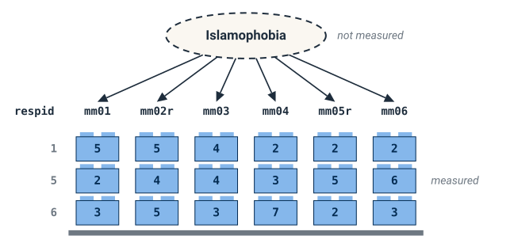

# Latent structures {#sec-latente}

```{r setup-kap8, include=FALSE}
library(tidyverse)
library(mariposa)
library(patchwork)
source("R/_common_en.R")
source("R/prep_en.R")
```

> *Do the six items really measure a single attitude, or do they contain several dimensions?*

In @sec-datentransformation you combined several items into a scale. But is that actually legitimate? Does each item load *evenly* on the construct, or do some items stand apart? Does the scale measure *one* thing or *several*? And how consistent are the items with each other?

::: {.callout-note}
**Research journal: Where are you in your mini study?** You have built scales and have your first bivariate findings. Now you check the measure itself: *Are the items dimensionally clean?* This is the validation step that decides whether your findings from @sec-univbivar and the modelling in @sec-erklaerung rest on a methodologically defensible measure. If at the end of this chapter Cronbach's α > .7 and EFA and CFA give a consistent picture, you have *defended the operationalisation against reviewers*.
:::

## What this chapter is about

Most of the constructs that social researchers are interested in cannot be measured *directly*; you can only infer them indirectly. Nobody can read “intelligence” off a thermometer, measure “satisfaction with democracy” with a ruler or record “Islamophobia” as a single value with a sensor. These are all **latent** (hidden) quantities. They only become visible when you ask people several concrete questions and combine the answers, like a detective who does not see the offender but works out who it is from the clues.

When you do this, a follow-up question arises: how do you actually know that the six items *really* measure one construct together? Perhaps they measure two different things that you are wrongly lumping together. Or one of the items is out of line and measures something else entirely. Or the items are related so unreliably that your scale score is nothing but noise.

This validation is the task of this chapter. Three tools are available for it, and they build on each other:

1. **Correlation matrix**: the simplest preliminary check. If the items do not even correlate strongly in pairs, there is nothing for them to measure together. Factor analysis is only worthwhile when the inter-item correlations are at least of medium strength.
2. **Exploratory factor analysis (EFA)**: the statistical answer to the question *“How many invisible factors explain the pattern of the observed correlations?”* With EFA you check whether your items really measure *one* dimension or whether they split into several sub-dimensions.
3. **Reliability (Cronbach's α)**: the answer to *“Are the items that together form a factor internally consistent enough to serve as a common measure?”* Cronbach's α has been the standard index for this since the 1950s.

At the end you take a brief look at **confirmatory factor analysis (CFA)** with `lavaan`, the next step when you want to *test* a specific structural hypothesis instead of only *exploring* the data. EFA asks: “Which structure fits best?” CFA asks: “Does *this* specific structure, which I derive from theory, fit the data?”

@fig-latenter-faktor shows what a latent variable is, using Islamophobia as the example. The six item towers hold the respondents' answers. Nobody has measured Islamophobia itself; it is a factor without values of its own. The scale score `islamophobia` from @sec-datentransformation is calculated from the items.

{#fig-latenter-faktor .lightbox fig-alt="At the top a dashed ellipse with the name Islamophobia, next to it not measured. Six arrows lead from it to the column names mm01, mm02r, mm03, mm04, mm05r and mm06. Below them a baseplate with six blue towers for the respid 1, 5 and 6: row 1 has 5, 5, 4, 2, 2 and 2, row 5 has 2, 4, 4, 3, 5 and 6, row 6 has 3, 5, 3, 7, 2 and 3. To the right of them, measured."}

The arrows run *from* the invisible factor *to* the observed items. The assumption is that *the factor produces the answers*. A person with a high level of Islamophobia therefore tends to choose high values on all six items. You will see the same direction of the arrows again in CFA path diagrams.

## What you will be able to do after this chapter {-}

- Set up and read an inter-item correlation matrix and visualise it as a heatmap with ggplot2.
- Understand the KMO measure and Bartlett's test as assumption checks and find them in the `efa()` output.
- Decide on the number of factors with the eigenvalue criterion and a scree plot drawn by hand.
- Run an exploratory factor analysis, read factor loadings and visualise them as a sorted bar chart.
- Explain the difference between PCA, EFA and CFA, and know when each method is appropriate.
- Choose a rotation (`varimax`, `oblimin`) deliberately.
- Calculate Cronbach's α, read item statistics, identify problematic items, check α-if-deleted as a bar chart and compare α with McDonald's ω.
- Set up a simple CFA model with `lavaan` and interpret fit indices.

## Inter-item correlations {#sec-korrelationsmatrix}

### The preliminary check before any factor analysis

Imagine six reporters sending in their reports on the same situation. If five of them paint a similar picture and one describes something completely different, *you know before any analysis* that five probably measure the same thing and one measures something else. Inter-item correlations give you this preliminary diagnosis for your scale.

They are the basic requirement for any meaningful factor analysis: if the items do *not* correlate with each other in pairs, there is nothing for them to measure together, and an EFA would find no factors because there are none.

::: {.callout-note collapse="true"}
## Background: What does a correlation measure mathematically?

The Pearson correlation $r$ is the *standardised covariance*. It measures how strongly two variables deviate *together* from their respective means, relative to their individual spread:

$$r = \frac{\text{Cov}(x, y)}{\text{SD}(x) \cdot \text{SD}(y)}$$

Read it as: *“how strongly x and y vary together, in units of each variable's own typical variation.”* Because of the division, $r$ always lies between $-1$ (perfectly opposed) and $+1$ (perfectly in step). This is the number you get in the `pearson_cor()` output for each pair of items.
:::

### Computing the matrix with `pearson_cor()`

**Question:** How strongly are the six Islamophobia items related to each other?

```{r cor-matrix}
allbus |>
  pearson_cor(mm01, mm02r, mm03, mm04, mm05r, mm06, weights = wghtpew)
```

### Reading the thresholds

The compact output lists all fifteen item pairs with Pearson's *r* and the *p*-value. `summary()` gives you the classic square matrix, together with *p*-values, confidence intervals and *N* per cell. All pairs lie between 0.34 and 0.56. Three thresholds help you to classify such values straight away:

| Inter-item *r* | Interpretation                                                   |
| :------------- | :--------------------------------------------------------------- |
| < 0.20         | item does not belong: probably measures something else           |
| 0.30 – 0.70    | healthy range: items are related, but not redundant              |
| > 0.85         | redundancy: two items measure almost the same thing; one is almost superfluous |

::: {.callout-note collapse="true"}
## Background: The correlation matrix in the appendix

An inter-item correlation matrix belongs in the appendix of an empirical paper that uses a scale of its own. It is the quickest sanity check for the operationalisation: anyone who sees a value close to 0 or above 0.85 there starts to worry.
:::

### Heatmap with ggplot2

A table of fifteen numbers is tedious to read. The same information as a heatmap can be read at a glance: dark cells mean a strong relationship. You build it by hand from the `pearson_cor()` output:

```{r cor-heatmap}
cor_obj <- allbus |>
  pearson_cor(mm01, mm02r, mm03, mm04, mm05r, mm06, weights = wghtpew)

cor_obj$matrices[[1]]$correlations |>
  as_tibble(rownames = "Item1") |>
  pivot_longer(-Item1, names_to = "Item2", values_to = "r") |>
  ggplot(aes(Item1, Item2, fill = r)) +
  geom_tile(color = "white") +
  geom_text(aes(label = sprintf("%.2f", r)), color = "white", size = 4) +
  scale_fill_gradient2(low = "#2166ac", mid = "white", high = "#b2182b",
                       midpoint = 0, limits = c(-1, 1)) +
  labs(x = NULL, y = NULL, fill = "r",
       title = "Inter-item correlations of the six Islamophobia items",
       caption = "ALLBUS 2023, weighted with wghtpew") +
  coord_fixed() +
  theme(plot.title = element_text(hjust = 0.5))
```

**Interpretation.** The diagonal is trivially 1.0 (each item correlates perfectly with itself). The off-diagonal cells are the interesting ones: all six items show values well above 0.3. The reporter from the example above who describes something else does not appear here; all items clearly point in the same direction. The preliminary check is passed, and the EFA can start.

::: {.callout-important collapse="true"}
## mariposa tip: The full matrix from the `pearson_cor()` object

`pearson_cor()` returns more than the printed view: underneath is a structured list object. `cor_obj$matrices[[1]]$correlations` is the square correlation matrix (rownames = colnames = variable names). In the same way you get `$p_values`, `$ci_lower`, `$ci_upper` and `$n_obs` as parallel matrices. That is everything you need for your own visualisations, without calling `cor()` from base R separately. If you want to process the list of pairs as a table instead, `as_tibble(cor_obj)` returns it as a tibble; this works for every analysis result since mariposa 0.7.4.
:::

The inter-item correlations give the green light: all items are related, and none of them is out of place. Now comes the actual factor analysis. It works like an X-ray of the correlations: it tries to infer how many *invisible* dimensions must lie behind the observed correlations to produce this pattern.

Imagine that all six items are driven by a single underlying attitude. Then *all* items must correlate clearly with each other, since a person with high Islamophobia ticks high values everywhere. That would be a one-factor model. If *two* underlying attitudes are at work (such as “cognitive stereotypes” and a “politically restrictive stance”), some item pairs correlate more strongly than others, and the result is a two-factor model. The EFA checks which one fits.

You take this step by step: first the assumptions (KMO, Bartlett), then the decision on the number of factors (eigenvalues, scree plot), then the final models (one factor or two factors) including rotation.

## Checking the assumptions: KMO and Bartlett {#sec-kmo-bartlett}

Before you start the EFA at all, two tests check whether it makes sense *technically*. Both appear automatically at the top of every `efa()` output. You do not have to compute them separately, but you need to be able to read them.

### KMO: how much *shared* variance is there at all?

Imagine you want to distil one editorial from six newspaper articles. If the articles overlap in content, that is no problem. But if each of them deals with a *completely different* topic, there is nothing common to extract. The **Kaiser-Meyer-Olkin measure (KMO)** quantifies this: what share of the item variance is still left as *partial* variance (that is, after controlling for all other items), and how much is *shared*?

The core of the formula:
$$\text{KMO} = \frac{\sum r_{ij}^2}{\sum r_{ij}^2 + \sum a_{ij}^2}$$
with $r_{ij}$ = pairwise correlations and $a_{ij}$ = partial correlations (correlations after the influence of all other items has been removed).

Read it as: *“what share of the relationships between the items cannot be explained away by other items, and can therefore really be traced back to a common underlying factor.”*

Conceptually, KMO is the average over all items: for each item, the *shared* part (good for factor analysis) is weighed against the *partial* part, and KMO itself is the aggregate of these parts. You will see the per-item values (officially **MSA**, *measure of sampling adequacy*) shortly in the diagnostic block, with actual values from our model and as a plot. The table of thresholds for practical use:

| KMO         | Sampling adequacy    |
| :---------- | :------------------- |
| ≥ 0.90      | marvelous            |
| ≥ 0.80      | meritorious          |
| ≥ 0.70      | middling             |
| ≥ 0.60      | mediocre (lower limit) |
| < 0.60      | factor analysis not recommended |

### Bartlett's test: are the correlations different from zero at all?

Bartlett's test of sphericity asks a basic minimum question: is the correlation matrix *significantly different* from an identity matrix at all (a matrix in which only the diagonal is 1 and all off-diagonal values are 0, that is, no correlation whatsoever)?

If the test is significant ($p < .05$), this means: *“at least one correlation in the matrix is different from zero, so there is something to factor-analyse.”* With N > 1000, Bartlett's test is almost always significant; it is more of a *technical minimum check* than a substantive argument. KMO is the far more informative measure.

### Three diagnostic levels from one call to `efa()`

You call `efa()` once with `n_factors = 1` and store the result. The number of factors does not matter here; you are only interested in the values for the assumption checks. From the returned object you read *three* diagnostic levels.

Level 1 is the overall KMO. The compact print shows it as the central number:

```{r efa-vor}
efa_check <- allbus |>
  efa(mm01, mm02r, mm03, mm04, mm05r, mm06,
      weights = wghtpew, n_factors = 1)
efa_check
```

Overall KMO ≈ 0.86: as a whole, the sample is “meritorious” (see the table of thresholds above).

`efa_check` is a list with 34 elements; the print shows only a few numbers from it. Like the list `result` in @fig-liste, it is a box with compartments (@fig-ergebnisobjekt): with `$` you take out one compartment, and because `$kmo` is itself a list, `efa_check$kmo$per_item` leads to the per-item values in two steps.

{#fig-ergebnisobjekt .lightbox fig-alt="A dark name tag efa_check above a box with five compartments. $loadings holds a tower of 0.811, 0.664, 0.753, 0.769, 0.657 and 0.769 under PC1. $eigenvalues holds a tower of 3.281, 0.833, 0.555, 0.479, 0.439 and 0.412. $kmo holds a smaller box with the compartments $overall, containing the brick 0.862, and $per_item, containing a tower of 0.857, 0.876, 0.874, 0.849, 0.851 and 0.867 outlined in green. $bartlett holds a smaller box with the compartments $chi_sq with 6532.633, $df with 15 and $p_value with 0. The last compartment shows only grey ellipsis dots. Below it the code efa_check$kmo$per_item."}

Level 2 is Bartlett's test. You read it from the object slot `$bartlett`:

```{r efa-bartlett}
efa_check$bartlett
```

χ² ≈ 6533 with df = 15 and *p* < .001: the correlation matrix is clearly different from an identity matrix. The minimum requirement is met.

Level 3 is the per-item KMO (MSA). This is the really interesting diagnostic step, because it shows whether *each individual item* fits into the common factor model. In the output object it is stored as a named numeric vector in `$kmo$per_item`; you put it into a tibble:

```{r efa-msa}
tibble(item = names(efa_check$kmo$per_item),
       MSA  = round(efa_check$kmo$per_item, 3))
```

Rule of thumb per item: an MSA ≥ 0.5 is acceptable, and a value below 0.5 suggests removing this item from the factor analysis. Here all six items lie between 0.85 and 0.88. These are clean values throughout, and no item needs to be removed.

As a plot, with shared (blue) and partial (grey) variance per item and the MSA threshold of 0.5 as a dashed line:

```{r kmo-msa-plot, fig.height=3.2}
tibble(item   = names(efa_check$kmo$per_item),
       shared = efa_check$kmo$per_item) |>
  mutate(partial = 1 - shared) |>
  pivot_longer(c(shared, partial),
               names_to = "share", values_to = "value") |>
  mutate(share = fct_relevel(share, "shared")) |>   # shared part at the bottom
  ggplot(aes(x = item, y = value, fill = share)) +
  geom_col(width = 0.7, position = position_stack(reverse = TRUE)) +
  geom_hline(yintercept = 0.5, linetype = "dashed", color = "grey40") +
  annotate("text", x = 6.4, y = 0.52,
           label = "MSA threshold 0.5",
           color = "grey30", size = 3, hjust = 1) +
  scale_fill_manual(
    values = c(shared = "#1f77b4", partial = "grey80"),
    labels = c("shared variance (MSA)", "partial variance"),
    name = NULL
  ) +
  scale_y_continuous(labels = scales::percent_format(accuracy = 1)) +
  labs(x = NULL, y = "Share per item",
       title = "How much shared variance does each item have?",
       caption = "Actual values from efa_check$kmo$per_item · ALLBUS 2023, weighted")
```

In every bar the blue part reaches far above the 0.5 threshold. The plot confirms what the table above shows in numbers.

**Overall interpretation.** All three levels give the green light: overall KMO 0.86, Bartlett's test significant, an MSA ≥ 0.85 for every single item. In the next section you decide on the number of factors.

## Determining the number of factors {#sec-anzahl-faktoren}

### Eigenvalue: how much information does a factor capture?

Imagine you squeeze the information from six items into *one* common underlying factor. How much of the total variation in the items fits into this one dimension? This is what the **eigenvalue** $\lambda$ measures.

The intuitive rule of thumb is surprisingly simple: each item has a *standardised* variance of 1. So you can read eigenvalues “in item units”:

- $\lambda = 1$ → the factor captures as much information as *a single* item and adds nothing.
- $\lambda = 3$ → the factor captures as much as *three* items, a substantial gain.
- $\lambda = 0.3$ → the factor captures less than one item and picks up only noise.

This gives the **Kaiser criterion**: keep all factors with $\lambda > 1$. It is simple and robust and has been the standard since the 1960s, even though newer methods (see below) refine it.

### Three criteria for deciding on the number of factors

| Criterion             | Decision rule                                                    | Strength / weakness                          |
| :-------------------- | :--------------------------------------------------------------- | :------------------------------------------- |
| Kaiser                | all factors with $\lambda > 1$                                   | simple; tends to *overestimate*              |
| Scree test            | number of factors at the “elbow” in the eigenvalue plot          | visually intuitive; subjective               |
| Parallel analysis     | comparison with eigenvalues of randomly generated data of the same size | methodological gold standard; more effort |

Most methods textbooks now recommend parallel analysis (via `psych::fa.parallel()`). For this workshop, the combination of the Kaiser criterion and a visual scree plot is enough; you see both in the next step.

### Scree plot: finding the elbow

The **scree plot** (*scree* is the loose rock that collects on a mountain slope) shows the eigenvalues as a descending line. Imagine a mountain with large boulders at the top and fine scree at the bottom: the “real” factors are at the top, the noise factors at the bottom. You are looking for the point that separates them.

You read the eigenvalues from the `efa()` object with `$eigenvalues` and plot them by hand:

```{r scree-plot, fig.height=3.6}
efa_obj <- allbus |>
  efa(mm01, mm02r, mm03, mm04, mm05r, mm06,
      weights = wghtpew, n_factors = 1)

tibble(
  factor     = seq_along(efa_obj$eigenvalues),
  eigenvalue = efa_obj$eigenvalues
) |>
  ggplot(aes(x = factor, y = eigenvalue)) +
  geom_line(color = "#1f77b4", linewidth = 1) +
  geom_point(color = "#1f77b4", size = 3) +
  geom_hline(yintercept = 1, linetype = "dashed", color = "grey50") +
  annotate("text", x = 5.5, y = 1.08, label = "Kaiser threshold (λ = 1)",
           color = "grey40", size = 3, hjust = 1) +
  scale_x_continuous(breaks = seq_along(efa_obj$eigenvalues)) +
  labs(x = "Factor", y = "Eigenvalue (λ)",
       title = "Scree plot of the six Islamophobia items",
       caption = "ALLBUS 2023, weighted with wghtpew")
```

**Interpretation.** You are looking for two signals: (a) How many factors lie above the Kaiser line ($\lambda > 1$)? (b) Where is the clearest “elbow” in the line? A first eigenvalue that clearly stands out, followed by a flat rest, is the classic picture of a one-dimensional scale. Two clearly raised values point to a two-dimensional structure.

## Extracting a one-factor solution {#sec-efa-1}

You have checked the assumptions and decided on the number of factors. Now comes the actual model, with the focus on the factor loadings.

### What is a factor loading?

Think of an invisible *factor* as a dial. When the dial is turned up, people tick strongly agreeing answers on some items: the loading is high. On other items the answer hardly responds: the loading is low. The **factor loading** is the strength of the relationship between item and factor.

Mathematically, in the one-factor solution the loading *equals the correlation* between item and factor. It ranges from $-1$ to $+1$, with the usual thresholds:

| \|Loading\| | Interpretation                  |
| :--------- | :------------------------------ |
| < 0.30     | irrelevant                      |
| 0.30 – 0.50 | moderate                       |
| 0.50 – 0.70 | usable                         |
| ≥ 0.70     | high (item is a core indicator) |

In the plot the factor sits in the middle and the items radiate outwards; the thickness of a line shows the strength of the loading. Items with a thick line are *strongly* tied to the factor, items with a thin line *less* strongly. The loadings already come from the actual one-factor solution (the `efa_obj` from the scree plot chunk); in the next section you look them up in the output table:

```{r faktorladung-radial, fig.height=4.2}
factor_radial <- efa_obj$loadings |>
  as_tibble(rownames = "item") |>
  rename(loading = PC1) |>
  mutate(angle = seq(0, 2 * pi, length.out = 7)[1:6],
         x = cos(angle), y = sin(angle))

factor_radial |>
  ggplot() +
  geom_segment(aes(x = 0, y = 0, xend = x, yend = y,
                   linewidth = loading),
               color = "#1f77b4", lineend = "round") +
  geom_point(aes(x = x, y = y), size = 5, color = "#1f77b4") +
  geom_label(aes(x = x * 1.20, y = y * 1.20,
                 label = sprintf("%s\nλ = %.2f", item, loading)),
             size = 3.2, linewidth = 0, fill = "white") +
  annotate("point", x = 0, y = 0, size = 16,
           color = "black", fill = "#fbbf24", shape = 21) +
  annotate("text", x = 0, y = 0, label = "Factor",
           fontface = "bold", size = 4) +
  scale_linewidth_continuous(range = c(0.5, 3.5)) +
  coord_fixed(xlim = c(-1.5, 1.5), ylim = c(-1.5, 1.5)) +
  theme_void() +
  theme(legend.position = "none") +
  labs(title = "Factor loading as strength of connection",
       caption = "Line thickness = how strongly the item is tied to the factor.")
```

**Interpretation.** `mm01` (λ = 0.81) is the strongest core indicator; it responds most clearly when the factor “turns”. `mm03`, `mm04` and `mm06` follow close behind (each about 0.75–0.77). The two reverse-coded items `mm02r` and `mm05r` are tied somewhat less strongly to the factor at around 0.66, but still lie clearly in the usable range. There is no real peripheral indicator (λ < 0.5).

### Running the model with `efa()` and reading the loadings

You already know the compact output from @sec-kmo-bartlett: KMO, explained variance, N. For the loadings you need the detailed version with `summary()`, which is structured like the SPSS output of `FACTOR`:

```{r efa-1}
allbus |>
  efa(mm01, mm02r, mm03, mm04, mm05r, mm06,
      weights = wghtpew, n_factors = 1) |>
  summary()
```

**Interpretation.** Four blocks matter to you:

- *KMO and Bartlett's Test*: as already read in @sec-kmo-bartlett.
- *Communalities*: how much of each item's variance the factor accounts for (*Extraction*). `mm01` is at 0.66, the two reverse-coded items at around 0.44.
- *Total Variance Explained*: the eigenvalues of all six possible components and the explained variance. The one extracted factor explains 54.7%; 40–60% is typical for one-factor scales that work well.
- *Component Matrix*: one column `PC1` with the strength of the relationship between item and factor for each item, sorted by size, from 0.81 (`mm01`) to 0.66 (`mm05r`). mariposa would hide loadings below 0.4 (argument `blank`) to keep the table readable.

### Visualising the loadings

A table with six loadings is still easy to read. A sorted bar chart, however, shows at a glance which items are most strongly tied to the construct and which are more peripheral indicators. You build this by hand from the `efa()` object as well:

```{r loadings-bar, fig.height=3.6}
efa_1 <- allbus |>
  efa(mm01, mm02r, mm03, mm04, mm05r, mm06,
      weights = wghtpew, n_factors = 1)

efa_1$loadings |>
  as_tibble(rownames = "item") |>
  rename(loading = PC1) |>
  ggplot(aes(x = loading, y = fct_reorder(item, loading))) +
  geom_col(fill = "#1f77b4") +
  geom_vline(xintercept = c(0.5, 0.7), linetype = "dashed", color = "grey50") +
  scale_x_continuous(limits = c(0, 1), expand = c(0, 0)) +
  labs(x = "Factor loading", y = NULL,
       title = "How strongly is each item tied to the latent factor?",
       caption = "Vertical lines: thresholds for usable (0.5) and high (0.7)")
```

**Interpretation.** Items above 0.7 are core indicators of the construct; anything between 0.5 and 0.7 is usable; anything below 0.5 you would keep on theoretical grounds or remove on empirical grounds. The bar chart also serves as a quick check of the items: if an item is *clearly* out of line (for example < 0.3 or with the opposite sign), this points to a reverse-coding error or an item on a different topic.

## Two-factor solution with rotation {#sec-efa-2}

What if the scale is *not* one-dimensional? The research debate on Islamophobia sometimes distinguishes between a cognitive, stereotyping component (for example `mm06`, “fanatics”) and a politically restrictive component (for example `mm04`, “monitor”). You can try this out with two factors *and* rotation.

When you extract more than one factor, the way the loadings are divided among the factors is mathematically *not unique*: many solutions are statistically equivalent. A **rotation** turns the factor axes geometrically and so enforces *one* interpretable solution: each item should load as highly as possible on *one* factor and low on the others.

Three families of rotation:

- `"varimax"`: orthogonal, the factors stay uncorrelated. The standard choice if you later interpret the factors as independent constructs.
- `"oblimin"` / `"promax"`: oblique, the factors may be correlated. More realistic in the social sciences, where constructs are rarely completely independent.
- `"none"`: no rotation. Rare, only for pure data reduction.

Rule of thumb: if theory makes it clear that the constructs are correlated (Islamophobia and populism are related), use `oblimin`; otherwise use `varimax`. mariposa computes all rotations itself with the algorithms of SPSS `FACTOR`. You need no additional package for this, and the rotated loadings match SPSS.

What does a rotation do visually? The plot shows six items in a two-dimensional factor space, *before* and *after* a varimax rotation. Before the rotation the items load diffusely on both axes; after the rotation each of them is neatly aligned with *one* axis:

```{r rotation-vor-nach, fig.height=3.8}
items_unrot <- tibble(
  item = paste0("mm0", 1:6),
  F1 = c(0.65, 0.55, 0.50, 0.40, 0.45, 0.35),
  F2 = c(-0.40, -0.50, 0.60, 0.55, -0.45, 0.50)
)

items_rot <- tibble(
  item = paste0("mm0", 1:6),
  F1 = c(0.80, 0.85, 0.10, 0.05, 0.75, 0.10),
  F2 = c(0.05, 0.10, 0.85, 0.80, 0.10, 0.80)
)

baseplot <- function(d, ttl, sub) {
  d |>
    ggplot(aes(F1, F2, label = item)) +
    geom_hline(yintercept = 0, color = "grey50") +
    geom_vline(xintercept = 0, color = "grey50") +
    geom_segment(aes(x = 0, y = 0, xend = F1, yend = F2),
                 color = "#1f77b4", alpha = 0.5) +
    geom_point(size = 3, color = "#1f77b4") +
    geom_text(nudge_y = 0.08, size = 3) +
    coord_fixed(xlim = c(-1, 1), ylim = c(-1, 1)) +
    labs(x = "Factor 1", y = "Factor 2",
         title = ttl, subtitle = sub)
}

baseplot(items_unrot, "Before rotation",
         "Loadings are spread across both axes") +
baseplot(items_rot, "After varimax rotation",
         "Each item loads clearly on one axis")
```

**Interpretation.** On the left, no axis clearly describes a factor; the items lie between the axes. On the right, the rotation has attached the items either *almost only* to factor 1 or *almost only* to factor 2 (at the top). This is what makes the interpretation readable: *“F1 = this group of items, F2 = that group of items.”*

```{r efa-2}
allbus |>
  efa(mm01, mm02r, mm03, mm04, mm05r, mm06,
      weights = wghtpew, n_factors = 2, rotation = "varimax") |>
  summary()
```

**Interpretation.** The *Rotated Component Matrix* now has two columns, `PC1` and `PC2`; loadings below 0.4 are hidden. Look at each row: does the item load *clearly* on one factor or *evenly* on both? The result is revealing, though it differs from what the research debate would suggest:

- `mm04`, `mm03` and `mm06` load on `PC1` (loadings 0.78–0.83): monitoring, conflict, fanatics.
- `PC2` contains exactly the two *reverse-coded* items, `mm05r` (0.84) and `mm02r` (0.79).
- `mm01` loads on both factors (0.63 and 0.51) and cannot be clearly assigned to either.

So the second factor separates the two positively worded items from the four negatively worded ones, and the distinction between “cognitive, stereotyping” and “politically restrictive” does not appear. This is the typical picture of a **method factor**: it reflects the direction of the wording rather than a second substantive dimension (more on method effects in @sec-cfa). The *Total Variance Explained* fits this: at 0.83, the eigenvalue of the second factor lies below the Kaiser threshold of 1. Both point to the one-factor solution, which is *more parsimonious* and clearer in content. The principle of parsimony (Occam's razor) is a strong anchor when you choose a model.

The loading columns are called `PC1` and `PC2` because by default `efa()` runs a principal component analysis (PCA). PCA, EFA and CFA differ in their aims:

- PCA (`extraction = "pca"`) looks for *components* that explain as much variance as possible; good for data reduction.
- EFA (`extraction = "ml"`) models *latent factors* behind the items; good for building theory.
- CFA (with `lavaan`, see @sec-cfa) *tests* a factor model specified in advance; good for testing theory.

Rule of thumb: PCA for *reduction*, EFA for *exploration*, CFA for *confirmation*.

## Reliability: Cronbach's α {#sec-reliabilitaet}

### The idea: six friends and a walk

Imagine you ask six friends whether today is a good day for a walk. If all six say “yes, of course”, you know the judgement is *consistent*: they probably measure the same thing (weather, free time, mood). If three say “yes” and three say “no”, the scale probably measures different things; perhaps three of them looked out of the window and three at their calendar. Cronbach's α puts this idea into a number.

While EFA tells you how many *dimensions* the items contain, reliability analysis answers a different question: *“If the items measure one dimension, how consistently do they measure it?”* It is the second pillar of validity alongside the factor structure.

### The formula and why it looks like this

Cronbach's α has existed since 1951 (named after Lee J. Cronbach). The formula looks unwieldy at first, but it is straightforward:

$$\alpha = \frac{k \cdot \bar{r}}{1 + (k-1) \cdot \bar{r}}$$

with $k$ = number of items and $\bar{r}$ = average inter-item correlation.

Read it as: *“the more items there are, and the more strongly they are related on average, the higher α.”* Two worked examples make this concrete:

- $k = 6$ items with $\bar{r} = 0.5$ → $\alpha = (6 \cdot 0.5) / (1 + 5 \cdot 0.5) = 3 / 3.5 ≈ 0.86$.
- $k = 2$ items with the same $\bar{r} = 0.5$ → $\alpha = (2 \cdot 0.5) / (1 + 1 \cdot 0.5) = 1 / 1.5 ≈ 0.67$.

This gives the central rule of thumb: more items buy reliability, even if no single item measures any better. This is also why established scales often have 8–12 items instead of only 3–4.

### Calculating α with `reliability()`

```{r reliability}
rel_obj <- allbus |>
  reliability(mm01, mm02r, mm03, mm04, mm05r, mm06, weights = wghtpew)
rel_obj
```

**Interpretation.** The compact output gives Cronbach's α with a classification, McDonald's ω next to it (more on this shortly) and the *N* of cases that answered all six items. With α = 0.83 the scale has *good* reliability. Rules of thumb:

| α          | Rating         |
| :--------- | :------------- |
| ≥ 0.90     | excellent      |
| ≥ 0.80     | good           |
| ≥ 0.70     | acceptable     |
| ≥ 0.60     | questionable   |
| < 0.60     | unacceptable   |

### Reading the item statistics

`summary()` gives you the item statistics, in the same tables as SPSS `RELIABILITY` (*Item Statistics*, *Inter-Item Correlation Matrix*, *Item-Total Statistics*):

```{r reliability-summary}
summary(rel_obj)
```

For the diagnosis, two columns of the *Item-Total Statistics* table matter most:

- *Corrected Item-Total* (corrected item-total correlation): how strongly is the single item related to the sum of the *other* items (with its own value left out)? Thresholds: ≥ 0.30 usable, ≥ 0.50 strong.
- *Alpha if Deleted*: how would α change if this item were removed?

From these you can see straight away *which item* supports the scale and which tends to weaken it:

- α rises when the item is removed → the item does not fit the scale and is a candidate for deletion.
- α falls when the item is removed → the item contributes to reliability; keep it.

In this scale, all corrected item-total correlations lie between 0.52 (`mm05r`) and 0.70 (`mm01`), which is *strong* throughout. And deleting any one item would not raise α above 0.83: all six support the scale.

For `mm05r`, `reliability()` adds up the other five items in each row and correlates this sum with `mm05r` (@fig-item-total).

{#fig-item-total .lightbox fig-alt="On the left a baseplate with respid and the towers mm01, mm02r, mm03, mm04, mm05r and mm06 for the respid 1, 5 and 6: 5, 5, 4, 2, 2, 2; 2, 4, 4, 3, 5, 6; 3, 5, 3, 7, 2, 3. The bricks of mm05r are grey, below them it says not in the sum. A green arrow leads to a tower Sum without mm05r with 18, 19 and 21, next to it stands a blue tower mm05r with 2, 5 and 2. A bracket under both towers is labelled Corrected Item-Total 0.520."}

### Visualising α-if-deleted

Here too a bar chart lets you see the diagnosis at a glance. You extract `$item_total$alpha_if_deleted` from the mariposa object `rel_obj` above and add the overall α as a vertical reference line:

```{r alpha-deleted, fig.height=3.6}
rel_obj$item_total |>
  ggplot(aes(x = alpha_if_deleted, y = fct_reorder(item, alpha_if_deleted))) +
  geom_col(fill = "#1f77b4") +
  geom_vline(xintercept = rel_obj$alpha, linetype = "dashed", color = "grey40") +
  annotate("text", x = rel_obj$alpha, y = 0.6,
           label = sprintf("Overall α = %.2f", rel_obj$alpha),
           color = "grey30", size = 3, hjust = -0.05) +
  expand_limits(x = 1) +
  labs(x = "α if this item is deleted", y = NULL,
       title = "Which item supports the scale, and which weakens it?",
       caption = "Dashed line: Cronbach's α of the full scale")
```

**Interpretation.** A bar to the left of the dashed line means *“α would fall if I deleted this item”* → the item contributes to the scale; keep it. A bar to the right of the line means *“α would rise”* → a candidate for deletion. In a well-functioning scale, ideally all bars lie close together (and to the left of the line), with no item standing out.

::: {.callout-warning}
**Caution: Cronbach's α is a lower bound.** α assumes that all items are tied *equally strongly* to the factor (*τ-equivalence*). If this is not the case, α underestimates the true reliability. In the current methods literature, McDonald's ω is therefore considered the cleaner choice: ω is estimated from a one-factor model and lets each item have its own loading. `reliability()` reports ω as well: in the compact output, in the *Reliability Statistics* block and as the column *Omega if Deleted*. Here ω = 0.835 is almost exactly equal to α = 0.833, because the loadings do not differ enough to push α down noticeably. It is best to report both values in your methods section. Unlike α, ω has not yet been checked against SPSS output; the mariposa vignette [“SPSS Compatibility”](https://yannickdiehl.github.io/mariposa/articles/spss-compatibility.html) documents the current state.
:::

Besides α and ω, the methods report should include the item-total correlations and the α-if-deleted values of all items, as a table or as a bar chart like the one above. Readers can then judge for themselves whether your scale construction is methodologically consistent.

## Outlook: confirmatory factor analysis with `cfa()` and `semPaths()` {#sec-cfa}

So far you have *explored* the factor structure. If you have a specific hypothesis, such as “the six items measure *one* latent factor”, and want to *test* it, you need a confirmatory factor analysis. mariposa is not designed for this. You use `lavaan`, the standard package for CFA and structural equation models, and you draw the path diagrams with `semPlot`.

Install them once:

```{r lavaan-install, eval=FALSE}
install.packages(c("lavaan", "semPlot"))
```

::: {.callout-warning}
**Caution: lavaan masks mariposa's `efa()`.** `lavaan` also contains a function called `efa()`. If you load the package with `library(lavaan)`, R reports *“The following object is masked from ‘package:mariposa’: efa”*. From then on, `efa()` calls the lavaan version, and the calls from this chapter stop with a cryptic error message. This is why the code below calls lavaan with the package prefix (`lavaan::cfa()`) without loading it. If you have already run `library(lavaan)`, write `mariposa::efa()` explicitly for the mariposa function.
:::

Before you set up the model, here is the lavaan model syntax in three operators:

| Operator | Meaning                                                  | Example                               |
| :------- | :------------------------------------------------------- | :------------------------------------ |
| `=~`     | *“is measured by”*: factor → items                       | `islam =~ mm01 + mm02r + mm03`        |
| `~~`     | *covariance*: two variables may correlate                | `mm02r ~~ mm05r`                      |
| `~`      | *regression*: a variable is predicted by one or more others | `islam ~ educ + age`               |

Set up and estimate the model:

```{r cfa-setup, eval=FALSE}
model_cfa <- "islam =~ mm01 + mm02r + mm03 + mm04 + mm05r + mm06"

fit <- lavaan::cfa(model_cfa, data = allbus,
                   sampling.weights = "wghtpew", estimator = "MLR")

summary(fit, fit.measures = TRUE, standardized = TRUE)
```

A CFA tests whether your specified model fits the data. **Fit indices** measure how well it fits. Instead of a single figure, there are four standard measures that compare the model from *different* angles:

- CFI / TLI (*Comparative Fit Index / Tucker-Lewis Index*): compare your model with a *null model* without any structure. Values close to 1 indicate good fit; higher = better.
- RMSEA (*Root Mean Square Error of Approximation*): *absolute* fit, corrected for model complexity. Values close to 0 indicate good fit; lower = better.
- SRMR (*Standardized Root Mean Square Residual*): the average of the standardised residuals. Lower = better.

`fit.measures = TRUE` gives you all four at once. Rules of thumb: CFI/TLI ≥ 0.95, RMSEA ≤ 0.06, SRMR ≤ 0.08. A good model meets *several* of these thresholds; a single figure never decides on its own.

A “traffic light” plot of the fit shows four indices at a glance, green = threshold met, red = missed (schematic example values for a well-fitting model):

```{r fit-indizes-ampel, fig.height=2.8}
tibble(
  index     = c("CFI", "TLI", "RMSEA", "SRMR"),
  value     = c(0.96, 0.95, 0.055, 0.06),
  threshold = c(0.95, 0.95, 0.06, 0.08),
  direction = c("higher = better", "higher = better",
                "lower = better", "lower = better")
) |>
  mutate(
    met   = if_else(direction == "higher = better",
                    value >= threshold, value <= threshold),
    label = sprintf("%.3f", value)
  ) |>
  ggplot(aes(x = value, y = fct_rev(index), fill = met)) +
  geom_col(width = 0.6) +
  geom_vline(aes(xintercept = threshold),
             linetype = "dashed", color = "grey40") +
  geom_text(aes(label = label), hjust = -0.2, size = 3.2) +
  scale_fill_manual(
    values = c(`TRUE` = "#16a34a", `FALSE` = "#d62728"),
    labels = c(`FALSE` = "missed", `TRUE` = "threshold met"),
    name = NULL
  ) +
  scale_x_continuous(expand = expansion(mult = c(0.05, 0.2))) +
  facet_wrap(~ direction, scales = "free_x", ncol = 2) +
  labs(x = "Value", y = NULL,
       title = "Fit indices as a traffic-light check",
       caption = "green = threshold met · dashed line = rule-of-thumb threshold")
```

**Interpretation.** All four bars green → the model fits well. If one index just misses its threshold, that is no disaster; two or more missed indices are a warning sign.

With `estimator = "MLR"` (maximum likelihood with robust standard errors) you are on the safe side if the items are not ideally normally distributed. For purely ordinal items, `"WLSMV"` would be the cleaner choice, but it is computationally more demanding.

A path diagram:

```{r cfa-plot, eval=FALSE}
semPlot::semPaths(fit, whatLabels = "std", layout = "tree", edge.color = "black")
```

With scales that have positively and negatively worded items (such as our Islamophobia scale), a strict one-factor CFA model often fits poorly, because the reverse-coded items correlate with each other even after controlling for the main factor. This is a method effect (acquiescence) and *not* a substantive sub-factor. In the two-factor solution in @sec-efa-2 it appeared as a factor of its own. In CFA you deal with this by allowing residual covariances between the reverse-coded items (`mm02r ~~ mm05r`). This specification is methodologically sound and established in the literature.

::: {.callout-note collapse="true"}
## Background: When to use CFA and when not

A CFA makes sense if:

1. You have a *specific* theoretical hypothesis about the factor structure.
2. Your sample is large enough (rule of thumb: N ≥ 200).
3. You accept strict assumptions about distribution and estimation (MLR, WLSMV for ordinal items).

If you simply want to combine items into a scale and are not testing a structural hypothesis, EFA and α are the more pragmatic route.
:::

## Exercises {-}

::: {.callout-note title="Exercise 1 · EFA of the pa items · Reproduction"}
The research debate on populism discusses whether it is a *one-dimensional* attitude or consists of *three* components (anti-elitism, people-centrism, Manichaean worldview). Run an EFA of the seven reverse-coded `pa` items, first with `n_factors = 1`, then with `n_factors = 3` and varimax rotation. Which solution fits better?
:::

::: {.callout-tip title="Solution" collapse="true"}
```{r ex1-kap8-loesung, eval=FALSE}
allbus |>
  efa(pa29r, pa30r, pa31r, pa32r, pa33r, pa34r, pa35r,
      n_factors = 1)
allbus |>
  efa(pa29r, pa30r, pa31r, pa32r, pa33r, pa34r, pa35r,
      n_factors = 3, rotation = "varimax")
```
:::

::: {.callout-note title="Exercise 2 · Reliability of the populism scale · Reproduction"}
Calculate Cronbach's α for the seven reverse-coded `pa` items. Which item has the weakest item-total correlation? Would deleting it improve reliability?
:::

::: {.callout-tip title="Solution" collapse="true"}
```{r ex2-kap8-loesung, eval=FALSE}
allbus |>
  reliability(pa29r, pa30r, pa31r, pa32r, pa33r, pa34r, pa35r,
              weights = wghtpew)
```
:::

::: {.callout-note title="Exercise 3 · Checking your own scale · Transfer"}
Go back to the scale you built in the exercise at the end of @sec-datentransformation (your own construct). Check it: (a) correlation matrix, (b) EFA with one factor, (c) Cronbach's α. Write two or three sentences on whether the operationalisation is methodologically sound.

*No model solution: this exercise practises the complete validation workflow.*
:::

::: {.callout-note title="Exercise 4 · CFA with lavaan · Mini research question"}
If you have installed `lavaan`: specify a one-factor CFA model for the six Islamophobia items, allow a residual covariance between `mm02r` and `mm05r` (see the note on method effects above), and check the fit indices. Does the model meet CFI ≥ 0.95, RMSEA ≤ 0.08, SRMR ≤ 0.08?
:::

::: {.callout-tip title="Solution sketch" collapse="true"}
```{r ex4-kap8-loesung, eval=FALSE}
model <- '
  islam =~ mm01 + mm02r + mm03 + mm04 + mm05r + mm06
  mm02r ~~ mm05r
'
fit <- lavaan::cfa(model, data = allbus,
                   sampling.weights = "wghtpew", estimator = "MLR")
lavaan::fitMeasures(fit, c("cfi", "tli", "rmsea", "srmr"))
```
:::

::: {.callout-note}
**Research journal: Where your mini study stands.** Your scales are methodologically validated: the Islamophobia scale has good reliability with α = .83 and ω = .84, the EFA confirms a parsimonious one-factor structure (the second factor would only be a method factor of the reverse-coded items), and the CFA (see Exercise 4) shows that a one-factor model fits well once the method effect of the reversed wording is allowed for. What comes next: in @sec-erklaerung you take these scales and model them as dependent and independent variables in multivariate models.
:::

## What you know now {-}

- You create weighted inter-item correlation matrices with `pearson_cor()` and visualise them by hand as a heatmap in ggplot2 (source: `cor_obj$matrices[[1]]$correlations`).
- You read KMO and Bartlett's test as assumption checks and understand what lies behind the formulas.
- You extract eigenvalues from the `efa()` object and decide on the number of factors with the Kaiser criterion and a scree plot drawn by hand.
- You run an EFA with `efa()`, read factor loadings and visualise them as a sorted bar chart.
- You choose a rotation (`varimax`, `oblimin`) deliberately, based on theoretical expectations.
- You know the difference between PCA (data reduction), EFA (exploratory) and CFA (confirmatory).
- You calculate Cronbach's α and McDonald's ω with `reliability()`, read the item statistics from `summary()`, identify problematic items and show α-if-deleted as a bar chart.
- You recognise a method factor of reverse-coded items in a two-factor solution and know why `library(lavaan)` masks mariposa's `efa()`.
- You know when CFA with `lavaan` makes sense and what a minimal specification including a method effect looks like.

The next chapter (@sec-erklaerung) moves from *structure* to *explanation*: you model Islamophobia as a dependent variable and test which sociostructural and political predictors explain it best.

## Mini glossary: terms for latent structures {-}

| Term                  | Meaning in one sentence                                                                  |
| :-------------------- | :--------------------------------------------------------------------------------------- |
| latent                | unobserved underlying variable that is measured indirectly through several items         |
| manifest              | directly observed item (one column in the dataset)                                       |
| loading               | strength of the item–factor relationship; in a one-factor solution = correlation; ≥ 0.5 usable, ≥ 0.7 high |
| eigenvalue (λ)        | how much standardised item variance a factor accounts for; λ > 1 = more than a single item (Kaiser criterion) |
| KMO                   | proportion of shared (not partial) item variance; ≥ 0.6 acceptable, ≥ 0.7 good, ≥ 0.8 very good |
| Bartlett's test       | test of whether the correlation matrix differs significantly from the identity matrix; minimum condition for any EFA |
| scree plot            | eigenvalues as a descending line; read off the number of factors at the “elbow” or at the Kaiser threshold |
| rotation              | geometric turn of the factor axes for an interpretable solution (orthogonal: `varimax`; oblique: `oblimin`) |
| Cronbach's α          | reliability measure: $\alpha = k\bar{r} / (1 + (k-1)\bar{r})$; ≥ 0.7 acceptable          |
| McDonald's ω          | reliability measure from a one-factor model that lets each item have its own loading; usually ≥ α |
| item-total correlation | relationship of an item with the sum of the remaining items; ≥ 0.3 usable              |
| α-if-deleted          | how α changes if an item is deleted; diagnosis for items that do not belong to the scale |
| fit index             | measure of agreement between a CFA model and the data (CFI, TLI, RMSEA, SRMR)           |
| method effect         | systematic response tendency (e.g. acquiescence), not a substantive sub-dimension        |

## Further reading {-}

- mariposa vignette [“Scale Analysis”](https://yannickdiehl.github.io/mariposa/articles/scale-analysis.html).
- Yves Rosseel et al., [lavaan documentation](https://lavaan.ugent.be/): a very readable introduction to SEM with R.
- Andy Field et al., *Discovering Statistics Using R*, chapters on factor analysis and reliability.
- Brown, T. A. (2015). *Confirmatory Factor Analysis for Applied Research* (2nd ed.): the standard work on CFA in practice.
- Furr, R. M. (2017). *Psychometrics: An Introduction*: a readable introduction to reliability and validity.
